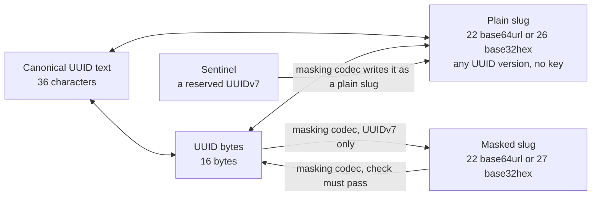

# @anizoptera/uuid-slug

[](https://www.npmjs.com/package/@anizoptera/uuid-slug)
[](https://github.com/Anizoptera/uuid-slug/actions/workflows/check.yml)
[](package.json)
[](package.json)
[](LICENSE)

Generate UUIDv4 and UUIDv7, encode any UUID as a lossless base64url slug, and create configurable
masked UUIDv7 slugs with your private key. Use shorter IDs in URLs and filenames while keeping
the same UUID database keys; no mapping table is needed.

```text
UUID: 0198abcd-1234-7abc-9def-0123456789ab
Slug: AZirzRI0eryd7wEjRWeJqw
```

UUIDv4 is random; UUIDv7 includes a timestamp. Plain slugs need no key and preserve all 128 UUID
bits in 22 base64url characters instead of 36 UUID-text characters. Lowercase base32hex also
supports case-insensitive filenames and timestamp-sorted plain UUIDv7 slugs under ASCII comparison.
Configure UUIDv7 masking with keys, key rotation, reserved IDs, the slug alphabet and a timestamp range.
Masking hides recognizable UUID fields; it is not encryption or access control.

It supports JavaScript and TypeScript on Node 20+, Bun, Deno, browsers and Workers, with no runtime
dependencies. Reuse your buffers; conversions return typed errors, and named imports let supported
bundlers remove unused features. Built-in generation uses secure randomness. For UUID text alone,
a native generator or UUID-only library may suffice.

[Install](#install) · [Quick start](#quick-start) · [Before you adopt](#before-you-adopt) · [API](#api) · [Performance](#measured-performance)

## Install

Run `bun add @anizoptera/uuid-slug`, or replace `bun` with `npm` or `pnpm`.

## Quick start

```ts
import { generateUuidV7WithPlainSlug } from "@anizoptera/uuid-slug";

const { uuid, slug } = generateUuidV7WithPlainSlug();
```

If you need only the slug, use `generatePlainUuidV7Slug()`. Plain slugs need no secret;
anyone can decode them. Use [masking](#masked-slugs) when you want to hide UUIDv7 fields.
Default generation returns the identifier directly and throws `rng_unavailable` only when
secure randomness is unavailable. [Conversions return errors as values](#handling-errors).

## Before you adopt

Keep standard UUIDs in storage so adopting slugs does not require replacing database keys.

| Decision | What you need to know |
| --- | --- |
| Choose an ID | Use UUIDv4 for random IDs or UUIDv7 for an embedded timestamp. Choose a [representation](#representations) separately. |
| Fit your application | The package is ESM-only. See [runtime requirements](#runtime); it needs no runtime dependencies, native addons or WebAssembly installation. |
| Control cost | Generate the output you need, reuse buffers and codecs, and import only the functions you use. [Performance comparisons](#measured-performance) distinguish wins from remaining gaps. |
| Handle failures | Conversions and configured generation return errors as values. Default generation can throw when secure randomness is unavailable. See [error handling](#handling-errors). |
| Require ordering | UUIDv7 records time, not a global sequence. Independent generators do not coordinate. See [ordering](#ordering-and-key-distribution). |
| Keep masked links readable | Retain each live format's keys, timestamp-range start and reserved IDs. [Migration](docs/api.md#changing-an-existing-id-format) requires compatible readers before new writers. |
| Protect records | Masking hides UUID fields; authorization still belongs to your application. See [security limits](#what-masking-is-not). |
| Upgrade the package | Review the [changelog](CHANGELOG.md). Incompatible changes require a major release, or a minor release before the first major release; APIs must be deprecated in a published release before removal. See [release policy](docs/release.md). |

Report bugs through [GitHub issues](https://github.com/Anizoptera/uuid-slug/issues).
The package uses the [Apache-2.0 license](LICENSE).

## TypeScript API map

UUIDv7 starts with a Unix-millisecond timestamp, so values from different milliseconds sort
by time in UUID byte order. A plain slug needs no key. A masked slug hides UUIDv7 fields with a secret held by a
reusable masking codec. A sentinel is an application-reserved UUIDv7 that the codec deliberately
leaves as a recognizable plain slug.

| Job | Main TypeScript API |
| --- | --- |
| Generate UUIDv4 | `generateUuidV4`, `generateUuidV4Bytes`, `generatePlainUuidV4Slug`, `generateUuidV4WithRandomFill` |
| Generate UUIDv7 | `generateUuidV7`, `generateUuidV7Bytes`, `generatePlainUuidV7Slug` |
| Generate one UUIDv7 with its slug | `generateUuidV7WithPlainSlug`, `maskingCodec.generateUuidV7WithMaskedSlug` |
| Generate an immutable UUIDv7 value | `generateUuidV7Value`, or its generator and masking-codec methods |
| Control UUIDv7 time, sequence, rollback, or entropy | `createUuidV7Generator`, `createUuidV7GeneratorWithRandomFill` |
| Convert UUID text, bytes, and plain slugs | `uuidToString`, `uuidToBytes`, `uuidToPlainSlug`, plus source-specific converters |
| Parse once for repeated work | `parseUuid` returns an immutable `Uuid` value |
| Inspect version, variant, timestamp, or payload | `Uuid.inspect`, `extractUuidVersion`, `extractUuidV7UnixMs`, `extractUuidV7Payload` |
| Narrow untrusted input | `isUuidText`, `isUuidString`, `isUuidBytes`, `isPlainUuidSlug`, their v4/v7 guards, and `isUuidSlugError` |
| Build UUIDv7 database range keys | `uuidV7StringBounds`, `uuidV7ByteBounds` |
| Validate a UUIDv7 timestamp window | `validateUuidV7StringUnixMs` and the plain or masked slug equivalents |
| Create UUIDv7 masking | `deriveUuidV7Mask`, `deriveUuidV7MaskAsync`, `createCustomUuidV7Mask` |
| Mask, unmask, rotate keys, or reserve sentinels | `createUuidV7MaskingCodec` and its methods |
| Read explicitly enabled old formats | `maskingCodec.createUuidSlugMigrationDecoder` |

TypeScript preserves known versions, text case, slug kind and caller-owned buffer types.
Generator, masking-codec and migration methods can be used as callbacks without binding `this`.

A 22-character base64url value can be plain or masked and identify different UUIDs.
A masking codec uses the first passing mask, then plain decoding if every mask rejects it.
Use a source-specific converter when you know which form was issued.

## Contents

- [Install](#install)
- [Quick start](#quick-start)
- [Before you adopt](#before-you-adopt) · [TypeScript API map](#typescript-api-map)
- [Convert existing IDs](#keep-your-existing-uuids) · [Bytes](#work-with-uuid-bytes) · [Representations](#representations)
- [Recorded time](#generate-at-a-recorded-time) · [Extract time](#use-the-uuid-as-the-timestamp-source) · [Ordering](#ordering-and-key-distribution)
- [Masking](#masked-slugs) · [Sentinels](#sentinels) · [Security limits](#what-masking-is-not)
- [Errors](#handling-errors) · [Types](docs/api.md#types)
- [API](#api)
- [Codec options](docs/api.md#masking-codec-options) · [Migration](docs/api.md#reading-original-slugs-during-migration)
- [Measured performance](#measured-performance)
- [Guarantees](#guarantees)
- [Runtime](#runtime)
- [License](#license)

## Keep your existing UUIDs

Encode your stored UUID; decode incoming slugs before querying that same key. Plain encoding
accepts every UUID version, including IDs from databases and other libraries. It preserves all
bits, so shortening adds no collisions and needs no mapping table. Masked UUIDv7 slugs also
recover the original UUID, but need the matching masking codec.

```ts
import { isUuidSlugError, plainSlugToUuidString, uuidStringToPlainSlug } from "@anizoptera/uuid-slug";

const slug = uuidStringToPlainSlug("0198abcd-1234-7abc-9def-0123456789ab");
const uuid = plainSlugToUuidString(slug);
if (isUuidSlugError(uuid)) console.error(uuid.message);
else console.log(uuid); // Use this UUID to look up the existing record.
```

UUIDv4 uses 122 bits for random data. UUIDv7 uses 48 bits for its millisecond timestamp. RFC 9562
allows the remaining 74 bits to hold random data, a counter, or both. Use UUIDv4 when the timestamp
has no value. Use UUIDv7 when you need timestamp sorting or extraction. Neither requires masking.
Anyone can decode a plain slug, including its UUIDv7 timestamp.

This package accepts every RFC 9562 UUIDv7. Conversion and masking preserve the 74 payload bits
without interpreting them. Payload extraction interprets only the layout supplied by the caller.
A UUID alone cannot prove which library generated it or whether those bits contain random data, a
counter, sub-millisecond time, or a combination.

UUIDv7 values from different milliseconds sort by timestamp in UUID byte order. Values from the
same millisecond follow their generator's payload rules; UUIDv7 alone does not promise their order.

Generation is limited to UUIDv4 and UUIDv7. Other versions remain accepted by version-neutral
parsing, inspection, and plain-slug conversion without version-specific package machinery.

## Assign IDs before saving or syncing

Create IDs before saving records, including in an offline client. Related records can refer to
those UUIDs before a database round trip, then keep the same IDs when synchronized. No central
ID allocator or worker number is required. Validate client-supplied IDs and check ownership on
the server; generating a valid UUID does not grant permission to create or replace a record.

## Generate at a recorded time

When importing records that do not yet have IDs, encode their recorded time instead of the import
time. Pass `at` to the UUIDv7 text, byte, plain-slug, paired, or immutable-value generator. It
accepts a Unix-millisecond `number` or `bigint`, a `Date`, zoned ISO timestamp text, a
Temporal-style `epochMilliseconds` or `epochNanoseconds` object, or a `{ seconds, nanoseconds }`
timestamp. Text must include a time zone. The 48-bit UUID timestamp stores the containing Unix
millisecond. A configured generator also stores the best fraction its selected payload bits can
represent; the default layout assigns no payload bits to fractions. A created generator mixes that
fraction with its counter and applies its rollback policy, so `at` calls join the same sequence.
Module-level calls remain independent.

```ts
import { BASE32HEX, generatePlainUuidV7Slug } from "@anizoptera/uuid-slug";

function idForImportedRecord(recordedAt: Date) {
  return generatePlainUuidV7Slug({ at: recordedAt, alphabet: BASE32HEX });
}
```

Pass the same created generator to any UUIDv7 representation call when its result must join one
sequence. The representation call generates and formats once; callers do not unwrap bytes first.

Each call uses fresh randomness, even at the same timestamp. For retries, keep the first ID or
use your application's deduplication key. Existing records should keep their UUIDs.
By default, masking accepts UUIDv7 timestamps from Unix millisecond `0` through `2^42 - 1`,
inclusive. Set `timestampRangeStartUnixMs` on the masking codec to move that fixed-size range.

Create a generator when calls must share ordering or use your clock. Default module calls
are independent; [custom clocks and ordering](docs/api.md#custom-clocks-and-ordering) explains
fraction bits, counter overflow and rollback. Ordered generation can advance encoded time.

## Use the UUID as the timestamp source

UUIDv7 already stores a millisecond timestamp. If that is the time your application needs,
you can omit a separate timestamp field. Read it without a database lookup or conversion to UUID text:

```ts
import { extractUuidV7UnixMs, isUuidSlugError } from "@anizoptera/uuid-slug";

function dateFromId(uuidOrPlainSlug: string) {
  const unixMs = extractUuidV7UnixMs(uuidOrPlainSlug);
  return isUuidSlugError(unixMs) ? unixMs : new Date(unixMs);
}
```

`extractUuidV7UnixMs(bytes, offset)` reads a UUID inside a larger buffer.
`maskingCodec.extractMaskedUuidV7UnixMs(slug)` reads the same timestamp from a masked slug using the
masking codec's keys. Masking preserves it. UUIDv4 has no timestamp and is rejected.

The other 74 UUIDv7 bits have no self-describing layout. A generator may use them for random data,
a fixed counter, a changing random value, a sub-millisecond fraction, or a fraction followed by a
counter. Use `extractUuidV7Payload(value, layout)` only when you know that generator's layout:

```ts
import { extractUuidV7Payload } from "@anizoptera/uuid-slug";

function payloadFromKnownLayout(uuid: string) {
  return extractUuidV7Payload(uuid, { subMillisecondFractionBits: 12, counterBits: 14 });
}
```

The result keeps each value with its bit width and returns every undeclared low bit in `remaining`.
A fraction value `n` stored in `b` bits represents the encoded time bucket
`[unixMs + n / 2**b, unixMs + (n + 1) / 2**b)` milliseconds. It does not recover a more exact time.
Use `maskingCodec.extractMaskedUuidV7Payload(slug, layout)` for masked slugs and sentinels.

Choose what the timestamp means when assigning the ID: generation time, or a supplied time for
imports. It has millisecond precision and does not prove when an external event happened.
Keep a separate field for other dates, finer precision, editable times, or date queries your UUID
index cannot serve. Changing the timestamp inside a UUID changes the ID.

## Representations

The concrete examples encode the same UUIDv7; the sentinel row describes a separately configured value.
`ch` means text characters and `B` means bytes.

| Representation | Size (ch/B) | Example | Meaning and use |
| --- | ---: | --- | --- |
| Compact UUID text | 32 | `0198abcd12347abc9def0123456789ab` | Input; hexadecimal may use mixed case |
| Canonical UUID text | 36 | `0198abcd-1234-7abc-9def-0123456789ab` | Input and the only emitted UUID text; lowercase by default or uppercase on request |
| Brace-wrapped UUID text | 38 | `{0198abcd-1234-7abc-9def-0123456789ab}` | Input; braces require canonical text and hexadecimal may use mixed case |
| UUID URN | 45 | `urn:uuid:0198abcd-1234-7abc-9def-0123456789ab` | Input; prefix is case-insensitive and requires canonical text; hexadecimal may use mixed case |
| UUID bytes | 16 | `01 98 ab cd 12 34 7a bc 9d ef 01 23 45 67 89 ab` | Compact storage; output can use a new array or caller-owned storage; URLs need text encoding |
| Plain base64url slug | 22 | `AZirzRI0eryd7wEjRWeJqw` | Shortest keyless lossless form for any UUID; case-sensitive and not lexically ordered |
| Plain base32hex slug | 26 | `06canj8i6htbp7ff04hkaps9lc` | Keyless and lossless; output is lowercase, input may use mixed case, and UUIDv7 values sort by timestamp |
| Masked base64url UUIDv7 slug | 22 | `ap225Qa_y6wN5LQCJgwH0z` | Short opaque form with a 16-bit check; case-sensitive, unordered, and decoding requires its codec |
| Masked base32hex UUIDv7 slug | 27 | `daerdp86nv5qo3f4mg12c307qco` | Opaque and unordered; output is lowercase, input may use mixed case, and decoding requires its codec |
| Sentinel UUIDv7 slug | 22/26 | Configured | A recognizable plain slug reserved by a codec; size follows its selected alphabet |

The masked examples use the public `UUID_V7_TEST_MASK`, which is unsuitable for private IDs.
Plain slugs preserve all UUID bits without a timestamp limit. Masked slugs need their matching
codec. Alphabet and masking are separate choices: use base32hex for case-insensitive storage,
and masking to hide recognizable UUIDv7 fields.

Generate bytes once when you need several representations, then convert only those you use.
Use paired generation when you need UUID text plus one slug.



## Work with UUID bytes

Decode a masked public ID directly into your database or protocol buffer using your masking codec:

```ts
import type { UuidV7MaskingCodec } from "@anizoptera/uuid-slug";

function decodePublicId(maskingCodec: UuidV7MaskingCodec, publicId: string, record: Uint8Array, offset: number) {
  return maskingCodec.maskedSlugToUuidBytes(publicId, record, offset);
}
```

Write a UUID directly into a binary record, leaving its other fields untouched:

```ts
import { uuidStringToBytes } from "@anizoptera/uuid-slug";

function convertUuid() {
  const record = new Uint8Array(32);
  return uuidStringToBytes("01990d4d-e600-7000-8000-000000000000", record, 8);
}
```

`uuidStringToBytes` accepts mixed-case canonical or compact UUID text, UUID URNs, and canonical text
enclosed by braces. It either allocates a plain
`Uint8Array` or writes 16 bytes at the requested offset. `bytesToUuidString` reads 16 bytes at an
optional offset and returns lowercase hyphenated text by default. Pass `UUID_TEXT_UPPERCASE` or
`"uppercase"` for uppercase output, or `UUID_TEXT_LOWERCASE` when the default must be an explicit
reusable choice.
The same optional preset works on every operation that returns UUID text, including generators,
plain and masked decoders, timestamp validation, and migration readers. It changes only UUID text;
slug alphabets and accepted input stay independent.
`Buffer` works because it is a `Uint8Array`. A standalone `ArrayBuffer` must contain exactly 16
bytes. A `DataView` must declare an exact 16-byte range, which can select a UUID inside a larger
buffer without copying. Offsets apply only to `Uint8Array`; other typed arrays and array-like values
are rejected. Use `isUuidBytes`, `isUuidV4Bytes`, or `isUuidV7Bytes` when unknown binary input must
be narrowed before storage or version-specific work.

For a binary database key or protocol field, use `uuidBytesToPlainSlug(record, offset)` and
`plainSlugToUuidBytes(slug, record, offset)` to avoid UUID text and temporary slices. Use
`maskingCodec.maskedSlugToUuidBytes(slug, record, offset)` for known masked IDs. These writes return the original
array, not a view of the UUID. Read it back at the same offset. Copy bytes you need to keep before
reusing the buffer.

Without an offset, `uuidBytesToPlainSlug` requires exactly 16 bytes. Plain-slug decoders reject
nonzero padding bits; `isPlainUuidSlug` checks canonical spelling and returns a boolean.

## Two kinds of slug

### Plain slugs

A plain slug holds the 16 UUID bytes as 22-character unpadded base64url by default:
`uuidStringToPlainSlug` and `uuidToString` preserve the UUID value, and anyone can convert either way. Use it
when you only want the identifier shorter.

Use `generatePlainUuidV7Slug(BASE32HEX)` for 26 lowercase characters that avoid case collisions
and sort by UUIDv7 timestamp under bytewise or ASCII comparison. Database collations and natural
file sorting may differ; see [ordering](#ordering-and-key-distribution). Every plain-slug writer
accepts the alphabet without a masking codec. Compare one representation at a time; mixed
alphabets, UUID text and masked slugs do not preserve this ordering.

`uuidToString` infers the alphabet from the length, 22 or 26, so both spellings remain readable
after you switch output. It accepts uppercase base32hex and returns lowercase UUID text by default.
Decode to a UUID before comparing identities or building a cache key:
different spellings can identify the same record. Preserve base64url case; lowercasing it changes
the value. Choose base32hex when storage cannot preserve case distinctions.

### Masked slugs

Masking hides recognizable UUIDv7 fields and remains reversible with your key. It writes
22 base64url characters by default, or 27 lowercase base32hex characters with
`maskedSlugAlphabet: BASE32HEX`. Both preserve the same payload and check. Masked slugs are
neither hashes nor authentication tokens; see [how masking works](docs/design.md).

Use a masking codec only when IDs must hide their UUIDv7 layout:

```ts
import {
  createUuidV7MaskingCodec,
  isUuidSlugError,
} from "@anizoptera/uuid-slug";

function createPublicIdGenerator(seed: string) {
  const maskingCodec = createUuidV7MaskingCodec({ maskSeed: seed });
  if (isUuidSlugError(maskingCodec)) return maskingCodec;
  return maskingCodec.generateMaskedUuidV7Slug;
}
```

Call `createPublicIdGenerator(seed)` at startup and check its result. Keep the returned function
and call it for each new ID; key derivation runs once. Masking-codec methods need no `bind`.

**Generate the seed; do not think one up.** For example, run `openssl rand -base64 32` and
store the result outside your source repository. Seeds shorter than 16 bytes are rejected, but
length alone does not make a seed unpredictable: a known UUID/slug pair allows offline guesses.

Keep the seed and `keyDerivationIterations` stable for as long as issued slugs must remain readable.
Changing either derives different keys; retain the old settings in `previousMasks` during
rotation. `keyDerivationIterations` defaults to `1`; increasing it adds construction and guessing cost,
but does not turn a human-chosen seed into a suitable secret.

The masked format preserves the UUIDv7 payload and adds a 16-bit check. See the
[wire layout](docs/design.md#representations-and-bit-budget) for its bit budget.

- A decoded slug is a candidate, not proof of issuance. Roughly one random 22-character string in
  65,536 passes the check and decodes to a well-formed, possibly unissued UUID. When accessing a
  stored record, check that it exists and that the caller may access it. A wrong candidate can name
  an existing record: a lookup alone does not prove correct decoding. Every extra
  mask you try adds another opportunity for false acceptance; the combined rate is
  at most the sum of the individual rates. Keep the rotation list short.
- Masking keeps the UUIDv7 timestamp within a configured range of `2^42`
  milliseconds. `timestampRangeStartUnixMs` sets the inclusive first millisecond; the inclusive
  last is `timestampRangeStartUnixMs + MAX_MASKED_UUID_V7_TIMESTAMP_OFFSET_MS`. The default start is `0`, which
  preserves existing slugs. Masking returns `invalid_timestamp` outside the selected range.
  Truncating instead would let
  two UUIDs share one slug, which nothing could recover from. Plain slugs have no such limit;
  registered sentinels are always plain slugs and therefore retain the full UUIDv7 timestamp range.

Set `timestampRangeStartUnixMs` to the earliest timestamp you need to mask; omit it for the default.
Keep the start unchanged while its slugs remain in use, or retain it with the old mask in
[`previousMasks`](docs/api.md#masking-codec-options).

### Sentinels

Sentinels are application-selected UUIDv7 values that are never masked, so they stay
recognisable in logs and support tickets. Codecs default to no sentinels; configure only identities
your application has reserved:

| Name            | UUID                                   | Slug                     |
| --------------- | -------------------------------------- | ------------------------ |
| `nil`           | `00000000-0000-7000-8000-000000000000` | `AAAAAAAAcACAAAAAAAAAAA` |
| `anonymous`     | `00000000-0001-7000-8000-000000000000` | `AAAAAAABcACAAAAAAAAAAA` |
| `unknown`       | `00000000-0002-7000-8000-000000000000` | `AAAAAAACcACAAAAAAAAAAA` |

Read the validated names, UUIDs, and slugs from `maskingCodec.sentinels`:

```ts
import { createUuidV7MaskingCodec, isUuidSlugError } from "@anizoptera/uuid-slug";

function createSentinels(seed: string) {
  const maskingCodec = createUuidV7MaskingCodec({
    maskSeed: seed,
    sentinels: [{ name: "unknownUser", uuid: "00000000-0002-7000-8000-000000000000" }],
  });
  return isUuidSlugError(maskingCodec) ? maskingCodec : maskingCodec.sentinels;
}
```

Each sentinel name must be nonempty and unique within the masking codec. Each sentinel UUID must also be
unique. Its input accepts every UUID text spelling above; `maskingCodec.sentinels` exposes normalized lowercase text.

Sentinels keep their spelling across seed rotation when the alphabet and reserved UUIDs stay the
same. This lets reserved identities remain recognizable while ordinary IDs use the new mask.
The example named `nil` is an application sentinel, not the all-zero UUID; that UUID
is not UUIDv7 and cannot be a masking-codec sentinel.

Keep sentinel definitions stable while their slugs are in use. Decoding checks sentinels first, so they
are reserved even if a mask could produce the same text. Encoding rejects a non-sentinel UUID
whose masked output collides with a reserved slug, using `invalid_mask`; it never returns
a slug that would decode to the wrong sentinel.

## Ordering and key distribution

Both plain alphabets keep the timestamp at the start. UUIDv7s from the same millisecond share
that prefix; nearby milliseconds can share much of it. Base64url retains this grouping but can
reverse time order: the prefixes `AAAAAAAz` and `AAAAAAA0` encode consecutive milliseconds,
yet ASCII sorting puts the second first.

Base32hex preserves UUID byte order because its alphabet, `0-9a-v`, follows numeric order and
the most significant bits come first. Equal-length slugs sort by timestamp even when a character
spans two UUID fields. This is timestamp order, not event order: clocks can move backwards, and
UUIDv7 does not promise creation order within a millisecond.

`uuidV7StringBounds(ms)` returns two search keys because one millisecond identifies a set, not one UUID:
the timestamp fixes the first 48 bits while 74 payload bits can differ. The first key sets those
payload bits to zero and the second sets them to one. Pass an inclusive end millisecond to cover a
longer interval. Use these bounds only where comparison follows UUID wire-byte order; SQL Server's
`uniqueidentifier` order does not.

Use plain slugs to keep time grouping, and base32hex for chronological text sorting.
Masking scrambles the timestamp with the other fields. It can suit storage that benefits from
spreading new keys across text ranges instead of grouping them by time.

Plain UUIDv7 base32hex filenames sort chronologically without decoding. Masked filenames need
decoding or separate dates for that view. Plain URLs need no secret; masked URLs require you to
keep the mask as long as the links must work. Neither grants access to the record.

Masking does not guarantee even key distribution or faster database writes. Measure with your
storage's sorting and partition rules. If you partition by hash, hash the UUID rather than its
slug so a change of spelling does not move the record. Changing only public URLs does not change
an index on the original UUID.
Sentinels remain plain slugs and keep their original grouping.

With unchanged settings, built-in masking gives the same UUID the same slug. URLs and filenames
stay stable, but anyone can recognize repeated uses of that slug. Key rotation can give the
record a different slug; compare decoded UUIDs to check whether two slugs identify the same record.

## What masking is not

Masking uses a four-round Feistel network with HalfSipHash-2-4 round functions and a
seed-derived key schedule. It removes the directly recognizable UUIDv7 field layout. The package makes no
claim about how hard the mask is to break, with or without known UUID and slug pairs. The round
function is tested against reference vectors; that says nothing about the whole construction. See
[the mechanism and its limits](docs/design.md).

Masked slugs are not authentication tokens or capabilities. The check detects many incorrect
decodes; it is not a message authentication code. Confirm decoded candidates against your store
and enforce authorization separately. Supplying a custom transform still leaves the same short check
and does not turn the API into an authenticated-token system.

```ts
import { isUuidSlugError } from "@anizoptera/uuid-slug";
import type { UuidV7MaskingCodec, UuidV7String } from "@anizoptera/uuid-slug";

async function findAuthorizedRecord<Record>(
  maskingCodec: UuidV7MaskingCodec,
  slug: string,
  findByUuid: (uuid: UuidV7String) => Promise<Record | undefined>,
  canRead: (record: Record) => boolean,
) {
  const uuid = maskingCodec.maskedSlugToUuidString(slug);
  if (isUuidSlugError(uuid)) return uuid;
  const record = await findByUuid(uuid);
  return record !== undefined && canRead(record) ? record : undefined;
}
```

**Supply your own secret seed for real identifiers.** Masking-codec construction fails with
`invalid_mask` when neither `maskSeed` nor `mask` is supplied, and when both are supplied. Pass
`maskSeed` for a plain secret. Pass `mask` for a mask you derived separately, for
`UUID_V7_TEST_MASK`, or for seed material that also needs a label or a key-derivation work factor.
For tests and demos that need stable public bytes,
select `UUID_V7_TEST_MASK` explicitly; anyone can decode identifiers produced with it.

A browser can use a masked ID returned by your service without knowing the seed. Keep private
masking and decoding on a trusted service; shipping the seed in client code makes it public.
Plain-slug generation and conversion need no seed and can run entirely in the client.

## Handling errors

Conversions return `T | UuidSlugError`; async mask construction resolves to the same union.
Pass a result directly into the next compatible operation, then check `isUuidSlugError` where
you handle failures. It recognizes package errors across realms and package copies; it does
not authenticate untrusted input.

```ts
import { isUuidSlugError, plainSlugToUuidBytes, uuidStringToPlainSlug } from "@anizoptera/uuid-slug";

function saveUuid(uuidText: string, save: (bytes: Uint8Array) => void) {
  const bytes = plainSlugToUuidBytes(uuidStringToPlainSlug(uuidText));
  if (isUuidSlugError(bytes)) return bytes;
  save(bytes);
}
```

The inner conversion's failure passes through the outer conversion unchanged. Check an
intermediate result only when the caller also needs that intermediate successful value.

Use the error's `code` for handling and its `message` for diagnostics. `UuidSlugErrorCode` is the
exported code type. Each code has a named constant such as `INVALID_BUFFER`, so callers never need
to copy a code string or recover one from a collection. Do not parse messages; they can add details
without changing the code. Errors wrapping failed entropy draws, clock readings, and custom
transform calls preserve the original exception as `cause`.

## API

Use the [TypeScript reference](docs/api.md) for [types](docs/api.md#types),
[call signatures](docs/api.md#api), [codec options](docs/api.md#masking-codec-options),
[migration](docs/api.md#reading-original-slugs-during-migration) and
[timestamp windows](docs/api.md#validating-timestamp-windows).
Each export also documents its accepted input, result and failures in editor hover help.

## Measured performance

Choose the output your application needs directly: UUID text, slug, or bytes. Caller-buffer
methods reuse your storage; named imports let bundlers remove unused features. Reuse codecs
to pay key derivation once. These choices avoid conversions, allocations, and setup on each call.

The comparisons time complete calls, including validation and error handling, against native APIs
and competing packages on Node, Bun, Deno, and Chromium. Portable fallbacks are measured separately.
The ranking excludes insecure randomness and timestamp extraction without UUID-version checks;
counter layouts and clock advancement are measured differences, not exclusions.

The [performance study](bench/PERFORMANCE.md) measures CPU use, allocations, retained memory
and responsiveness. Results come from repeated runs on one machine; workloads, hardware and
runtime versions can change rankings. Browser competitor comparisons use Chromium. Retained
memory after GC does not measure total allocation or establish resource parity with every rival.

| Evidence | Scope | Current result |
| --- | --- | --- |
| UUIDv7 text | Node, Bun, Deno, Chromium | Leads the compared packages, including `fastv7`. Module calls have no cross-form ordering; created generators add an explicit ordering contract and clock controls. |
| UUIDv4 text | Node, Bun, Deno, Chromium | Uses native generation on Bun, Deno and Node without JIT compilation; uses pooled entropy on Node with JIT compilation and Chromium. Leads the compared packages on Chromium; trails the fastest compared package on Bun. |
| UUIDv4/v7 bytes | New arrays and caller buffers on Node, Bun, Deno, Chromium | Leads the compared packages on Node and Chromium. On Bun, caller-buffer writes trail `uuid`; owned UUIDv7 byte comparisons are unresolved. On Deno, both UUIDv7 byte forms are unresolved against `uuidv7` and `uniku`. |
| Plain-slug generation | UUIDv4/v7 base64url | Retained Bun measurements favor native Web Crypto with reusable storage for UUIDv4 slugs; resource parity remains unresolved. Bun UUIDv7 slugs retain native delegation. |
| Conversion | UUID text, bytes, both plain-slug alphabets, timestamp extraction | Text timestamp extraction leads `uuidv7-js` on Node, Bun, Deno, and Chromium. The study has no comparable package for extraction from bytes or slugs. |
| Bundling | Bun, esbuild, Parcel, Rollup, Rolldown, Rspack, webpack | A named root import keeps only the code it needs. |

See the [performance study](bench/PERFORMANCE.md) for measurements, competitors, and rejected
optimizations. Raw results are in [competitors.md](bench/results/competitors.md) and
[matrix.md](bench/results/matrix.md), including plain-slug generation.

## Guarantees

These are API contracts. The benchmarks in [`bench/README.md`](bench/README.md) measure cost;
passing them proves none of this. See [security boundaries](docs/security.md) for entropy failures
and masking limits.

- Generated IDs have RFC 9562 version and variant bits.
- Built-in generators use the runtime's cryptographically secure random source. They never fall
  back to weaker randomness. If secure randomness is unavailable, generation with no arguments or
  only a spelling preset throws `UuidSlugError` with code `rng_unavailable`, and every generation
  call with an explicit time, a generator, caller-owned output, or custom entropy returns it.
- UUID collisions are possible. Keep a uniqueness constraint where a duplicate could overwrite or
  misidentify data. On conflict while creating a record, keep the existing record and generate a
  new ID.
- Default generation trusts proper native runtime results and provides no stronger guarantees.
  Stronger guarantees belong to explicitly configured calls. Native call failures fall back to
  portable generation; if both fail, the error retains both causes.
- A v7 carries a 48-bit millisecond timestamp in its leading bits, so UUID strings sort by their
  encoded timestamps across different milliseconds.
  Backfilled timestamps or a clock adjustment need not reflect generation order.
- Successful current-time calls on one generator strictly increase in UUID byte order under the
  default preserve policy, including calls with `at`. Module-level generation does not provide this
  guarantee. Reset-policy calls after their tolerance, independent generators, package copies, workers,
  and processes do not share sequence state; use a sequence column when order must cross boundaries.
- A 26-character plain UUIDv7 base32hex slug sorts by encoded timestamp across different
  milliseconds under ASCII comparison. Its digits are in value order and the timestamp comes
  first. Its lowercase spelling also suits case-insensitive storage.
- The default 22-character base64url form preserves all 16 bytes, but its alphabet runs `A-Za-z0-9-_`, so
  its character order and its value order disagree. Sort by the UUID, or by a timestamp column. A
  masked slug has no chronological ordering in either alphabet.
- Without an output buffer, byte generators return a plain `Uint8Array`, never a platform-specific
  subclass. With an output buffer, they return that same
  caller-owned array and write only the requested UUID range.
- `uuidStringToBytes` and `plainSlugToUuidBytes` validate the complete identifier
  before writing. Invalid text or destination ranges return an error and leave caller storage
  unchanged.
- Named root imports let supported bundlers remove the cipher, key derivation, sentinel table,
  and unrelated generation code.
- A UUIDv7 masking codec requires private mask options or a package-produced mask.
  The published-key mask is available only as `UUID_V7_TEST_MASK`; omission never
  selects it.

## Runtime

The [Rust crate](rust/uuid-slug) uses the same identifier formats. Cross-language masked reads
require matching seeds, iteration counts and timestamp ranges; see [cross-language contracts](docs/cross-language.md).

| Runtime | Loads | Generation |
| --- | --- | --- |
| Node 20 and newer | compiled JavaScript | native UUIDv4 text without JIT compilation; pooled native entropy for other output |
| Bun | published TypeScript | native default UUIDv4 text, UUIDv7 text and UUIDv7 base64url slugs; pooled Web Crypto for other output and configured generators |
| Deno | published TypeScript | native UUIDv4 text; pooled Web Crypto for bytes and UUIDv7; no flag or import map needed |
| Cloudflare Workers, browsers, other compatible runtimes | compiled JavaScript | the package's own generator over Web Crypto |

The npm package has no runtime dependencies, native addons or WebAssembly modules to install.

Bun's native UUIDv7 timestamp can advance ahead of the clock during bursts. Create a generator
when you need control over ordering, clock policy or payload layout. Bun still selects its native
functions when compiled JavaScript is imported directly. The `development` export condition loads
TypeScript source.

Workers checks use local workerd requests with and without `nodejs_compat`; deployed Workers
verification remains open. See [edge checks](bench/README.md#profiling).

Convert stored UUIDs, decode slugs, and extract timestamps without an entropy source. This suits
read-only tools and static builds that never generate IDs. Generation needs secure randomness;
conversion does not. See [runtime and distribution checks](docs/cross-language.md#distribution-and-dependencies)
for the supported test matrix.

## License

Apache-2.0. Copyright 2026 Anizoptera and Art Shendrik.
