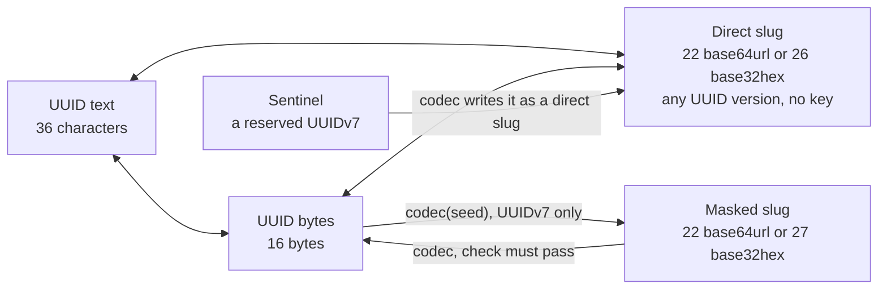

# @anizoptera/uuid-slug

[](https://www.npmjs.com/package/@anizoptera/uuid-slug)
[](https://github.com/Anizoptera/uuid-slug/actions/workflows/check.yml)
[](package.json)
[](package.json)
[](LICENSE)

## TL;DR

**Fastest zero-deps UUIDv7/v4 generation and handling + optionally opaque short UUID slugs for databases, URLs, and files.**

- Encode any UUID as short `base64url` or lowercase `base32hex`.
- Adopt optional reversible seeded masking makes slugs opaque (supports only UUIDv7).
- Keep one ID across all representations, with no lost bits or mapping table.
- Write directly into your buffers without intermediate text or new output arrays (performance optimized or API).
- Read UUIDv7 timestamps instead of duplicating them twice.
- Use native fastest paths and portable fallbacks across Node, Bun, Deno, and browsers.
- Benefit from cross-runtime correctness tested and performance optimized.
- Generation uses only secure randomness with enough entropy.
- Failures return typed errors instead of throwing or falling back to weaker randomness.
- Unused features tree-shake away with any modern bundler.

[Install](#install) · [Quick start](#quick-start) · [Contents](#contents) · [API](#api) · [Performance](#measured-performance)

The same UUIDv7 in each format (**16 bytes in binary**):

| Format (characters) | Example | Choose it for |
| --- | --- | --- |
| UUIDv7 (32-36) | `0198abcd-1234-7abc-9def-0123456789ab` | Standard UUID storage; time sorting |
| Base64url (22) | `AZirzRI0eryd7wEjRWeJqw` | Short URLs; case-sensitive; 10-14 chars saved |
| Base32hex (26) | `06canj8i6htbp7ff04hkaps9lc` | Lowercase filenames; time sorting; 6-10 chars saved |
| Masked base64url (22) | `ap225Qa_y6wN5LQCJgwH0z` | Random-looking, short, case-sensitive |
| Masked base32hex (27) | `daerdp86nv5qo3f4mg12c307qco` | Random-looking, lowercase filenames |

All slugs recover the same UUIDv7. Masking hides the UUID layout, making it look like a random string; encoding and decoding require your secret. Direct base64url keeps time grouping, not sort order. [Time sorting](#ordering-and-key-distribution) requires bytewise comparison; masked slugs
have no time order and are closer to random distribution.

## Install (use your favorite package manager)

```bash
bun add @anizoptera/uuid-slug
pnpm add @anizoptera/uuid-slug
npm add @anizoptera/uuid-slug
```

## Quick start

When you need both a database UUID and a public slug, generate both from one byte draw:

```ts
import {
  generateUuidV7WithDirectSlug,
} from "@anizoptera/uuid-slug";

function createShortId() {
  return generateUuidV7WithDirectSlug();
}
```

If you only need the slug, call `generateDirectUuidV7Slug()` directly.

## Contents

- [Install](#install)
- [Quick start](#quick-start)
- [Keep your existing UUIDs](#keep-your-existing-uuids)
- [Assign IDs before saving or syncing](#assign-ids-before-saving-or-syncing)
- [Generate at a recorded time](#generate-at-a-recorded-time)
- [Use the UUID as the timestamp source](#use-the-uuid-as-the-timestamp-source)
- [Representations](#representations)
- [Work with UUID bytes](#work-with-uuid-bytes)
- [Two kinds of slug](#two-kinds-of-slug)
  - [Direct slugs](#direct-slugs) · [Masked slugs](#masked-slugs) · [Sentinels](#sentinels)
- [Ordering and key distribution](#ordering-and-key-distribution)
- [What masking is not](#what-masking-is-not)
- [Handling errors](#handling-errors)
- [Types](#types)
- [API](#api)
  - [Generate IDs](#generate-ids) · [Convert and inspect IDs](#convert-and-inspect-ids)
  - [Use a masking codec](#use-a-masking-codec) · [Constructors and guards](#constructors-and-guards)
  - [Codec options](#codec-options)
  - [Changing an existing ID format](#changing-an-existing-id-format)
  - [Reading original slugs during migration](#reading-original-slugs-during-migration)
  - [Validating timestamp windows](#validating-timestamp-windows)
- [Measured performance](#measured-performance)
- [Guarantees](#guarantees)
- [Runtime](#runtime)
- [License](#license)

## Keep your existing UUIDs

Encode your stored UUID; decode incoming slugs before querying that same key. Direct encoding
accepts every UUID version, including IDs from databases and other libraries. It preserves all
bits, so shortening adds no collisions and needs no mapping table. Masked UUIDv7 slugs also
recover the original UUID, but need the matching codec.

Use UUIDv4 for random IDs without a timestamp, or UUIDv7 when its timestamp is useful.
Neither requires masking. Anyone can decode a direct slug, including its UUIDv7 timestamp.

Use this package for short public IDs, binary storage, typed validation, and the same API across
runtimes. Named root imports let you use UUID generation alone without bundling the other features.

## Assign IDs before saving or syncing

Create IDs before saving records, including in an offline client. Related records can refer to
those UUIDs before a database round trip, then keep the same IDs when synchronized. No central
ID allocator or worker number is required. Validate client-supplied IDs and check ownership on
the server; generating a valid UUID does not grant permission to create or replace a record.

## Generate at a recorded time

When importing records that do not yet have IDs, encode their recorded time instead of the import
time. `generateUuidV7AtUnixMs` and `generateUuidV7BytesAtUnixMs` accept whole Unix milliseconds in
`0..2^48-1`, use secure randomness, and leave the current-time generator's sequence unchanged.

```ts
import { BASE32HEX, generateUuidV7AtUnixMs, isUuidSlugError, uuidStringToDirectSlug } from "@anizoptera/uuid-slug";

function idForImportedRecord(recordedUnixMs: number) {
  const uuid = generateUuidV7AtUnixMs(recordedUnixMs);
  if (isUuidSlugError(uuid)) return uuid;
  return uuidStringToDirectSlug(uuid, BASE32HEX);
}
```

Each call uses fresh randomness, even at the same timestamp. For retries, keep the first ID or
use your application's deduplication key. Existing records should keep their UUIDs.
Masking still requires a timestamp below `2^42` milliseconds.

Use `createUuidV7Generator({ readUnixMs })` for an application clock or time-dependent tests.
Each generator has its own sequence state. A fixed clock does not make IDs repeatable:
randomness still comes from the runtime.

## Use the UUID as the timestamp source

UUIDv7 already stores a millisecond timestamp. If that is the time your application needs,
you can omit a separate timestamp field. Read it without a database lookup or conversion to UUID text:

```ts
import { extractUuidV7UnixMs, isUuidSlugError } from "@anizoptera/uuid-slug";

function dateFromId(uuidOrDirectSlug: string) {
  const unixMs = extractUuidV7UnixMs(uuidOrDirectSlug);
  return isUuidSlugError(unixMs) ? unixMs : new Date(unixMs);
}
```

`extractUuidV7UnixMs(bytes, offset)` reads a UUID inside a larger buffer.
`codec.extractUuidSlugUnixMs(slug)` reads the same timestamp from a masked slug using the codec's
keys. Masking preserves it. UUIDv4 has no timestamp and is rejected.

Choose what the timestamp means when assigning the ID: generation time, or a supplied time for
imports. It has millisecond precision and does not prove when an external event happened.
Keep a separate field for other dates, finer precision, editable times, or date queries your UUID
index cannot serve. Changing the timestamp inside a UUID changes the ID.

## Representations

A UUID contains 128 bits: 36 characters as canonical text or 16 bytes in binary form.

Direct slugs need no key and preserve every UUID version, variant, and timestamp bit without a
timestamp limit. A codec is an object configured with a mask derived from your secret seed to
encode and decode UUIDv7. A sentinel is a reserved UUIDv7 that the codec leaves unmasked.



| Representation | Size | Choose it for | Tradeoff |
| --- | ---: | --- | --- |
| UUID text | 36 characters | Standard interchange and logs | Longer text; standardized fields stay visible |
| UUID bytes | 16 bytes | Compact database or protocol storage | Needs text encoding in URLs and filenames |
| Direct base64url slug | 22 characters | Short URLs; retains UUIDv7 timestamp prefixes | Case-sensitive; text sorting can reverse timestamp order |
| Direct base32hex slug | 26 characters | Lowercase filenames; chronological UUIDv7 text keys | Longer than base64url; timestamp stays readable |
| Masked base64url UUIDv7 slug | 22 characters | Short public IDs without recognizable UUID fields or time grouping | Case-sensitive; no chronological order; decoding needs the mask |
| Masked base32hex UUIDv7 slug | 27 characters | Lowercase filenames without recognizable UUID fields or time grouping | Longer than base64url; no chronological order; decoding needs the mask |

Both direct and masked slugs work in URLs and filenames. Choose masking to hide recognizable
UUID fields; choose base32hex to avoid case collisions. These choices are independent.

## Work with UUID bytes

Decode a masked public ID directly into your database or protocol buffer using your codec:

```ts
import type { UuidV7SlugCodec } from "@anizoptera/uuid-slug";

function decodePublicId(ids: UuidV7SlugCodec, publicId: string, record: Uint8Array, offset: number) {
  return ids.slugToUuidBytes(publicId, record, offset);
}
```

Write a UUID directly into a binary record, leaving its other fields untouched:

```ts
import { uuidStringToBytes } from "@anizoptera/uuid-slug";

function convertUuid() {
  const record = new Uint8Array(32);
  return uuidStringToBytes("01990d4d-e600-7000-8000-000000000000", record, 8);
}
```

`uuidStringToBytes` accepts mixed-case UUID text with or without hyphens. It either allocates a plain
`Uint8Array` or writes 16 bytes at the requested offset. `bytesToUuidString` reads 16 bytes at an
optional offset and returns lowercase hyphenated text by default. Pass `UUID_TEXT_UPPERCASE` for
uppercase output or `UUID_TEXT_LOWERCASE` when the default must be an explicit reusable choice.
`Buffer` works because it is a `Uint8Array`; `ArrayBuffer`, `DataView`, and array-like values do
not. Use `isUuidBytes`, `isUuidV4Bytes`, or `isUuidV7Bytes` when unknown binary input must be
narrowed before storage or version-specific work.

For a binary database key or protocol field, use `uuidBytesToDirectSlug(record, offset)` and
`slugToUuidBytes(slug, record, offset)` to avoid UUID text and temporary slices. Use
`codec.slugToUuidBytes(slug, record, offset)` for masked IDs. These writes return the original
array, not a view of the UUID. Read it back at the same offset. Copy bytes you need to keep before
reusing the buffer.

## Two kinds of slug

### Direct slugs

A direct slug holds the 16 UUID bytes as 22-character unpadded base64url by default:
`uuidStringToDirectSlug` and `slugToUuidString` preserve the UUID value, and anyone can convert either way. Use it
when you only want the identifier shorter.

Pass `"base32hex"` to get 26 lowercase characters that sort by UUIDv7 millisecond timestamp.
A v7 starts with its timestamp, and base32hex writes its digits in the same order as their values. That
makes them usable directly as an ordered database key. base64url cannot do it: its alphabet runs
`A-Za-z0-9-_`, so `0` stands for a larger value than `A` but sorts before it.

Use bytewise or ASCII ordering for those keys. A database collation or a file manager's natural
sort can order text differently. Compare one representation at a time: mixing UUID text, both
slug alphabets, or masked slugs does not preserve timestamp order.

base32hex also avoids case collisions in filenames. A directory listing sorted bytewise follows
the encoded timestamps across different milliseconds. `generateDirectUuidV7Slug(BASE32HEX)` produces
one directly; every keyless slug writer accepts the alphabet without requiring a codec.

`slugToUuidString` infers the alphabet from the length, 22 or 26, so both spellings remain readable
after you switch output. It accepts uppercase base32hex and returns canonical lowercase UUID text.
Decode to a UUID before comparing identities or building a cache key:
different spellings can identify the same record. Preserve base64url case; lowercasing it changes
the value. Choose base32hex when storage cannot preserve case distinctions.

### Masked slugs

Masking supports UUIDv7 only. Its compact payload and check pass through a small
block cipher keyed by your seed, then encoded as 22 base64url characters by default, or 27
lowercase base32hex characters with `outputAlphabet: BASE32HEX`. Both preserve the same payload
and check. Use it when the identifier is public and you want an opaque, hash-like spelling instead
of recognizable UUID fields. Masked slugs are reversible and therefore are not hashes. The exact steps are in
[how masking works](docs/design.md).

Use a codec only when IDs must hide their UUIDv7 layout:

```ts
import {
  createUuidV7SlugCodec,
  isUuidSlugError,
} from "@anizoptera/uuid-slug";

function createPublicIdGenerator(seed: string) {
  const ids = createUuidV7SlugCodec({ mask: { seed } });
  if (isUuidSlugError(ids)) return ids;
  return ids.generateUuidV7CodecSlug;
}
```

Call `createPublicIdGenerator(seed)` at startup and check its result. Keep the returned function
and call it for each new ID; key derivation runs once. Codec methods need no `bind`.

**Generate the seed; do not think one up.** For example, run `openssl rand -base64 32` and
store the result outside your source repository. Seeds shorter than 16 bytes are rejected, but
length alone does not make a seed unpredictable: a known UUID/slug pair allows offline guesses.

Keep the seed and `keyDerivationIterations` stable for as long as issued slugs must remain readable.
Changing either derives different keys; retain the old settings in `previousMasks` during
rotation. `keyDerivationIterations` defaults to `1`; increasing it adds construction and guessing cost,
but does not turn a human-chosen seed into a suitable secret.

The application creates one codec from a stable secret seed. Encoding compresses the UUIDv7's
fixed fields, adds a 16-bit check, applies the keyed reversible transform, then writes the selected
slug alphabet. Decoding reverses those steps and rejects a value when its check does not match.
Create the codec once and reuse it; changing its seed changes the mapping.

A supported UUIDv7 carries 116 bits that the masked format must preserve: the version and
variant are fixed, and the top six bits of the timestamp stay zero until the year 2109. 22 base64url
characters hold 132 bits, so the spare 16 carry a check for incorrect decoding. Two things follow,
and both are part of the contract rather than implementation detail:

- **A decoded slug is a candidate, not a proof.** Roughly one random 22-character string in
  65,536 passes the check and decodes to a well-formed, possibly unissued UUID. When accessing a
  stored record, check that it exists and that the caller may access it. A wrong candidate can name
  an existing record: a lookup alone does not prove correct decoding. Every extra
  mask you try adds another opportunity for false acceptance; the combined rate is
  at most the sum of the individual rates. Keep the rotation list short.
- **Masking accepts timestamps through `MAX_MASKED_UUID_V7_UNIX_MS` (`2^42 - 1`) and refuses the
  next millisecond**, which arrives in the year 2109. It returns
  `invalid_timestamp` because those six bits are spent on the check. Truncating instead would let
  two UUIDs share one slug, which nothing could recover from. Direct slugs have no such limit;
  registered sentinels are always direct slugs and therefore retain the full UUIDv7 timestamp range.

### Sentinels

Sentinels are application-selected UUIDv7 values that are never masked, so they stay
recognisable in logs and support tickets. Codecs default to no sentinels; configure only identities
your application has reserved:

| Name            | UUID                                   | Slug                     |
| --------------- | -------------------------------------- | ------------------------ |
| `nil`           | `00000000-0000-7000-8000-000000000000` | `AAAAAAAAcACAAAAAAAAAAA` |
| `anonymous`     | `00000000-0001-7000-8000-000000000000` | `AAAAAAABcACAAAAAAAAAAA` |
| `unknown`       | `00000000-0002-7000-8000-000000000000` | `AAAAAAACcACAAAAAAAAAAA` |

Read the validated names, UUIDs, and slugs from `codec.sentinels`:

```ts
import { createUuidV7SlugCodec, isUuidSlugError } from "@anizoptera/uuid-slug";

function createIds(seed: string) {
  const ids = createUuidV7SlugCodec({
    mask: { seed },
    sentinels: [{ name: "unknownUser", uuid: "00000000-0002-7000-8000-000000000000" }],
  });
  return isUuidSlugError(ids) ? ids : ids.sentinels;
}
```

Each sentinel name must be nonempty and unique within the codec. Each sentinel UUID must also be
unique, canonical UUIDv7 text.

Sentinels keep their spelling across seed rotation when the alphabet and reserved UUIDs stay the
same. This lets reserved identities remain recognizable while ordinary IDs use the new mask.
The example named `nil` is an application sentinel, not the all-zero UUID; that UUID
is not UUIDv7 and cannot be a codec sentinel.

Keep sentinel definitions stable while their slugs are in use. Decoding checks sentinels first, so they
are reserved even if a mask could produce the same text. Encoding rejects a non-sentinel UUID
whose masked output collides with a reserved slug, using `invalid_mask`; it never returns
a slug that would decode to the wrong sentinel.

## Ordering and key distribution

Both direct alphabets keep the timestamp at the start. UUIDv7s from the same millisecond share
that prefix; nearby milliseconds can share much of it. Base64url retains this grouping but can
reverse time order: the prefixes `AAAAAAAz` and `AAAAAAA0` encode consecutive milliseconds,
yet ASCII sorting puts the second first.

Base32hex preserves UUID byte order because its alphabet, `0-9a-v`, follows numeric order and
the most significant bits come first. Equal-length slugs sort by timestamp even when a character
spans two UUID fields. This is timestamp order, not event order: clocks can move backwards, and
UUIDv7 does not promise creation order within a millisecond.

Use direct slugs to keep time grouping, and base32hex for chronological text sorting.
Masking scrambles the timestamp with the other fields. It can suit storage that benefits from
spreading new keys across text ranges instead of grouping them by time.

Direct UUIDv7 base32hex filenames sort chronologically without decoding. Masked filenames need
decoding or separate dates for that view. Direct URLs need no secret; masked URLs require you to
keep the mask as long as the links must work. Neither grants access to the record.

Masking does not guarantee even key distribution or faster database writes. Measure with your
storage's sorting and partition rules. If you partition by hash, hash the UUID rather than its
slug so a change of spelling does not move the record. Changing only public URLs does not change
an index on the original UUID.
Sentinels remain direct slugs and keep their original grouping.

With unchanged settings, built-in masking gives the same UUID the same slug. URLs and filenames
stay stable, but anyone can recognize repeated uses of that slug. Key rotation can give the
record a different slug; compare decoded UUIDs to check whether two slugs identify the same record.

## What masking is not

Masking uses a four-round Feistel network with HalfSipHash-2-4 round functions and a
seed-derived key schedule. It removes the directly recognizable UUIDv7 field layout. The package makes no
claim about how hard the mask is to break, with or without known UUID and slug pairs. The round
function is tested against reference vectors; that says nothing about the whole construction. See
[the mechanism and its limits](docs/design.md).

Masked slugs are not authentication tokens or capabilities. The check detects many incorrect
decodes; it is not a message authentication code. Confirm decoded candidates against your store
and enforce authorization separately. Supplying a custom transform still leaves the same short check
and does not turn the API into an authenticated-token system.

```ts
import { isUuidSlugError } from "@anizoptera/uuid-slug";
import type { UuidV7SlugCodec, UuidV7String } from "@anizoptera/uuid-slug";

async function findAuthorizedRecord<Record>(
  ids: UuidV7SlugCodec,
  slug: string,
  findByUuid: (uuid: UuidV7String) => Promise<Record | undefined>,
  canRead: (record: Record) => boolean,
) {
  const uuid = ids.slugToUuidString(slug);
  if (isUuidSlugError(uuid)) return uuid;
  const record = await findByUuid(uuid);
  return record !== undefined && canRead(record) ? record : undefined;
}
```

**Supply your own secret seed for real identifiers.** Codec construction fails with
`invalid_mask` when `mask` is missing. For tests and demos that need stable public bytes,
select `UUID_V7_TEST_MASK` explicitly; anyone can decode identifiers produced with it.
The masked examples in the TL;DR use this test mask; every row there identifies the same UUIDv7.

A browser can use a masked ID returned by your service without knowing the seed. Keep private
masking and decoding on a trusted service; shipping the seed in client code makes it public.
Direct generation and conversion need no seed and can run entirely in the client.

## Handling errors

Fallible synchronous operations return `T | UuidSlugError`; async mask construction resolves to
the same union. Pass that union directly into the next compatible operation and use
`isUuidSlugError` once at the boundary. The guard checks the `__failure` protocol marker first,
then recognizes unmarked package errors from older copies across realms. The marker is a routing
protocol, not proof of origin; untrusted data still belongs in the documented parser or validator.

```ts
import { isUuidSlugError, slugToUuidBytes, uuidStringToDirectSlug } from "@anizoptera/uuid-slug";

function saveUuid(uuidText: string, save: (bytes: Uint8Array) => void) {
  const bytes = slugToUuidBytes(uuidStringToDirectSlug(uuidText));
  if (isUuidSlugError(bytes)) return bytes;
  save(bytes);
}
```

The inner conversion's failure passes through the outer conversion unchanged. Check an
intermediate result only when the caller also needs that intermediate successful value.

Use the error's `code` for handling and its `message` for diagnostics. `UuidSlugErrorCode` is the
exported code type. Each code has a named constant such as `INVALID_BUFFER`, so callers never need
to copy a code string or recover one from a collection. Errors wrapping failed entropy draws, clock readings, and custom transform calls
preserve the original exception as `cause`.

`uuidBytesToDirectSlug` and `slugToUuidBytes` convert one 16-byte UUID, not arbitrary binary data. Without an
offset, `uuidBytesToDirectSlug` requires exactly 16 bytes; an explicit offset selects 16 bytes from a larger
array. `slugToUuidBytes` rejects noncanonical spelling. `isDirectUuidSlug` returns a boolean, not an error.

```ts
import { BASE32HEX, uuidBytesToDirectSlug } from "@anizoptera/uuid-slug";

function encodeStoredUuid(bytes: Uint8Array) {
  return uuidBytesToDirectSlug(bytes, BASE32HEX);
}
```

## Types

Branded types distinguish values this library has validated or produced. Plain strings and byte
arrays are not assignable to them; pass raw input directly to package operations or use a guard when
you need to retain the narrowed type. A brand proves format, not issuance or permission to access a record.
JavaScript consumers do not need TypeScript. The shipped declarations compile with TypeScript 5.0
and newer.

Use `BASE64URL`, `BASE32HEX`, `MAX_MASKED_UUID_V7_UNIX_MS`, and the named error-code constants
instead of copying their values.
Migration readers accept `SEEDED_MASK_FORMAT`, `FIXED_MASK_FORMAT`, or `DIRECT_SLUG_FORMAT`;
their TypeScript type permits only formats enabled when the reader was created.

| Type | What the value is |
| --- | --- |
| `UuidString`, `UuidV4String`, `UuidV7String` | Canonical UUID text; the version is known where the name says so. |
| `DirectUuidSlug`, `DirectUuidV4Slug`, `DirectUuidV7Slug` | A direct slug in either alphabet; the version is known where the name says so. |
| `MaskedUuidV7Slug` | A masked UUIDv7 slug; its check bits require codec decoding. |
| `SentinelUuidV7Slug` | A reserved direct UUIDv7 slug, also usable wherever `DirectUuidV7Slug` is accepted. |
| `UuidV7CodecSlug` | Masked or sentinel: what a masking call returns. |
| `UuidBytes`, `UuidV4Bytes`, `UuidV7Bytes` | `UuidBytes` proves the 16-byte shape; v4/v7 brands also prove version and variant bits. |
| `SlugAlphabet` | `"base64url"` or `"base32hex"`. |
| `UuidV7SlugCodec`, `UuidV7SlugCodecOptions`, `UuidV7Mask`, `UuidV7MaskOptions`, `AsyncUuidV7MaskOptions`, `CustomUuidV7MaskOptions`, `UuidV7Sentinel`, `UuidV7SentinelConfig` | The codec, what `createUuidV7SlugCodec` takes, and the mask and sentinel shapes it accepts and exposes. |
| `UuidV7Generator`, `UuidV7GeneratorOptions`, `UuidV7TimestampWindow`, `UuidSlugMigrationDecoder`, `UuidSlugMigrationOptions`, `UuidSlugMigrationFormat`, `UuidSlugErrorCode` | A generator and its `readUnixMs` option, the timestamp window, the migration reader with its options and format names, and the union of error codes. |

A brand narrows what a call accepts at compile time. A value already typed as the wrong kind is
rejected before it runs, with or without an output buffer:

| Value typed as | Rejected by | Why |
| --- | --- | --- |
| Masked or possibly masked (`MaskedUuidV7Slug`, `UuidV7CodecSlug`) | Direct-slug decoding and timestamp operations | Its key belongs to the codec; decode there. |
| UUID text (`UuidString` and its versions) | Slug parsers, codec slug readers, and migration readers | UUID text is not a slug; use `codec.uuidToSlug` to mask it. |
| Known v4 (`UuidV4String`, `DirectUuidV4Slug`, `UuidV4Bytes`) | v7-only timestamp validation, masking, and codec byte masking | A v4 has no timestamp. |

Parsers accept ordinary strings and validate them at runtime. Choose the decoder from your ID
format: direct and masked base64url spellings overlap. UUID values with an unknown version
also receive runtime version checks.
Parsing and direct string or slug conversions keep a known v4 or v7 brand.
Formatting bytes returns a version-agnostic value because the bytes may have changed since they
were validated. Byte operations return the exact branded type when they allocate, and the caller's
exact array subtype when writing into supplied storage; codec byte decoding returns owned
`UuidV7Bytes` or that subtype.

**Some masked slugs also pass direct-slug guards.** Canonical trailing bits, version, and variant
can all match by chance. A guard answers "is this well formed", never "is this mine". Decode with
the matching API. For access to stored records, check existence and authorization separately.

## API

Generation, conversion, and validation return the result below or `UuidSlugError`. When you supply
an output array, the exact array and its type are preserved; otherwise byte outputs are new plain
`Uint8Array` values. Invalid input leaves caller storage unchanged.

Generator, codec, and migration methods do not depend on `this`; they can be passed as callbacks
without binding them first. Each export's full contract, accepted input, result, and errors, is in
its declaration comment; your editor shows it on hover.

### Generate IDs

Import these functions from the package root. UUIDv7 text and byte methods also exist on an
independent generator; UUIDv4 and direct-slug generation remain module-level.

| Call | Successful result |
| --- | --- |
| `generateUuidV4()` / `generateUuidV7()` | Canonical UUID text, typed with its version. |
| `generateDirectUuidV4Slug(alphabet?)` / `generateDirectUuidV7Slug(alphabet?)` | A direct slug in the chosen alphabet, typed with its UUID version. |
| `generateUuidV7WithDirectSlug(alphabet?)` | UUIDv7 text and its direct slug from one generated value. |
| `generateUuidV4Bytes()` / `generateUuidV7Bytes()` | A new 16-byte array, typed with its UUID version. |
| `generateUuidV4Bytes(out, offset?)` / `generateUuidV7Bytes(out, offset?)` | Your output array, with the UUID written at the offset. |
| `generateUuidV7AtUnixMs(ms)` | UUIDv7 text with the supplied timestamp. |
| `generateUuidV7BytesAtUnixMs(ms, out?, offset?)` | UUIDv7 bytes with the supplied timestamp, newly allocated or written into your array. |

### Convert and inspect IDs

These root imports need no codec or seed. Text and direct-slug conversions preserve a known v4/v7
type. Byte formatting returns a version-agnostic type because caller-owned bytes can change.

| Call | Successful result |
| --- | --- |
| `uuidStringToDirectSlug(uuid, alphabet?)` / `slugToUuidString(slug)` | The same UUID as a direct slug or canonical UUID text. |
| `uuidStringToBytes(uuid, out?, offset?)` / `bytesToUuidString(bytes, offset?)` | The same UUID as bytes or canonical UUID text. |
| `slugToUuidBytes(slug, out?, offset?)` / `uuidBytesToDirectSlug(bytes, offset?, alphabet?)` | The same UUID as bytes or a direct slug, without intermediate UUID text. |
| `extractUuidV7UnixMs(value, offset?)` | Unix milliseconds from UUIDv7 text, a direct slug, or bytes. |
| `validateUuidV7Timestamp(uuid, window)` / `validateDirectUuidV7SlugUnixMs(slug, window)` | Lowercase hyphenated UUIDv7 text, or the original direct slug, after checking its timestamp. |

### Use a masking codec

The codec holds immutable masking keys, sentinels, rotation, and writer settings.
These methods use that configuration. New output uses its current mask;
readers also try its configured previous masks.

| Member | Successful result |
| --- | --- |
| `generateUuidV7CodecSlug()` | A new `UuidV7CodecSlug`: masked or a reserved sentinel. |
| `generateUuidV7WithCodecSlug()` | UUIDv7 text and its codec slug from one generated value. |
| `uuidToSlug(uuid)` | A `UuidV7CodecSlug` from UUIDv7 text or bytes. |
| `slugToUuidString(slug)` | The original `UuidV7String`. |
| `slugToUuidBytes(slug, out?, offset?)` | New `UuidV7Bytes` or your output array; no UUID text is created. |
| `extractUuidSlugUnixMs(slug)` | Unix milliseconds from a masked slug or sentinel. |
| `validateUuidSlugUnixMs(slug, window)` | The original slug, narrowed to `UuidV7CodecSlug` after checking its timestamp. |
| `sentinels` | Readonly reserved names, UUIDs, and slugs. |
| `createMigrationDecoder(options?)` | A reader for the old formats you enable; new output stays unchanged. |

A byte offset is the zero-based index where one 16-byte UUID starts inside a larger `Uint8Array`.
Omit it for a standalone 16-byte array. Output offsets select where a method writes; input offsets
select where it reads. Bytes outside that 16-byte range stay unchanged.

Masking is possible for any UUID version, but this library supports it only for UUIDv7.
Its fixed version, variant, and restricted timestamp range leave room for a 16-bit check without
lengthening the default 22-character slug. Direct slugs support every UUID version.

The `At` pair takes the instant first and leaves current-time sequence state unchanged. See
[Generate at a recorded time](#generate-at-a-recorded-time) for backfills, limits, and retry behavior.

Use an independent generator when the application owns the clock:

```ts
import { createUuidV7Generator } from "@anizoptera/uuid-slug";

function createEventGenerator(readUnixMs: () => number) {
  return createUuidV7Generator({ readUnixMs });
}
```

Both masking entry points return a raw sentinel slug when the UUID is registered as a sentinel.
Their result type is `UuidV7CodecSlug`, the union of masked and sentinel slugs.

The byte decoder returns a new plain `Uint8Array` branded as `UuidV7Bytes` when storage is omitted.
When storage is supplied, it validates and decodes before writing, then returns that exact array;
an error leaves the array unchanged.

Each decoder accepts every value that a supported matching encoder can produce. Masked decoding
always accepts both alphabets, sentinels, and current or previous masks. Migration adds only
the old formats you enable. Forms no supported encoder produces are invalid.

### Constructors and guards

Also exported from the package root:

- Type guards: `isUuidString`, `isUuidV4String`, `isUuidV7String`, `isDirectUuidSlug`, `isDirectUuidV4Slug`,
  `isDirectUuidV7Slug`, `isUuidBytes`, `isUuidV4Bytes`, and `isUuidV7Bytes`.
- `extractUuidV7UnixMs` reads Unix milliseconds from UUIDv7 text, either direct-slug alphabet,
  or bytes. Use `codec.extractUuidSlugUnixMs` for masked slugs and sentinels because their decoding
  keys belong to the codec. Both return an error for other UUID versions; a v4's first six bytes
  are random and must not be presented as a timestamp.
- `deriveUuidV7Mask` builds a mask from a seed; `deriveUuidV7MaskAsync` adds cooperative
  cancellation; `createCustomUuidV7Mask` adapts separate forward and reverse callbacks.
  `UUID_V7_TEST_MASK` is the explicit, published-key choice for deterministic examples.
- `createUuidV7Generator(options?)` builds a generator with its own sequence state, your `readUnixMs`
  or `Date.now` when omitted, and the package's platform cryptographic entropy. Its options type is `UuidV7GeneratorOptions`. Untyped malformed
  options return `invalid_options`. Generation returns `rng_unavailable` when secure
  platform entropy is unavailable and never substitutes caller-controlled bytes.
- `UuidSlugError`, including code `rng_unavailable` when the runtime has no usable randomness.
  `UuidSlugErrorCode` types the `code` property; `isUuidSlugError` recognizes package errors across
  JavaScript realms and duplicate package copies.
- `BASE64URL` and `BASE32HEX` select slug output without copying string literals.

### Codec options

```ts
import { BASE32HEX, createUuidV7SlugCodec } from "@anizoptera/uuid-slug";

function configureCodec(seed: string, previousSeed: string) {
  return createUuidV7SlugCodec({
    mask: { seed, keyDerivationIterations: 1 },
    sentinels: [{ name: "nil", uuid: "00000000-0000-7000-8000-000000000000" }],
    previousMasks: [{ seed: previousSeed }],
    outputAlphabet: BASE32HEX,
  });
}
```

The masked payload is fixed at 132 bits, including a 16-bit check. `outputAlphabet` defaults to
`"base64url"`. Readers accept either masked spelling without an alphabet argument. With
`outputAlphabet: BASE32HEX`, sentinels are written as 26-character base32hex slugs; their
22-character base64url spelling still decodes.

To supply a different mixing implementation, call
`createCustomUuidV7Mask({ diagnosticLabel, mask, unmask })`. Each callback receives distinct 16-byte input
bytes and returns either a 16-byte result or `UuidSlugError`; `unmask` must invert `mask` for
every input. A callback may mutate and return its isolated input. The factory copies callback results
into package storage, captures the callbacks in an opaque frozen handle, and rejects invalid results
and failed round-trip probes. Unexpected throws become errors with the thrown value as their cause.
Finite probes cannot prove invertibility, so the caller remains responsible for the complete domain.

```ts
import {
  createCustomUuidV7Mask,
  createUuidV7SlugCodec,
  isUuidSlugError,
} from "@anizoptera/uuid-slug";

function adaptMask(mix: (input: Uint8Array, output: Uint8Array, forward: boolean) => void) {
  const transform = (direction: "mask" | "unmask") => (input: Uint8Array) => {
    const output = new Uint8Array(16);
    mix(input, output, direction === "mask");
    return output;
  };
  const mask = createCustomUuidV7Mask({
    diagnosticLabel: "existing-scheme",
    mask: transform("mask"),
    unmask: transform("unmask"),
  });
  return isUuidSlugError(mask) ? mask : createUuidV7SlugCodec({ mask });
}
```

Mask, codec, generator, sentinel, migration, and timestamp options reject unknown keys instead of
silently applying a default. Invalid mask or codec options return an error. Create custom handles
before passing them; an arbitrary object is not a mask.

Share one derived mask between codecs to avoid repeating key derivation, for example when URLs
use base64url and filenames use base32hex. Each codec chooses its alphabet and sentinels; keep
sentinel definitions the same if the codecs must read each other's output.

Diagnostic labels name masks in diagnostics. Slugs contain no diagnosticLabel, so a diagnosticLabel cannot select the decoding
key. Services must use the same seed bytes and iteration count to derive matching keys.
String seeds use UTF-8: base64 text and the bytes it encodes are different seeds.

For expensive derivation, await `deriveUuidV7MaskAsync` and pass the completed mask to the codec:

```ts
import {
  deriveUuidV7MaskAsync,
  createUuidV7SlugCodec,
  isUuidSlugError,
} from "@anizoptera/uuid-slug";

async function createResponsiveCodec(
  seed: string,
  keyDerivationIterations: number,
  signal: AbortSignal,
) {
  const mask = await deriveUuidV7MaskAsync({ seed, keyDerivationIterations, signal });
  return isUuidSlugError(mask) ? mask : createUuidV7SlugCodec({ mask });
}
```

The async form derives the same keys and accepts the same seed settings. It splits encoding,
packing and hashing into cooperative work slices, allowing host tasks to run during long
construction. Cancellation stops derivation and returns `UuidSlugError` with code `aborted` and
`signal.reason` as its cause. Invalid options return `invalid_mask`; unexpected construction
failures retain their cause. No partially derived mask is returned.

Options are captured when called. Byte seeds are copied before the first suspension, so later
caller mutation cannot change the key; synchronize concurrent writes to shared backing memory.
Copying a very large byte seed, plus allocation, GC, and host scheduling, can still block longer
than one work slice. Small derivations need no host yield. Construct once and reuse the mask;
passing seed options to each new codec would repeat derivation.

`previousMasks` is how you rotate a seed. Decoding tries `mask` first, then each entry in the
order you list them, and the first whose check passes wins. Put the newest first, and keep the
list short. Nothing else is ever tried: a codec decodes with the masks you gave it and no
others.

```ts
import { createUuidV7SlugCodec } from "@anizoptera/uuid-slug";

function createRotatedCodec(currentSeed: string, previousSeed: string) {
  return createUuidV7SlugCodec({
    mask: { seed: currentSeed },
    previousMasks: [{ seed: previousSeed }],
  });
}
```

Writers use `currentSeed`; readers also accept `previousSeed`. Remove the old seed only after its
IDs no longer need to decode.

### Changing an existing ID format

Preserve the UUID; change only how it is encoded. Do not generate a replacement UUID when
converting an existing ID: references and stored records must still identify the same object.

Deploy readers that accept both formats before any writer issues the new format. Include
background jobs, cached clients and extensions in that rollout. After switching writers, keep
compatible readers available for rollback: an old-only reader cannot read newly issued IDs.

Updating the database does not update bookmarks, shared links, cookies or client storage.
Remove compatibility only when the old IDs in those places no longer need to work.
No recent legacy traffic does not prove that old links are gone. To keep old URLs after removing
their decoder, retain an application-owned mapping from each supported old slug to its UUID.

Keep keys and sentinel definitions stable throughout the rollout. Non-v7 UUIDs and UUIDv7s
timestamped at or beyond 2^42 ms cannot use the current masked format; preserve them as UUIDs
or direct slugs. Never truncate the timestamp or substitute a new identity to make masking pass.

### Reading original slugs during migration

Create a migration reader from your codec. Enable only the old formats your application issued:

```ts
import type { UuidV7SlugCodec } from "@anizoptera/uuid-slug";

function readLegacySlug(ids: UuidV7SlugCodec, incomingSlug: string) {
  const reader = ids.createMigrationDecoder({
    acceptFixedMask: true,
    acceptDirectSlug: true,
  });
  return reader.slugToUuidString(incomingSlug);
}
```

`acceptFixedMask` accepts the fixed-key permutation/XOR format with a 4-bit check that predates
seeded masking, from before package 0.2.0. Releases from 0.2.0 on write different formats, and the
0.2.0 masked format itself is not readable.
`acceptDirectSlug` accepts direct UUID slugs of any version, including old base64url spellings whose
last four bits were ignored. Ordinary `slugToUuidString` remains strict about those trailing bits.
Both options must be booleans; untyped malformed reader configuration returns `invalid_options`.
Neither option changes generation, ordinary codec methods, keys or sentinels.

`slugToUuidString` returns one UUID or `UuidSlugError`: sentinels first, then current keys, then enabled
original and direct formats. A successful decode still needs a record lookup. The same slug can
decode to different UUIDs in different formats; the original check has only four bits.

When you know the input format, name it to avoid trying unrelated formats:

```ts
import { isUuidSlugError, FIXED_MASK_FORMAT } from "@anizoptera/uuid-slug";
import type { UuidSlugMigrationDecoder, UuidV7SlugCodec } from "@anizoptera/uuid-slug";

function replaceOriginalSlug(
  ids: UuidV7SlugCodec,
  reader: UuidSlugMigrationDecoder<typeof FIXED_MASK_FORMAT>,
  oldSlug: string,
) {
  const uuid = reader.slugToUuidString(oldSlug, FIXED_MASK_FORMAT);
  if (isUuidSlugError(uuid)) return uuid;
  const replacement = ids.uuidToSlug(uuid);
  if (isUuidSlugError(replacement)) return replacement;
  return { uuid, replacement }; // Keep uuid in the database; use replacement in new links.
}
```

Enable an old format before selecting it. Recognized sentinels always return their reserved UUID,
including old trailing-bit aliases when reading original or direct slugs.
With literal options, TypeScript offers only `SEEDED_MASK_FORMAT` and the formats enabled with `true`;
options whose values are dynamic remain selectable because they may be enabled at runtime.

For unknown formats, use `slugToUuidStringCandidates` to find the matching record without guessing:

```ts
import { isUuidSlugError } from "@anizoptera/uuid-slug";
import type { UuidSlugMigrationDecoder, UuidString } from "@anizoptera/uuid-slug";

async function findMigratedRecord(
  reader: UuidSlugMigrationDecoder,
  incomingSlug: string,
  findRecordsByUuids: (uuids: readonly UuidString[]) => Promise<readonly unknown[]>,
) {
  const candidates = reader.slugToUuidStringCandidates(incomingSlug);
  if (isUuidSlugError(candidates)) return candidates;
  const matches = candidates.length ? await findRecordsByUuids(candidates) : [];
  if (matches.length !== 1)
    return new Error(matches.length ? "ID matches multiple records" : "ID not found");
  return matches[0]; // Check access before returning the record to the caller.
}
```

`findRecordsByUuids` is your database query. Return distinct records by UUID. `slugToUuidStringCandidates`
returns distinct UUIDs in decoding order, or an empty array if none match. Malformed input and
failed mask callbacks return an error. Callback errors keep their cause; they never produce a
successful but incomplete list.
An old sentinel alias can also be a seeded masked ID. `slugToUuidStringCandidates` retains both UUIDs;
`slugToUuidString` keeps sentinel priority.

Keep this reader while old inputs must work. Replace it with
`ids.createMigrationDecoder({ acceptDirectSlug: true })` to stop trying the fixed mask, or
`ids.createMigrationDecoder({ acceptFixedMask: true })` to stop direct-slug decoding.
`ids.createMigrationDecoder()` tries only current keys and sentinels. Removing the migration reader entirely
leaves ordinary codec decoding unchanged. Neither method can identify the issuing format from
the slug alone, so successful decoding is not a reliable count of legacy traffic.

### Validating timestamp windows

```ts
import { validateUuidV7Timestamp } from "@anizoptera/uuid-slug";

function validateRecentUuid(uuid: string) {
  return validateUuidV7Timestamp(uuid, { maxTimestampDeltaMs: 60_000 });
}
```

The timestamp must be inside the inclusive interval `referenceUnixMs - maxTimestampDeltaMs`
through `referenceUnixMs + maxTimestampDeltaMs`. The maximum delta is required, finite, and
nonnegative; zero and finite fractions are valid. `referenceUnixMs` defaults to one `Date.now()`
reading and must be finite when supplied. Invalid settings return an error instead of disabling
the check.

`validateDirectUuidV7SlugUnixMs` starts from a direct slug; `codec.validateUuidSlugUnixMs` starts from
a slug decoded with that codec. Success returns the same spelling with its UUIDv7 slug type.
The window accepts timestamps on either side of the reference time; it does not enforce expiry,
authentication, or replay prevention. Use ordinary decoding for permanent identifiers. For links
with expiration or one-time use, check the stored expiry and consumption state as well.

## Measured performance

Choose the output your application needs directly: UUID text, slug, or bytes. Caller-buffer
methods reuse your storage; named imports let bundlers remove unused features. Reuse codecs
to pay key derivation once. These choices avoid conversions, allocations, and setup on each call.

The comparisons time complete calls, including validation and error handling, against native APIs
and competing packages on Node, Bun, Deno, and Chromium. Portable fallbacks are measured separately.
The ranking excludes calls that use `Math.random`, allow a smaller same-millisecond collision
margin, or extract timestamps without checking the UUID version; their timings remain in the study.

The [performance study](bench/PERFORMANCE.md) also measures CPU use, allocations, retained memory,
and responsiveness on those runtimes. Guards avoid decoded arrays and error objects; caller-buffer
paths avoid temporary byte views. Key rotation decodes input text once, and pooled randomness
reduces calls to the platform RNG. Node and Bun regression checks enforce these limits.

Those checks cannot see every engine allocation or prove lower memory use than every competitor.
Memory remaining after GC is not total memory allocated.

These results come from repeated runs on one machine. Workload, hardware, and engine version can
change the ranking. Browser performance comparisons use Chromium; Firefox and WebKit run correctness checks.

| Evidence | Scope | Current result |
| --- | --- | --- |
| UUIDv7 text | Node, Bun, Deno, Chromium | Leads the compared packages. Calls Node's native UUIDv7 generator when available and Bun's native generator, with portable fallback on failure. |
| UUIDv4 text | Node, Bun, Deno, Chromium | Uses native generation on Node, Bun, and Deno. Trails the fastest compared package on Bun, Deno, and Chromium. |
| UUIDv4/v7 bytes | New arrays and caller buffers on Node, Bun, Deno, Chromium | Leads the compared packages except Bun's UUIDv4 caller-buffer writes, which trail `uuid`, and Deno's new UUIDv7 arrays, which are unresolved against `uuidv7`. |
| Conversion | UUID text, bytes, both direct-slug alphabets, timestamp extraction | Text timestamp extraction trails `uuidv7-js` on all four runtimes. The study has no comparable package for extraction from bytes or slugs. |
| Bundling | Bun, esbuild, Parcel, Rollup, Rolldown, Rspack, webpack | A named root import keeps only the code it needs. |

See the [performance study](bench/PERFORMANCE.md) for measurements, competitors, and rejected
optimizations. Raw results are in [competitors.md](bench/results/competitors.md) and
[matrix.md](bench/results/matrix.md), including direct-slug generation.

## Guarantees

These are API contracts. The benchmarks in [`bench/README.md`](bench/README.md) measure cost;
passing them proves none of this. See [security boundaries](docs/security.md) for entropy failures
and masking limits.

- Generated IDs have RFC 9562 version and variant bits.
- Built-in generators use the runtime's cryptographically secure random source. They never fall
  back to weaker randomness. If secure randomness is unavailable,
  generation returns `rng_unavailable`. With a working runtime, collision risk is negligible.
  Treat any collision as a generator or entropy failure.
- Native generation falls back to the portable generator if its first result fails validation
  or a call throws. If both fail, the returned error retains both causes.
- A v7 carries a 48-bit millisecond timestamp in its leading bits, so UUID strings sort by their
  encoded timestamps across different milliseconds.
  Backfilled timestamps or a clock adjustment need not reflect generation order.
- Two IDs created in the same millisecond may sort in either order. RFC 9562 §6.2 permits different
  counter and random-bit strategies. Do not use a v7
  to recover the order of events inside a millisecond; use a sequence column.
- A 26-character direct UUIDv7 base32hex slug sorts by encoded timestamp across different
  milliseconds under ASCII comparison. Its digits are in value order and the timestamp comes
  first. Its lowercase spelling also suits case-insensitive storage.
- The default 22-character base64url form preserves all 16 bytes, but its alphabet runs `A-Za-z0-9-_`, so
  its character order and its value order disagree. Sort by the UUID, or by a timestamp column. A
  masked slug has no chronological ordering in either alphabet.
- Without an output buffer, byte generators return a plain `Uint8Array`, never a platform-specific
  subclass. With an output buffer, they return that same
  caller-owned array and write only the requested UUID range.
- `uuidStringToBytes` and `slugToUuidBytes` validate the complete identifier
  before writing. Invalid text or destination ranges return an error and leave caller storage
  unchanged.
- Named root imports let supported bundlers remove the cipher, key derivation, sentinel table,
  and unrelated generation code.
- A codec requires private mask options or a package-produced mask.
  The published-key mask is available only as `UUID_V7_TEST_MASK`; omission never
  selects it.

## Runtime

The native Rust crate in [`rust/uuid-slug`](rust/uuid-slug) implements the same wire contract: a
slug issued by a Node service decodes in a Rust service holding the same seed, and one shared case
corpus runs against both implementations in CI. The npm package remains TypeScript/JavaScript-only.

| Runtime | Loads | Generation |
| --- | --- | --- |
| Node 20 and newer | compiled JavaScript | native `crypto.randomUUID`, and `crypto.randomUUIDv7` where the version has it |
| Bun | published TypeScript | native UUIDv4/v7 text; pooled Web Crypto for bytes and direct UUIDv7 slugs |
| Deno | published TypeScript | native UUIDv4 text; pooled Web Crypto for bytes and UUIDv7; no flag or import map needed |
| Browsers, other runtimes | compiled JavaScript | the package's own generator over Web Crypto |

The npm package has no runtime dependencies or native addons to install.

- Bun loads the published TypeScript source and uses `Bun.randomUUIDv7` for current-time
  UUIDv7 text. Bytes and direct UUIDv7 slugs use the package's own generator over Web Crypto.
  Explicit timestamps use that generator to preserve the requested instant.
  If Bun loads the compiled JavaScript directly, it still uses the Bun-specific source and native
  functions. Tooling that opts into the `development` condition loads the same source.
- Node uses native `crypto.randomUUID`, and native `crypto.randomUUIDv7` where the
  version provides it, otherwise the bundled v7 generator.
- Deno loads the published TypeScript source, uses Web Crypto `randomUUID` for UUIDv4 text,
  and runs the package's own generator for bytes and UUIDv7. No resolver flag or import map is needed.
- Browsers and other compatible runtimes run the package's own generator over Web Crypto.

Capabilities are probed once when the module loads. A missing method is left undefined, so no call
pays for a throw and a retry. Native base64url and hex encoders are used where a runtime provides
them and they measured faster; on Deno the portable encoder measured faster, so it is kept there.
The UUIDv7 generator is created on first use, so conversion-only imports draw no entropy.

Convert stored UUIDs, decode slugs, and extract timestamps without an entropy source. This suits
read-only tools and static builds that never generate IDs. Generation needs secure randomness;
conversion does not. The npm package does not load the Rust crate or a WebAssembly module.

Every change runs in CI on each published Node major from 20 upward, with the newest left unpinned
so a new native API cannot change behavior unnoticed; on the latest Bun and Deno; and as a packed
consumer on Node, Bun, Deno, Chromium, Firefox, and WebKit. The Rust crate builds and tests
natively on Linux, macOS, and Windows for x86-64 and Arm64, and its WebAssembly build runs in the
same three browser engines.

## License

Apache-2.0. Copyright 2026 Anizoptera and Art Shendrik.
