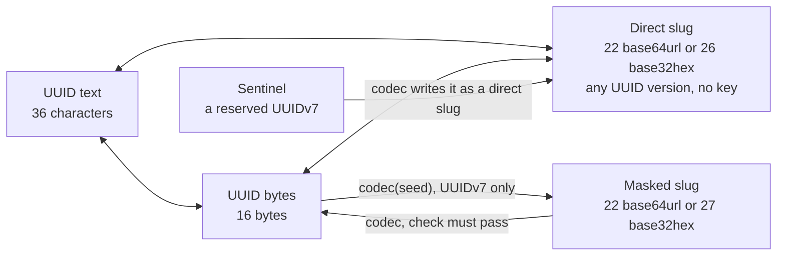

# @anizoptera/uuid-slug

[](https://www.npmjs.com/package/@anizoptera/uuid-slug)
[](https://github.com/Anizoptera/uuid-slug/actions/workflows/check.yml)
[](package.json)
[](package.json)
[](LICENSE)

Generate and validate UUIDv4 and UUIDv7. Encode any UUID as a reversible 22-character base64url or
26-character base32hex slug. UUIDv7 also supports keyed masking that removes its recognizable
layout.

Keep UUIDs in your database and use shorter IDs in URLs, APIs, and filenames without a second ID
or lookup table. Use your existing UUID generator, or generate UUIDv4 and UUIDv7 here.

The priority is to lead competing libraries in speed and resource efficiency while preserving
correctness and secure entropy. Node, Bun, Deno, and browsers use native functions or package code
according to measured cost for each operation. [Performance evidence](#measured-performance)
covers full calls, allocations, and runtime differences, including where this package still trails.
There are no runtime dependencies. Random bits come from a secure source or generation fails;
there is no fallback to `Math.random`. Failures are returned as values, never thrown.
Validated UUIDs and slugs carry branded TypeScript types. A
Rust crate implements the same wire format, so a slug issued by Node decodes in Rust with the same
seed.

## TL;DR

A UUID is a 128-bit identifier, 36 characters as text. A slug here is that same value as short
URL-safe text: convert either way and nothing is lost. A masked slug is a UUIDv7 scrambled with a
secret seed plus a 16-bit check, so a public ID does not look like a UUID. The codec holding the
seed reverses it. Masking is obfuscation, not authorization.



Always true:

- Failures come back as `UuidSlugError` values, not exceptions. Check with `isUuidSlugError`.
- Types and guards prove a value is well formed, not that you issued it. Look every decoded ID up
  in your store.
- Random bits come from the runtime's secure source. If it is missing you get `rng_unavailable`,
  never `Math.random`.
- Keep the seed, `keyDerivationIterations`, and sentinel definitions stable while issued slugs
  must decode. Changing them can break old links. Rotate seeds through `previousMasks`.
- Goal: the fastest UUID package on Node, Bun, Deno, and Chromium without dropping a guarantee.
  Performance changes are measured as whole calls against native functions and competing packages;
  gains must repeat without weakening correctness or secure entropy. Resource checks also constrain
  allocations, copies, and entropy calls.
  [Measured performance](#measured-performance) lists where the package still loses.

Where to start:

| You need | Call | Read |
| --- | --- | --- |
| Shorter UUIDs in URLs | `generateUuidV7Slug()`, `uuidToSlug`, `slugToUuid` | [Two kinds of slug](#two-kinds-of-slug) |
| Keep existing database IDs and foreign keys | `uuidToSlug`, or `codec.encodeUuid` for UUIDv7 masking | [Keep your existing UUIDs](#keep-your-existing-uuids) |
| Text keys or filenames that sort by UUIDv7 time | the same calls with `"base32hex"` | [Two kinds of slug](#two-kinds-of-slug) |
| Public keys without UUIDv7's timestamp grouping | `codec.encodeUuid`, `codec.generateSlug` | [Ordering and key distribution](#ordering-and-key-distribution) |
| Binary keys, written into a buffer you own if you pass one | `generateUuidV7Bytes(out, offset)`, `uuidToBytes`, `bytesToUuid` | [Quick start](#quick-start) |
| Assign new IDs to historical records | `generateUuidV7At`, `generateUuidV7BytesAt` | [Generate at a recorded time](#generate-at-a-recorded-time) |
| Use the ID's timestamp without storing a second field | `extractUuidV7Timestamp`, `codec.extractSlugTimestamp` | [Use the UUID as the timestamp source](#use-the-uuid-as-the-timestamp-source) |
| Public IDs that do not look like UUIDs | `createUuidV7SlugCodec({ mask: { seed } })`, then `generateSlug`, `encodeUuid`, `decodeSlug` | [Two kinds of slug](#two-kinds-of-slug), [What masking is not](#what-masking-is-not) |
| Rotate the seed without breaking old links | `previousMasks` | [Codec options](#codec-options) |
| Read slugs issued by older package formats | `codec.createMigrationDecoder` | [Reading original slugs during migration](#reading-original-slugs-during-migration) |
| Reserved IDs such as `anonymous` | `sentinels` | [Two kinds of slug](#two-kinds-of-slug) |
| Reject stale or future IDs | `validateUuidV7Timestamp`, `validateUuidV7SlugTimestamp`, `codec.validateSlugTimestamp` | [Validating timestamp windows](#validating-timestamp-windows) |
| The same IDs from a Rust service | the `rust/uuid-slug` crate, same seed | [Cross-language contract](docs/cross-language.md) |
| Plain UUID text only | `generateUuidV4()`, `generateUuidV7()`; bundlers drop the rest | [Measured performance](#measured-performance) |

Traps:

| Assumption | Fact |
| --- | --- |
| A base64url slug sorts exactly by time | It retains timestamp prefixes, but alphabet transitions can reverse text order. Direct UUIDv7 base32hex preserves timestamp order across milliseconds. |
| Two IDs from one millisecond sort in creation order | Not promised on any runtime. Use a sequence column. |
| A masked slug is a token | It is reversible, and its check is 16 bits: per key tried, about one random string in 65,536 decodes to a well-formed UUID you never issued. Check authorization on the record, not the slug. |
| Any UUID can be masked | UUIDv7 only. A timestamp at or past 2^42 ms, year 2109, is refused, never truncated. |
| A guard passed, so the value is mine | A guard says well formed, nothing more: some masked slugs pass direct-slug guards by chance. Decode with the codec, then look the UUID up. |
| A codec works without a mask | Construction fails. `UUID_V7_TEST_MASK` is a published key; anyone can decode what it issues. |
| A seed a human chose is fine | Seeds under 16 bytes are rejected, and length is not the point: one known UUID and slug pair allows offline guesses. Generate the seed. |
| `bytesToSlug` encodes arbitrary binary data | It encodes one 16-byte UUID. Pass an explicit byte offset to read it from a larger buffer. |
| A migration decoder's successes count old-format traffic | No. The old format's check is only four bits, so one slug can decode under several formats. |

Native APIs are used where they meet the contract and measured faster, the package's own code
everywhere else. base64url and hex use the native encoders on Node and Bun; Deno keeps the
package's encoder because it measured faster there. Every natively generated identifier is checked
before it is returned.

| Runtime | Loads | Generation |
| --- | --- | --- |
| Node 20 and newer | compiled JavaScript | native `crypto.randomUUID`, and `crypto.randomUUIDv7` where the version has it |
| Bun | published TypeScript | native UUIDv4/v7 text; pooled Web Crypto for bytes and direct UUIDv7 slugs |
| Deno | published TypeScript | native UUIDv4 text; pooled Web Crypto for bytes and UUIDv7; no flag or import map needed |
| Browsers, other runtimes | compiled JavaScript | the package's own generator over Web Crypto |

CI covers every published Node major from 20, the latest Bun and Deno, the packed tarball on Node,
Bun, Deno, Chromium, Firefox, and WebKit, and the Rust crate on Linux, macOS, and Windows; see
[Runtime](#runtime).

## Contents

- [Install](#install)
- [Quick start](#quick-start)
- [Keep your existing UUIDs](#keep-your-existing-uuids)
- [Generate at a recorded time](#generate-at-a-recorded-time)
  - [Use the UUID as the timestamp source](#use-the-uuid-as-the-timestamp-source)
- [Representations](#representations)
- [Two kinds of slug](#two-kinds-of-slug)
- [Ordering and key distribution](#ordering-and-key-distribution)
- [What masking is not](#what-masking-is-not)
- [Handling errors](#handling-errors)
- [Types](#types)
- [API](#api)
  - [Codec options](#codec-options)
  - [Changing an existing ID format](#changing-an-existing-id-format)
  - [Reading original slugs during migration](#reading-original-slugs-during-migration)
  - [Validating timestamp windows](#validating-timestamp-windows)
- [Measured performance](#measured-performance)
- [Guarantees](#guarantees)
- [Runtime](#runtime)
- [License](#license)

## Install

```bash
pnpm add @anizoptera/uuid-slug
```

Import from the package root:

```ts
import { generateUuidV7Slug, slugToUuid } from "@anizoptera/uuid-slug";
```

The native Rust crate in [`rust/uuid-slug`](rust/uuid-slug) implements the same wire contract: a
slug issued by a Node service decodes in a Rust service holding the same seed, and one shared case
corpus runs against both implementations in CI. The npm package remains TypeScript/JavaScript-only.

## Quick start

```ts
import {
  generateUuidV7Slug,
  isUuidSlugError,
  slugToUuid,
} from "@anizoptera/uuid-slug";

function createShortId() {
  const slug = generateUuidV7Slug();
  if (isUuidSlugError(slug)) return slug;

  const uuid = slugToUuid(slug);
  if (isUuidSlugError(uuid)) return uuid;
  return { slug, uuid };
}
```

Use a codec only when IDs must hide their UUIDv7 layout:

```ts
import {
  createUuidV7SlugCodec,
  isUuidSlugError,
} from "@anizoptera/uuid-slug";

function createPublicId(seed: string) {
  // Reuse the codec in real code: the seed is expanded once, at construction.
  const ids = createUuidV7SlugCodec({ mask: { seed } });
  if (isUuidSlugError(ids)) return ids;

  const publicId = ids.generateSlug();
  if (isUuidSlugError(publicId)) return publicId;
  return { ids, publicId };
}
```

Keep binary database keys binary through the same codec:

```ts
import { generateUuidV7Bytes, isUuidSlugError } from "@anizoptera/uuid-slug";
import type { UuidV7SlugCodec } from "@anizoptera/uuid-slug";

function roundTripBytes(ids: UuidV7SlugCodec) {
  const inputBytes = generateUuidV7Bytes();
  if (isUuidSlugError(inputBytes)) return inputBytes;
  const publicId = ids.encodeUuid(inputBytes);
  if (isUuidSlugError(publicId)) return publicId;
  return ids.decodeSlugToBytes(publicId);
}
```

Convert UUID text to bytes, then write it inside a binary record:

```ts
import { bytesToUuid, isUuidSlugError, uuidToBytes } from "@anizoptera/uuid-slug";

function convertUuid() {
  const bytes = uuidToBytes("01990d4d-e600-7000-8000-000000000000");
  if (isUuidSlugError(bytes)) return bytes;
  const uuid = bytesToUuid(bytes);
  if (isUuidSlugError(uuid)) return uuid;

  // Leave the record's other fields untouched.
  const record = new Uint8Array(32);
  return uuidToBytes(uuid, record, 8);
}
```

`uuidToBytes` accepts one canonical lowercase UUID and either allocates a plain `Uint8Array` or
writes 16 bytes at the requested offset. `bytesToUuid` reads 16 bytes at an optional offset.
`Buffer` works because it is a `Uint8Array`; `ArrayBuffer`, `DataView`, and array-like values do
not. Use `isUuidBytes`, `isUuidV4Bytes`, or `isUuidV7Bytes` when unknown binary input must be
narrowed before storage or version-specific work.

For a binary database key or protocol field, use `bytesToSlug(record, offset)` and
`slugToBytes(slug, record, offset)` to skip UUID text and temporary slices. Masked IDs support the
same direct return to storage through `codec.decodeSlugToBytes(slug, record, offset)`.
Successful writes return the original array, not a view of the UUID. Use the offset when reading
it back, and copy the bytes if they must outlive reuse of that storage.

**Generate the seed; do not think one up.** For example, run `openssl rand -base64 32` and
store the result outside your source repository. Seeds shorter than 16 bytes are rejected, but
length alone does not make a seed unpredictable: a known UUID/slug pair allows offline guesses.

Keep the seed and `keyDerivationIterations` stable for as long as issued slugs must remain readable.
Changing either derives different keys; retain the old settings in `previousMasks` during
rotation. `keyDerivationIterations` defaults to `1`; increasing it adds construction and guessing cost,
but does not turn a human-chosen seed into a suitable secret.

## Keep your existing UUIDs

Encode the UUID you already store; decode the incoming slug before querying the same key.
Direct encoding works with every UUID version, including IDs from a database or another library.
It preserves all bits, so shortening an ID does not reduce its uniqueness or require a mapping
table. A masked UUIDv7 also recovers the original UUID, but needs the matching codec.

Use UUIDv4 when you want random identifiers without an embedded creation time. Use UUIDv7 when
its millisecond timestamp is useful for ordering. Neither choice requires masking. Direct slugs
remain readable by anyone, so shortening a UUIDv7 does not hide its timestamp.

If you only need UUID text from one runtime, its native UUID function may be enough. Use this
package when you also need shorter spellings, binary storage, validation with typed errors, or
the same API across runtimes. Named root imports let bundlers omit features you do not use.

## Generate at a recorded time

When importing records that do not yet have IDs, encode their recorded time instead of the import
time. `generateUuidV7At` and `generateUuidV7BytesAt` accept whole Unix milliseconds in
`0..2^48-1`, use secure randomness, and leave the current-time generator's sequence unchanged.

```ts
import { generateUuidV7At, isUuidSlugError, uuidToSlug } from "@anizoptera/uuid-slug";

function idForImportedRecord(recordedUnixMs: number) {
  const uuid = generateUuidV7At(recordedUnixMs);
  if (isUuidSlugError(uuid)) return uuid;
  return uuidToSlug(uuid, "base32hex");
}
```

The same timestamp produces fresh random IDs, not a repeatable ID for retries. Preserve the first
ID or use your application's deduplication key. Existing records should keep their UUIDs.
Masking still requires a timestamp below `2^42` milliseconds.

Use `createUuidV7Generator({ clock })` for an application clock or time-dependent tests. Each
generator has separate sequence state, but randomness still comes from the runtime; a fixed
clock does not make its output deterministic. Read a timestamp directly with
`extractUuidV7Timestamp` from UUID text, a direct slug, or bytes at an offset; use
`codec.extractSlugTimestamp` for a masked slug. This reads the encoded time, not proof of when a
record was created.

### Use the UUID as the timestamp source

If the UUIDv7's encoded millisecond is the timestamp your application needs, keep the UUID as
the single source of truth and omit a duplicate timestamp field. Extract Unix milliseconds
directly; no database lookup or full slug-to-UUID conversion is needed:

```ts
import { extractUuidV7Timestamp, isUuidSlugError } from "@anizoptera/uuid-slug";

function dateFromId(uuidOrDirectSlug: string) {
  const unixMs = extractUuidV7Timestamp(uuidOrDirectSlug);
  return isUuidSlugError(unixMs) ? unixMs : new Date(unixMs);
}
```

The same function reads UUID bytes, including a UUID at an offset in a larger buffer.
For masked slugs, `codec.extractSlugTimestamp` returns the original timestamp using the codec's
keys; masking does not discard it. UUIDv4 has no timestamp and is rejected.

Choose the meaning of that time when assigning the ID: generation time for new records, or an
explicit recorded time for imports. The field has millisecond precision and does not prove when
an external event happened. Keep a separate field when you need another meaning, finer precision,
an editable time, or date queries your UUID index cannot serve. Changing an encoded timestamp
changes the UUID and therefore the record's identity.

## Representations

| Representation | Size | Choose it for | Tradeoff |
| --- | ---: | --- | --- |
| UUID text | 36 characters | Standard interchange and logs | Longer text; standardized fields stay visible |
| UUID bytes | 16 bytes | Compact database or protocol storage | Needs text encoding in URLs and filenames |
| Direct base64url slug | 22 characters | Short URLs; retains UUIDv7 timestamp prefixes | Case-sensitive; text sorting can reverse timestamp order |
| Direct base32hex slug | 26 characters | Lowercase filenames; chronological UUIDv7 text keys | Longer than base64url; timestamp stays readable |
| Masked base64url UUIDv7 slug | 22 characters | Short public IDs without recognizable UUID fields or time grouping | Case-sensitive; no chronological order; decoding needs the mask |
| Masked base32hex UUIDv7 slug | 27 characters | Lowercase filenames without recognizable UUID fields or time grouping | Longer than base64url; no chronological order; decoding needs the mask |

Direct slugs need no key. Masked slugs require the codec configured with the matching mask. A
sentinel is a reserved UUIDv7 that its codec writes as a direct slug instead of masking.

Choose masking and alphabet separately. A URL can use either kind of slug; a filename can too.
Base32hex avoids case collisions for both. Masking changes which UUID structure is visible, not
whether the spelling is URL-safe or preserves case distinctions.

## Two kinds of slug

**Direct slug.** The 16 UUID bytes as unpadded base64url, 22 characters. Pure re-encoding:
`uuidToSlug` and `slugToUuid` preserve the UUID value, and anyone can convert either way. Use it
when you only want the identifier shorter.

Pass `"base32hex"` to get 26 lowercase characters that sort by UUIDv7 millisecond timestamp.
A v7 starts with its timestamp, and base32hex writes its digits in the same order as their values. That
makes them usable directly as an ordered database key. base64url cannot do it: its alphabet runs
`A-Za-z0-9-_`, so `0` stands for a larger value than `A` but sorts before it.

Use bytewise or ASCII ordering for those keys. A database collation or a file manager's natural
sort can order text differently. Compare one representation at a time: mixing UUID text, both
slug alphabets, or masked slugs does not preserve timestamp order.

base32hex also avoids case collisions in filenames. A directory listing sorted bytewise follows
the encoded timestamps across different milliseconds. `generateUuidV7Slug("base32hex")` produces
one directly; every keyless slug writer accepts the alphabet without requiring a codec.

`slugToUuid` infers the alphabet from the length, 22 or 26, so both spellings remain readable
after you switch output. Decode to a UUID before comparing identities or building a cache key:
different spellings can identify the same record. Preserve base64url case; lowercasing it changes
the value. Choose base32hex when storage cannot preserve case distinctions.

**Masked slug.** Masking supports UUIDv7 only. Its compact payload and check pass through a small
block cipher keyed by your seed, then encoded as 22 base64url characters by default, or 27
lowercase base32hex characters with `outputAlphabet: "base32hex"`. Both preserve the same payload
and check. Use it when the identifier is public and you want an opaque, hash-like spelling instead
of recognizable UUID fields. Masked slugs are reversible and therefore are not hashes. The exact steps are in
[how masking works](docs/design.md).

The application creates one codec from a stable secret seed. Encoding compresses the UUIDv7's
fixed fields, adds a 16-bit check, applies the keyed reversible transform, then writes the selected
slug alphabet. Decoding reverses those steps and rejects a value when its check does not match.
Create the codec once and reuse it; changing its seed changes the mapping.

A supported UUIDv7 carries 116 bits that the masked format must preserve: the version and
variant are fixed, and the top six bits of the timestamp stay zero until the year 2109. 22 base64url
characters hold 132 bits, so the spare 16 carry a check for incorrect decoding. Two things follow,
and both are part of the contract rather than implementation detail:

- **A decoded slug is a candidate, not a proof.** Roughly one random 22-character string in
  65,536 passes the check and decodes to a well-formed, possibly unissued UUID. Look the result
  up in your own store; a wrong candidate is then a miss rather than a wrong answer. Every extra
  mask you try adds another opportunity for false acceptance; the combined rate is
  at most the sum of the individual rates. Keep the rotation list short.
- **Masking refuses a timestamp at or past 2^42 ms**, which arrives in the year 2109. It returns
  `invalid_timestamp` because those six bits are spent on the check. Truncating instead would let
  two UUIDs share one slug, which nothing could recover from. Direct slugs have no such limit.

**Sentinels** are application-selected UUIDv7 values that skip masking on purpose, so they stay
recognisable in logs and support tickets. Codecs default to no sentinels; configure only identities
your application has reserved:

| Name            | UUID                                   | Slug                     |
| --------------- | -------------------------------------- | ------------------------ |
| `nil`           | `00000000-0000-7000-8000-000000000000` | `AAAAAAAAcACAAAAAAAAAAA` |
| `anonymous`     | `00000000-0001-7000-8000-000000000000` | `AAAAAAABcACAAAAAAAAAAA` |
| `unknown`       | `00000000-0002-7000-8000-000000000000` | `AAAAAAACcACAAAAAAAAAAA` |

Read the validated names, UUIDs, and slugs from `codec.sentinels`:

```ts
import { createUuidV7SlugCodec, isUuidSlugError } from "@anizoptera/uuid-slug";

function createIds(seed: string) {
  const ids = createUuidV7SlugCodec({
    mask: { seed },
    sentinels: [{ name: "unknownUser", uuid: "00000000-0002-7000-8000-000000000000" }],
  });
  return isUuidSlugError(ids) ? ids : ids.sentinels;
}
```

Each sentinel name must be nonempty and unique within the codec. Each sentinel UUID must also be
unique, canonical UUIDv7 text.

Keep sentinel definitions stable while their slugs are in use. Decoding checks sentinels first, so they
are reserved even if a mask could produce the same text. Encoding rejects a non-sentinel UUID
whose masked output collides with a reserved slug, using `invalid_mask`; it never returns
a slug that would decode to the wrong sentinel.

## Ordering and key distribution

Both direct alphabets preserve UUIDv7's leading timestamp bits. IDs from the same millisecond
share a timestamp prefix; nearby milliseconds can share much of it. Base64url therefore retains
time grouping even though it does not preserve the full text sort order. For example, the
timestamp prefixes `AAAAAAAz` and `AAAAAAA0` encode consecutive milliseconds, but ASCII sorting
puts the second first. Base32hex preserves timestamp order across different milliseconds.

Packing more bits into a character does not itself disturb order. This package's base32hex
alphabet, `0-9a-v`, follows numeric order and writes the most significant bits first. Comparing
fixed-length slugs therefore preserves UUID byte order, even when a character spans two fields.
That is encoded timestamp order, not necessarily event order: the clock can move backwards, and
UUIDv7 itself does not promise creation order within a millisecond.

Choose direct slugs when you want this locality, and base32hex when you also need chronological
text sorting. Masking scrambles the timestamp along with the other UUID fields, so masked keys
do not retain that time grouping. This can suit storage that benefits from spreading keys across
text ranges rather than concentrating new writes near the current timestamp.

For archive filenames, direct UUIDv7 base32hex supports chronological listings without decoding.
Masked filenames need decoding or separate metadata for that view. For public URLs, direct slugs
stay readable without key management; masked slugs hide the recognizable fields but require you
to retain the mask for the lifetime of those links. Neither choice changes access permissions.

The package does not guarantee uniform distribution or better database performance from masking.
Check the distribution with your storage's comparison and partition rules. If you need balanced
shards, use the database's hash partitioning or a separate hash of the UUID. Changing only the
public URL leaves a database index on the original UUID unchanged. Sentinels remain direct slugs
and do not gain the masked distribution.

Built-in masking is deterministic: unchanged codec settings map the same UUID to the same slug.
That supports stable URLs and filenames, but does not make repeated appearances unlinkable.
Key rotation can give the same record another spelling; compare decoded UUIDs when identity matters.

## What masking is not

Masking uses a four-round Feistel network with HalfSipHash-2-4 round functions and a
seed-derived key schedule. It removes the directly recognizable UUIDv7 field layout. The package makes no
claim about how hard the mask is to break, with or without known UUID and slug pairs. The round
function is tested against reference vectors; that says nothing about the whole construction. See
[the mechanism and its limits](docs/design.md).

Masked slugs are not authentication tokens or capabilities. The check detects many incorrect
decodes; it is not a message authentication code. Confirm decoded candidates against your store
and enforce authorization separately. Supplying a custom transform still leaves the same short check
and does not turn the API into an authenticated-token system.

```ts
import { isUuidSlugError } from "@anizoptera/uuid-slug";
import type { UuidV7SlugCodec, UuidV7String } from "@anizoptera/uuid-slug";

async function findAuthorizedRecord<Record>(
  ids: UuidV7SlugCodec,
  slug: string,
  findByUuid: (uuid: UuidV7String) => Promise<Record | undefined>,
  canRead: (record: Record) => boolean,
) {
  const uuid = ids.decodeSlug(slug);
  if (isUuidSlugError(uuid)) return uuid;
  const record = await findByUuid(uuid);
  return record !== undefined && canRead(record) ? record : undefined;
}
```

**Supply your own secret seed for real identifiers.** Codec construction fails with
`invalid_mask` when `mask` is missing. For tests and demos that need stable public bytes,
select `UUID_V7_TEST_MASK` explicitly; anyone can decode identifiers produced with it.

A browser can use a masked ID returned by your service without knowing the seed. Keep private
masking and decoding on a trusted service; shipping the seed in client code makes it public.
Direct generation and conversion need no seed and can run entirely in the client.

## Handling errors

Every operation that can fail, including generation and codec construction, returns
`T | UuidSlugError`. Use `isUuidSlugError` to narrow the union. It checks the error's name and
code rather than its class, so it works across realms and duplicate package copies; by the same
token any object can be shaped to pass it, so it proves nothing about where a value came from.

Use the error's `code` for handling and its `message` for diagnostics. `UuidSlugErrorCode` and
`UUID_SLUG_ERROR_CODES` are the exported type and runtime list of codes. Errors wrapping failed
entropy draws, clock readings, and custom transform calls preserve the original exception as `cause`.

`bytesToSlug` and `slugToBytes` convert one 16-byte UUID, not arbitrary binary data. Without an
offset, `bytesToSlug` requires exactly 16 bytes; an explicit offset selects 16 bytes from a larger
array. `slugToBytes` rejects noncanonical spelling. `isUuidSlug` returns a boolean, not an error.

```ts
import { bytesToSlug } from "@anizoptera/uuid-slug";

function encodeStoredUuid(bytes: Uint8Array) {
  return bytesToSlug(bytes, "base32hex");
}
```

## Types

Branded types distinguish values this library has validated or produced. Plain strings and byte
arrays are not assignable to them; pass raw input directly to package operations or use a guard when
you need to retain the narrowed type. A brand proves format, not issuance: check your store for that.
JavaScript consumers do not need TypeScript. The shipped declarations compile with TypeScript 5.0
and newer.

Use `UUID_SLUG_ALPHABETS` for configuration choices, `UUID_SLUG_MIGRATION_FORMATS` for recognized
migration format names, and `UUID_SLUG_ERROR_CODES` for error classification. These runtime lists
also work in JavaScript; there is no need to copy the package's vocabulary into your application.
The migration list names all formats, not which ones a particular reader has enabled.

| Type | What the value is |
| --- | --- |
| `UuidString`, `UuidV4String`, `UuidV7String` | Canonical UUID text; the version is known where the name says so. |
| `UuidSlug`, `UuidV4Slug`, `UuidV7Slug` | A direct slug in either alphabet; the version is known where the name says so. |
| `MaskedUuidV7Slug` | A masked UUIDv7 slug; its check bits require codec decoding. |
| `SentinelUuidV7Slug` | A reserved direct UUIDv7 slug, also usable wherever `UuidV7Slug` is accepted. |
| `UuidV7CodecSlug` | Masked or sentinel: what a masking call returns. |
| `UuidBytes`, `UuidV4Bytes`, `UuidV7Bytes` | One validated 16-byte UUID; generated bytes keep their version. |
| `SlugAlphabet` | `"base64url"` or `"base32hex"`. |
| `UuidV7SlugCodec`, `UuidV7SlugCodecOptions`, `UuidV7Mask`, `UuidV7MaskOptions`, `AsyncUuidV7MaskOptions`, `CustomUuidV7MaskOptions`, `UuidV7Sentinel`, `UuidV7SentinelConfig` | The codec, what `createUuidV7SlugCodec` takes, and the mask and sentinel shapes it accepts and exposes. |
| `UuidV7Generator`, `UuidV7GeneratorOptions`, `UuidV7TimestampWindow`, `UuidSlugMigrationDecoder`, `UuidSlugMigrationOptions`, `UuidSlugMigrationFormat`, `UuidSlugErrorCode` | A generator and its clock option, the timestamp window, the migration reader with its options and format names, and the union of error codes. |

A brand narrows what a call accepts at compile time. A value already typed as the wrong kind is
rejected before it runs, with or without an output buffer:

| Value typed as | Rejected by | Why |
| --- | --- | --- |
| Masked or possibly masked (`MaskedUuidV7Slug`, `UuidV7CodecSlug`) | Direct-slug decoding and timestamp operations | Its key belongs to the codec; decode there. |
| UUID text (`UuidString` and its versions) | Slug parsers, codec slug readers, and migration readers | UUID text is not a slug; use `codec.encodeUuid` to mask it. |
| Known v4 (`UuidV4String`, `UuidV4Slug`, `UuidV4Bytes`) | v7-only timestamp validation, masking, and codec byte masking | A v4 has no timestamp. |

Raw strings stay accepted at matching text inputs and are validated at runtime,
because direct and masked base64url spellings overlap: only the application knows which protocol
produced external text. UUID values whose version is unknown also receive runtime version checks.
Parsing and direct string or slug conversions keep a known v4 or v7 brand.
Formatting bytes returns a version-agnostic value because the bytes may have changed since they
were validated. Byte operations return the exact branded type when they allocate, and the caller's
exact array subtype when writing into supplied storage; codec byte decoding returns owned
`UuidV7Bytes` or that subtype.

**Some masked slugs also pass direct-slug guards.** Canonical trailing bits, version, and variant
can all match by chance. A guard answers "is this well formed", never "is this mine". Decode with
the matching API and look up the candidate; a brand or guard cannot establish issuance.

## API

The **Where** column tells you whether to import a function or call a codec method.

- **codec only.** Uses your configured keys or sentinels.
- **module only.** Import these functions directly. Codec settings do not affect them.

The state split keeps each caller responsible for one thing. A generator owns its clock and mutable
UUIDv7 sequence; the package runtime owns cryptographic entropy. A codec owns immutable masking
keys, sentinels, rotation, and writer settings.
Generator, codec, and migration methods do not depend on `this`; they can be passed as callbacks
without binding them first. Each export's full contract, accepted input, result, and errors, is in
its declaration comment; your editor shows it on hover. This table only says where each call lives.

| Method                                                  | Where             | Returns                       | What it does                             |
| ------------------------------------------------------- | ----------------- | ----------------------------- | ---------------------------------------- |
| `generateUuidV4()` / `generateUuidV7()`                   | module only | `UuidSlugError` or UUID string | Generate. |
| `generateUuidV4Bytes()` / `generateUuidV7Bytes()`         | module only | `UuidSlugError` or typed 16 bytes | Generate owned UUID bytes. |
| `generateUuidV4Bytes(out, offset?)` / `generateUuidV7Bytes(...)` | module only | `UuidSlugError` or the exact `out` type | Generate into caller storage. |
| `generateUuidV7At(ms)` / `generateUuidV7BytesAt(ms, out?, offset?)` | module only | `UuidSlugError` or UUIDv7 string; bytes as in the two rows above | Generate at an explicit instant. |
| `generateUuidV4Slug(alphabet?)` / `generateUuidV7Slug(alphabet?)` | module only | `UuidSlugError` or direct slug | Generate and encode. |
| `generateSlug()`                                          | codec only | `UuidSlugError` or `UuidV7CodecSlug` | Generate a masked or sentinel slug. |
| `encodeUuid(uuidOrBytes)` / `decodeSlug(slug)`            | codec only | `UuidSlugError` or `UuidV7CodecSlug`; `UuidSlugError` or `UuidV7String` | Mask UUIDv7 text or bytes; decode to text. |
| `decodeSlugToBytes(slug, out?, offset?)`                  | codec only | `UuidSlugError`, new `UuidV7Bytes`, or the exact `out` type | Decode without producing UUID text. |
| `extractSlugTimestamp(slug)`                              | codec only | `UuidSlugError \| number` | Read time from a masked slug or sentinel. |
| `validateSlugTimestamp(slug, window)`                     | codec only | `UuidSlugError` or the same slug, typed `UuidV7CodecSlug` | Decode, then check the timestamp window. |
| `sentinels`                                             | codec only        | `readonly UuidV7Sentinel[]`   | The reserved values this codec knows.    |
| `createMigrationDecoder(options?)`                       | codec only | `UuidSlugMigrationDecoder` | Read selected old formats without changing new output. |
| `uuidToSlug(uuid, alphabet?)` / `slugToUuid(slug)`      | module only       | `UuidSlugError` or `UuidSlug`; `UuidSlugError` or `UuidString`. A known v4 or v7 brand on the input is kept | Direct slug, both ways.                  |
| `uuidToBytes(uuid, out?, offset?)` / `bytesToUuid(bytes, offset?)` | module only | `UuidSlugError`, new `UuidBytes`, or the exact `out` type; `UuidSlugError` or `UuidString` | Convert canonical UUID text and bytes. |
| `slugToBytes(slug, out?, offset?)` / `bytesToSlug(bytes, offset?, alphabet?)` | module only | `UuidSlugError`, new `UuidBytes`, or the exact `out` type; `UuidSlugError` or `UuidSlug` | Slug to bytes and back.                  |
| `extractUuidV7Timestamp(value, offset?)`            | module only       | `UuidSlugError \| number`     | Read time from UUIDv7 text, direct slug, or bytes. |
| `validateUuidV7Timestamp(uuid, window)` / `validateUuidV7SlugTimestamp(slug, window)` | module only | `UuidSlugError` or the same value, typed `UuidV7String` or `UuidV7Slug` | Check the timestamp window on UUIDv7 text or a direct slug. |

A byte offset is the zero-based index where one 16-byte UUID starts inside a larger `Uint8Array`.
Omit it for a standalone 16-byte array. Output offsets select where a method writes; input offsets
select where it reads. Bytes outside that 16-byte range stay unchanged.

There is no version-neutral `uuidToMaskedSlug`. Every UUID version has recognizable fields, but
this package defines one masked wire format for UUIDv7. Its fixed version, variant, and timestamp
range leave room for the format's 16-bit check without lengthening the default 22-character slug.

The `At` pair takes the instant first and leaves current-time sequence state unchanged. See
[Generate at a recorded time](#generate-at-a-recorded-time) for backfills, limits, and retry behavior.

Use an independent generator when the application owns the clock:

```ts
import { createUuidV7Generator } from "@anizoptera/uuid-slug";

function createEventGenerator(readUnixMs: () => number) {
  return createUuidV7Generator({ clock: readUnixMs });
}
```

Both masking entry points return a raw sentinel slug when the UUID is registered as a sentinel.
Their result type is `UuidV7CodecSlug`, the union of masked and sentinel slugs.

The byte decoder returns a new plain `Uint8Array` branded as `UuidV7Bytes` when storage is omitted.
When storage is supplied, it validates and decodes before writing, then returns that exact array;
an error leaves the array unchanged.

Each decoder accepts every value that a supported matching encoder can produce. Masked decoding
always accepts both alphabets, sentinels, and current or previous masks. Migration adds only
the old formats you enable. Forms no supported encoder produces are invalid.

Also exported, all module-level:

- Type guards: `isUuidString`, `isUuidV4String`, `isUuidV7String`, `isUuidSlug`, `isUuidV4Slug`,
  `isUuidV7Slug`, `isUuidBytes`, `isUuidV4Bytes`, and `isUuidV7Bytes`.
- `extractUuidV7Timestamp` reads Unix milliseconds from UUIDv7 text, either direct-slug alphabet,
  or bytes. Use `codec.extractSlugTimestamp` for masked slugs and sentinels because their decoding
  keys belong to the codec. Both return an error for other UUID versions; a v4's first six bytes
  are random and must not be presented as a timestamp.
- `createUuidV7Mask` builds a mask from a seed; `createUuidV7MaskAsync` adds cooperative
  cancellation; `createCustomUuidV7Mask` adapts separate forward and reverse callbacks.
  `UUID_V7_TEST_MASK` is the explicit, published-key choice for deterministic examples.
- `createUuidV7Generator(options?)` builds a generator with its own sequence state, your `clock`
  or `Date.now` when omitted, and the package's platform cryptographic entropy. Its options type is `UuidV7GeneratorOptions`. Untyped malformed
  options return `invalid_options`. Generation returns `rng_unavailable` when secure
  platform entropy is unavailable and never substitutes caller-controlled bytes.
- `UuidSlugError`, including code `rng_unavailable` when the runtime has no usable randomness.
  `UuidSlugErrorCode` types the `code` property; `isUuidSlugError` recognizes package errors across
  JavaScript realms and duplicate package copies.
- `UUID_SLUG_ALPHABETS` and `UUID_SLUG_MIGRATION_FORMATS` are the runtime values for
  configuration and user-interface validation. Their TypeScript unions derive from the same lists.

### Codec options

```ts
import { createUuidV7SlugCodec } from "@anizoptera/uuid-slug";

function configureCodec(seed: string, previousSeed: string) {
  return createUuidV7SlugCodec({
    mask: { seed, keyDerivationIterations: 1 },
    sentinels: [{ name: "nil", uuid: "00000000-0000-7000-8000-000000000000" }],
    previousMasks: [{ seed: previousSeed }],
    outputAlphabet: "base32hex",
  });
}
```

The masked payload is fixed at 132 bits, including a 16-bit check. `outputAlphabet` defaults to
`"base64url"`. Readers accept either masked spelling without an alphabet argument. With
`outputAlphabet: "base32hex"`, sentinels are written as 26-character base32hex slugs; their
22-character base64url spelling still decodes.

To supply a different mixing implementation, call
`createCustomUuidV7Mask({ label, mask, unmask })`. Each callback receives distinct 16-byte input
bytes and returns either a 16-byte result or `UuidSlugError`; `unmask` must invert `mask` for
every input. A callback may mutate and return its isolated input. The factory copies callback results
into package storage, captures the callbacks in an opaque frozen handle, and rejects invalid results
and failed round-trip probes. Unexpected throws become errors with the thrown value as their cause.
Finite probes cannot prove invertibility, so the caller remains responsible for the complete domain.

```ts
import {
  createCustomUuidV7Mask,
  createUuidV7SlugCodec,
  isUuidSlugError,
} from "@anizoptera/uuid-slug";

function adaptMask(mix: (input: Uint8Array, output: Uint8Array, forward: boolean) => void) {
  const transform = (direction: "mask" | "unmask") => (input: Uint8Array) => {
    const output = new Uint8Array(16);
    mix(input, output, direction === "mask");
    return output;
  };
  const mask = createCustomUuidV7Mask({
    label: "existing-scheme",
    mask: transform("mask"),
    unmask: transform("unmask"),
  });
  return isUuidSlugError(mask) ? mask : createUuidV7SlugCodec({ mask });
}
```

`createUuidV7Mask({ seed, keyDerivationIterations })` returns an error for invalid seed options.
`createUuidV7SlugCodec(options)` returns an error for invalid options. Create custom handles before
passing them; an arbitrary object is not a mask.

Derive a mask once and share it between codecs when one application needs both URL and filename
output. Each codec can select its own alphabet and sentinels without repeating key derivation.
Keep sentinel definitions aligned if those codecs must read each other's output.
Mask labels identify configuration in diagnostics; they are not encoded in slugs and do not select
a read key. To reproduce a built-in mask across services, preserve the seed bytes and iteration
count. String seeds are UTF-8: the text of a base64 secret and its decoded bytes are different seeds.

For expensive derivation, await `createUuidV7MaskAsync` and pass the completed mask to the codec:

```ts
import {
  createUuidV7MaskAsync,
  createUuidV7SlugCodec,
  isUuidSlugError,
} from "@anizoptera/uuid-slug";

async function createResponsiveCodec(
  seed: string,
  keyDerivationIterations: number,
  signal: AbortSignal,
) {
  const mask = await createUuidV7MaskAsync({ seed, keyDerivationIterations, signal });
  return isUuidSlugError(mask) ? mask : createUuidV7SlugCodec({ mask });
}
```

The async form derives the same keys and accepts the same seed settings. It splits encoding,
packing and hashing into cooperative work slices, allowing host tasks to run during long
construction. Cancellation stops derivation and returns `UuidSlugError` with code `aborted` and
`signal.reason` as its cause. Invalid options return `invalid_mask`; unexpected construction
failures retain their cause. No partially derived mask is returned.

Options are captured when called. Byte seeds are copied before the first suspension, so later
caller mutation cannot change the key; synchronize concurrent writes to shared backing memory.
Copying a very large byte seed, plus allocation, GC, and host scheduling, can still block longer
than one work slice. Small derivations need no host yield. Construct once and reuse the mask;
passing seed options to each new codec would repeat derivation.

`previousMasks` is how you rotate a seed. Decoding tries `mask` first, then each entry in the
order you list them, and the first whose check passes wins. Put the newest first, and keep the
list short. Nothing else is ever tried: a codec decodes with the masks you gave it and no
others.

```ts
import { createUuidV7SlugCodec } from "@anizoptera/uuid-slug";

function createRotatedCodec(currentSeed: string, previousSeed: string) {
  return createUuidV7SlugCodec({
    mask: { seed: currentSeed },
    previousMasks: [{ seed: previousSeed }],
  });
}
```

Writers use `currentSeed`; readers also accept `previousSeed`. Remove the old seed only after its
IDs no longer need to decode.

### Changing an existing ID format

Preserve the UUID; change only how it is encoded. Do not generate a replacement UUID when
converting an existing ID: references and stored records must still identify the same object.

Deploy readers that accept both formats before any writer issues the new format. Include
background jobs, cached clients and extensions in that rollout. After switching writers, keep
compatible readers available for rollback: an old-only reader cannot read newly issued IDs.

Updating the database does not update bookmarks, shared links, cookies or client storage.
Remove compatibility only when the old IDs in those places no longer need to work.
No recent legacy traffic does not prove that old links are gone. To keep old URLs after removing
their decoder, retain an application-owned mapping from each supported old slug to its UUID.

Keep keys and sentinel definitions stable throughout the rollout. Non-v7 UUIDs and UUIDv7s
timestamped at or beyond 2^42 ms cannot use the current masked format; preserve them as UUIDs
or direct slugs. Never truncate the timestamp or substitute a new identity to make masking pass.

### Reading original slugs during migration

Create a migration reader from your codec. Enable only the old formats your application issued:

```ts
import type { UuidV7SlugCodec } from "@anizoptera/uuid-slug";

function readLegacySlug(ids: UuidV7SlugCodec, incomingSlug: string) {
  const reader = ids.createMigrationDecoder({ originalMask: true, directSlug: true });
  return reader.decodeSlug(incomingSlug);
}
```

`originalMask` accepts the fixed-key permutation/XOR format with a 4-bit check that predates
seeded masking, from before package 0.2.0. Releases from 0.2.0 on write different formats, and the
0.2.0 masked format itself is not readable.
`directSlug` accepts direct UUID slugs of any version, including old base64url spellings whose
last four bits were ignored. Ordinary `slugToUuid` remains strict about those trailing bits.
Both options must be booleans; untyped malformed reader configuration returns `invalid_options`.
Neither option changes generation, ordinary codec methods, keys or sentinels.

`decodeSlug` returns one UUID or `UuidSlugError`: sentinels first, then current keys, then enabled
original and direct formats. A successful decode still needs a record lookup. The same slug can
decode to different UUIDs in different formats; the original check has only four bits.

When you know the input format, name it to avoid trying unrelated formats:

```ts
import { isUuidSlugError } from "@anizoptera/uuid-slug";
import type { UuidSlugMigrationDecoder, UuidV7SlugCodec } from "@anizoptera/uuid-slug";

function replaceOriginalSlug(
  ids: UuidV7SlugCodec,
  reader: UuidSlugMigrationDecoder<"original-mask">,
  oldSlug: string,
) {
  const uuid = reader.decodeSlug(oldSlug, "original-mask");
  if (isUuidSlugError(uuid)) return uuid;
  const replacement = ids.encodeUuid(uuid);
  if (isUuidSlugError(replacement)) return replacement;
  return { uuid, replacement }; // Keep uuid in the database; use replacement in new links.
}
```

Enable an old format before selecting it. Recognized sentinels always return their reserved UUID,
including old trailing-bit aliases when reading original or direct slugs.
With literal options, TypeScript offers only `"current-mask"` and the formats enabled with `true`;
options whose values are dynamic remain selectable because they may be enabled at runtime.

For unknown formats, use `decodeSlugCandidates` to find the matching record without guessing:

```ts
import { isUuidSlugError } from "@anizoptera/uuid-slug";
import type { UuidSlugMigrationDecoder, UuidString } from "@anizoptera/uuid-slug";

async function findMigratedRecord(
  reader: UuidSlugMigrationDecoder,
  incomingSlug: string,
  findRecordsByUuids: (uuids: readonly UuidString[]) => Promise<readonly unknown[]>,
) {
  const candidates = reader.decodeSlugCandidates(incomingSlug);
  if (isUuidSlugError(candidates)) return candidates;
  const matches = candidates.length ? await findRecordsByUuids(candidates) : [];
  if (matches.length !== 1)
    return new Error(matches.length ? "ID matches multiple records" : "ID not found");
  return matches[0]; // Check access before returning the record to the caller.
}
```

`findRecordsByUuids` is your database query. Return distinct records by UUID. `decodeSlugCandidates`
returns distinct UUIDs in decoding order, or an empty array if none match. Malformed input and
failed mask callbacks return an error. Callback errors keep their cause; they never produce a
successful but incomplete list.
An old sentinel alias can also be a current masked ID. `decodeSlugCandidates` retains both UUIDs;
`decodeSlug` keeps sentinel priority.

Keep this reader while old inputs must work. Replace it with `ids.createMigrationDecoder({ directSlug: true })`
to stop trying the original mask, or `ids.createMigrationDecoder({ originalMask: true })` to stop direct-slug decoding.
`ids.createMigrationDecoder()` tries only current keys and sentinels. Removing the migration reader entirely
leaves ordinary codec decoding unchanged. Neither method can identify the issuing format from
the slug alone, so successful decoding is not a reliable count of legacy traffic.

### Validating timestamp windows

```ts
import { validateUuidV7Timestamp } from "@anizoptera/uuid-slug";

function validateRecentUuid(uuid: string) {
  return validateUuidV7Timestamp(uuid, { maxTimestampDeltaMs: 60_000 });
}
```

The timestamp must be inside the inclusive interval `referenceUnixMs - maxTimestampDeltaMs`
through `referenceUnixMs + maxTimestampDeltaMs`. The maximum delta is required, finite, and
nonnegative; zero and finite fractions are valid. `referenceUnixMs` defaults to one `Date.now()`
reading and must be finite when supplied. Invalid settings return an error instead of disabling
the check.

`validateUuidV7SlugTimestamp` starts from a direct slug; `codec.validateSlugTimestamp` starts from
a slug decoded with that codec. Successful validation returns the same spelling with the appropriate
UUIDv7 slug type. This is a symmetric timestamp sanity check, not past-only expiry,
authentication, or replay prevention. Use ordinary decoding for permanent identifiers. For links
with expiration or one-time use, check the stored expiry and consumption state as well.

## Measured performance

Speed and resource efficiency are design priorities: minimize the cost of each complete call
without weakening validation, failure handling, or secure entropy. The target is to lead comparable
libraries on each supported runtime. That is a target, not a claim that every operation wins.
Native functions compete with the package's own code; availability alone does not select them.

- Compare whole public calls on Node, Bun, Deno, and Chromium with native functions and competing
  packages. Measure portable fallbacks separately, even where native functions normally run.
- Keep performance changes only when separate runs show a useful gain and confidence intervals
  rule out no change. Node and Bun outrank Chromium, and Chromium outranks Deno, so a gain on a lower runtime
  does not pay for a loss on a higher one. Rejected variants stay recorded with their evidence.
- CI counts JavaScript-visible allocations and platform calls on Node and Bun: guards allocate no
  decoded arrays or errors, writes into caller buffers create no temporary views, key rotation
  decodes text once, and repeated random draws come from one pool. CI also compares each
  operation's cost with the runtime function it builds on.
- A package that wins by giving something up is still timed but cannot be the reference:
  `Math.random` entropy, a smaller same-millisecond collision margin, or a timestamp read that skips
  the version check.

Throughput is only part of the cost. The [performance study](bench/PERFORMANCE.md) also examines
CPU profiles, allocations, retained memory, and responsiveness on Node, Bun, Deno, and Chromium.
Allocation counters cannot see every engine allocation; memory retained after GC does not measure
all memory allocated. These checks constrain resource use but do not establish a memory lead over
every competitor.

The table summarizes the retained local measurements. Rankings depend on workload, hardware, and
engine version; they are not speed guarantees for another machine. Firefox and WebKit run
correctness checks; these performance comparisons use Chromium.

| Evidence | Scope | Current result |
| --- | --- | --- |
| Generation | Node, Bun, Deno, Chromium; v4/v7 text, owned bytes, caller buffers, direct slugs | Byte output leads the compared packages on each runtime, into a new array or a caller buffer, except Bun's UUIDv4 write into a caller buffer, which trails `uuid`, and Deno's UUIDv7 new array, which is unresolved against `uuidv7`. UUIDv7 text leads the compared packages and matches the native generator on Node and Bun. UUIDv4 text matches Node's native generator but trails the fastest compared package on Bun, Deno, and Chromium. |
| Conversion | UUID text, bytes, both direct-slug alphabets, timestamp extraction | Complete validated calls are measured. UUIDv7 timestamp extraction from text trails `uuidv7-js` on every runtime; extraction from bytes and slugs has no comparable package. |
| Bundling | Bun, esbuild, Parcel, Rollup, Rolldown, Rspack, webpack | A named root import keeps only the code it needs. |

[Methods, competitors, results, limitations, and rejected optimizations](bench/PERFORMANCE.md) hold
the numbers. The latest full run on one machine is tracked as
[competitors.md](bench/results/competitors.md) and [matrix.md](bench/results/matrix.md).

## Guarantees

These are API contracts. The benchmarks in [`bench/README.md`](bench/README.md) measure cost;
passing them proves none of this. See [security boundaries](docs/security.md) for entropy failures
and masking limits.

- Generated IDs have RFC 9562 version and variant bits.
- Built-in generators use the runtime's cryptographically secure random source. They never fall
  back to weaker randomness. If secure randomness is unavailable,
  generation returns `rng_unavailable`. With a working runtime, collision risk is negligible.
  Treat any collision as a generator or entropy failure.
- If optional native generation throws or returns a malformed UUID, slug, or byte array, the
  matching portable generator is tried. If both fail, the returned error retains both causes.
- A v7 carries a 48-bit millisecond timestamp in its leading bits, so UUID strings sort by their
  encoded timestamps across different milliseconds.
  Backfilled timestamps or a clock adjustment need not reflect generation order.
- Two IDs created in the same millisecond may sort in either order. RFC 9562 §6.2 permits different
  counter and random-bit strategies. Do not use a v7
  to recover the order of events inside a millisecond; use a sequence column.
- A 26-character direct UUIDv7 base32hex slug sorts by encoded timestamp across different
  milliseconds under ASCII comparison. Its digits are in value order and the timestamp comes
  first. Its lowercase spelling also suits case-insensitive storage.
- The default 22-character base64url form preserves all 16 bytes, but its alphabet runs `A-Za-z0-9-_`, so
  its character order and its value order disagree. Sort by the UUID, or by a timestamp column. A
  masked slug has no chronological ordering in either alphabet.
- Without an output buffer, byte generators return a plain `Uint8Array`, never a platform-specific
  subclass. With an output buffer, they return that same
  caller-owned array and write only the requested UUID range.
- `uuidToBytes` and `slugToBytes` validate the complete identifier
  before writing. Invalid text or destination ranges return an error and leave caller storage
  unchanged.
- Named root imports let supported bundlers remove the cipher, key derivation, sentinel table,
  and unrelated generation code.
- A codec requires private mask options or a package-produced mask.
  The published-key mask is available only as `UUID_V7_TEST_MASK`; omission never
  selects it.

## Runtime

No runtime dependencies, on any platform.

- Bun loads the published TypeScript source and uses `Bun.randomUUIDv7` for current-time
  UUIDv7 text. Bytes and direct UUIDv7 slugs use the package's own generator over Web Crypto.
  Explicit timestamps use that generator to preserve the requested instant.
  If Bun loads the compiled JavaScript directly, it still uses the Bun-specific source and native
  functions. Tooling that opts into the `development` condition loads the same source.
- Node uses native `crypto.randomUUID`, and native `crypto.randomUUIDv7` where the
  version provides it, otherwise the bundled v7 generator.
- Deno loads the published TypeScript source, uses Web Crypto `randomUUID` for UUIDv4 text,
  and runs the package's own generator for bytes and UUIDv7. No resolver flag or import map is needed.
- Browsers and other compatible runtimes run the package's own generator over Web Crypto.

Capabilities are probed once when the module loads. A missing method is left undefined, so no call
pays for a throw and a retry. Native base64url and hex encoders are used where a runtime provides
them and they measured faster; on Deno the portable encoder measured faster, so it is kept there.
The UUIDv7 generator is created on first use, so conversion-only imports draw no entropy.

Every change runs in CI on each published Node major from 20 upward, with the newest left unpinned
so a new native API cannot change behavior unnoticed; on the latest Bun and Deno; and as a packed
consumer on Node, Bun, Deno, Chromium, Firefox, and WebKit. The Rust crate builds and tests
natively on Linux, macOS, and Windows for x86-64 and Arm64, and its WebAssembly build runs in the
same three browser engines.

## License

Apache-2.0. Copyright 2026 Anizoptera and Art Shendrik.
