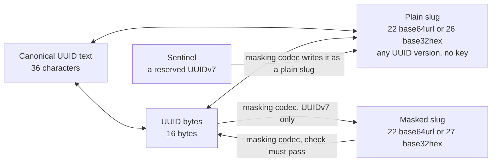

# @anizoptera/uuid-slug

[](https://www.npmjs.com/package/@anizoptera/uuid-slug)
[](https://github.com/Anizoptera/uuid-slug/actions/workflows/check.yml)
[](package.json)
[](package.json)
[](LICENSE)

## TL;DR

**Zero-dependency UUIDv4/v7 generation, lossless base64url and base32hex slugs for any UUID, and reversible UUIDv7 masking for databases, URLs, and files.**

- Encode any UUID as short `base64url` or lowercase `base32hex`.
- Use optional reversible masking to hide the timestamp and structure of UUIDv7 slugs.
- Keep one ID across all representations, with no lost bits or mapping table.
- Write directly into your buffers without intermediate text or new output arrays.
- Read the time directly from UUIDv7 when it is the timestamp your application needs.
- Use native runtime APIs with matching portable fallbacks.
- Failures return typed errors. Built-in generation never falls back to weaker randomness.
- Unused features tree-shake away with any modern bundler.

[Install](#install) · [Quick start](#quick-start) · [Contents](#contents) · [API](#api) · [Performance](#measured-performance)

### TypeScript API map

A UUID is a 128-bit identifier. UUIDv4 is random; UUIDv7 starts with a Unix-millisecond timestamp
so values from different milliseconds sort by time in UUID byte order. A slug is the same UUID in
shorter text. A plain slug needs no key. A masked slug hides UUIDv7 fields with a secret held by a
reusable masking codec. A sentinel is an application-reserved UUIDv7 that the codec deliberately
leaves as a recognizable plain slug.

```text
UUID text ─┐
UUID bytes ├── keyless conversion ── UUID text / bytes / plain slug
plain slug ┘

UUIDv7 text / bytes / plain slug ── masking codec ── masked slug / sentinel / decoded UUID
                     │
                     ├── current + previous masks
                     └── opt-in migration reader
```

The concrete examples encode the same UUIDv7; the sentinel row describes a separately configured value.
`ch` means text characters and `B` means bytes.

| Representation | Size (ch/B) | Example | Meaning and use |
| --- | ---: | --- | --- |
| Compact UUID text | 32 | `0198abcd12347abc9def0123456789ab` | Input; hexadecimal may use mixed case |
| Canonical UUID text | 36 | `0198abcd-1234-7abc-9def-0123456789ab` | Input and the only emitted UUID text; lowercase by default or uppercase on request |
| Brace-wrapped UUID text | 38 | `{0198abcd-1234-7abc-9def-0123456789ab}` | Input; braces require canonical text and hexadecimal may use mixed case |
| UUID URN | 45 | `urn:uuid:0198abcd-1234-7abc-9def-0123456789ab` | Input; prefix is case-insensitive and requires canonical text; hexadecimal may use mixed case |
| UUID bytes | 16 | `01 98 ab cd 12 34 7a bc 9d ef 01 23 45 67 89 ab` | Compact storage; output can use a new array or caller-owned storage; URLs need text encoding |
| Plain base64url slug | 22 | `AZirzRI0eryd7wEjRWeJqw` | Shortest keyless lossless form for any UUID; case-sensitive and not lexically ordered |
| Plain base32hex slug | 26 | `06canj8i6htbp7ff04hkaps9lc` | Keyless and lossless; output is lowercase, input may use mixed case, and UUIDv7 values sort by timestamp |
| Masked base64url UUIDv7 slug | 22 | `ap225Qa_y6wN5LQCJgwH0z` | Short opaque form with a 16-bit check; case-sensitive, unordered, and decoding requires its codec |
| Masked base32hex UUIDv7 slug | 27 | `daerdp86nv5qo3f4mg12c307qco` | Opaque and unordered; output is lowercase, input may use mixed case, and decoding requires its codec |
| Sentinel UUIDv7 slug | 22/26 | Configured | A recognizable plain slug reserved by a codec; size follows its selected alphabet |

Plain and masked slugs work in URLs and filenames. Alphabet and masking are independent choices.

The four concrete slug examples recover the UUIDv7 shown above. Masking makes UUIDv7 fields
unrecognizable; encoding and decoding require the codec that holds your secret. Plain base64url
keeps similar timestamps visually grouped but does not sort chronologically as text. Plain
base32hex does. Masked slugs expose no useful time order.

| Job | Main TypeScript API |
| --- | --- |
| Generate UUIDv4 | `generateUuidV4`, `generateUuidV4Bytes`, `generatePlainUuidV4Slug`, `generateUuidV4WithRandomFill` |
| Generate UUIDv7 | `generateUuidV7`, `generateUuidV7Bytes`, `generatePlainUuidV7Slug` |
| Generate one UUIDv7 with its slug | `generateUuidV7WithPlainSlug`, `maskingCodec.generateUuidV7WithMaskedSlug` |
| Generate an immutable UUIDv7 value | `generateUuidV7Value`, or its generator and masking-codec methods |
| Control UUIDv7 time, sequence, rollback, or entropy | `createUuidV7Generator`, `createUuidV7GeneratorWithRandomFill` |
| Convert UUID text, bytes, and plain slugs | `uuidToString`, `uuidToBytes`, `uuidToPlainSlug`, plus source-specific converters |
| Parse once for repeated work | `parseUuid` returns an immutable `Uuid` value |
| Inspect version, variant, timestamp, or payload | `Uuid.inspect`, `extractUuidVersion`, `extractUuidV7UnixMs`, `extractUuidV7Payload` |
| Narrow untrusted input | `isUuidText`, `isUuidString`, `isUuidBytes`, `isPlainUuidSlug`, their v4/v7 guards, and `isUuidSlugError` |
| Build UUIDv7 database range keys | `uuidV7StringBounds`, `uuidV7ByteBounds` |
| Validate a UUIDv7 timestamp window | `validateUuidV7StringUnixMs` and the plain or masked slug equivalents |
| Create UUIDv7 masking | `deriveUuidV7Mask`, `deriveUuidV7MaskAsync`, `createCustomUuidV7Mask` |
| Mask, unmask, rotate keys, or reserve sentinels | `createUuidV7MaskingCodec` and its methods |
| Read explicitly enabled old formats | `maskingCodec.createUuidSlugMigrationDecoder` |

The TypeScript types preserve known UUID versions, text case, slug kind, and caller-owned buffer
types. Expected failures return `UuidSlugError`; invalid writes leave caller storage unchanged.
Generation with no arguments or only a spelling preset returns its value directly and throws only
when the runtime has no secure random source.
Generator, masking-codec, and migration methods can be detached without binding `this`.
Stable error codes distinguish malformed encodings, UUIDs, buffers, options, masks, sentinels and
timestamps from unavailable entropy, cancellation, wrong UUID versions, and timestamps outside a window.

Operational contracts:

- A created UUIDv7 generator owns its clock and sequence. Its successful current-time values
  strictly increase in UUID byte order; sequence exhaustion advances logical time instead of failing or wrapping.
- Module-level UUIDv7 calls share no sequence state. Supply one generator when calls must share ordering.
- A masking codec is immutable. Writers use its current mask; readers also try previous masks in order.
- Caller-owned buffer writes are transactional. Invalid input or output ranges leave the buffer unchanged.
- Async mask derivation is cooperatively cancellable. Migration readers accept only enabled old formats
  and can return every distinct UUID candidate when one slug has several meanings.

Critical boundaries:

- A 22-character base64url value can be a plain slug and a masked slug for different UUIDs.
  A masking codec uses the first passing mask, then tries plain decoding if every mask rejects it.
  Use a source-specific converter when you know the slug is plain or masked.
- Masking hides recognizable UUIDv7 fields. It is not encryption, authentication, authorization,
  proof of issuance, or a replacement for record lookup and access checks.
- Mask checks can accept a wrong key by chance. Readers try only the configured current and previous masks;
  record lookup must decide whether the decoded UUID exists.
- Sentinels remain recognizable plain slugs and bypass the masking codec's timestamp range.
- Plain base32hex UUIDv7 slugs preserve timestamp order. Base64url and masked slugs do not.
- Generated UUID collisions remain possible. Use a uniqueness constraint wherever a duplicate can cause harm.

## Install (use your favorite package manager)

```bash
bun add @anizoptera/uuid-slug
pnpm add @anizoptera/uuid-slug
npm add @anizoptera/uuid-slug
```

## Quick start

When you need both a database UUID and a public slug, generate both from one byte draw:

```ts
import {
  generateUuidV7WithPlainSlug,
} from "@anizoptera/uuid-slug";

function createShortId() {
  return generateUuidV7WithPlainSlug();
}
```

If you only need the slug, call `generatePlainUuidV7Slug()` directly.

## Contents

- [Install](#install)
- [Quick start](#quick-start)
- [Keep your existing UUIDs](#keep-your-existing-uuids)
- [Assign IDs before saving or syncing](#assign-ids-before-saving-or-syncing)
- [Generate at a recorded time](#generate-at-a-recorded-time)
- [Use the UUID as the timestamp source](#use-the-uuid-as-the-timestamp-source)
- [Representations](#representations)
- [Work with UUID bytes](#work-with-uuid-bytes)
- [Two kinds of slug](#two-kinds-of-slug)
  - [Plain slugs](#plain-slugs) · [Masked slugs](#masked-slugs) · [Sentinels](#sentinels)
- [Ordering and key distribution](#ordering-and-key-distribution)
- [What masking is not](#what-masking-is-not)
- [Handling errors](#handling-errors)
- [Types](#types)
- [API](#api)
  - [Generate IDs](#generate-ids) · [Convert and inspect IDs](#convert-and-inspect-ids)
  - [Use a masking codec](#use-a-masking-codec) · [Constructors and guards](#constructors-and-guards)
- [Masking codec options](#masking-codec-options)
  - [Changing an existing ID format](#changing-an-existing-id-format)
  - [Reading original slugs during migration](#reading-original-slugs-during-migration)
  - [Validating timestamp windows](#validating-timestamp-windows)
- [Measured performance](#measured-performance)
- [Guarantees](#guarantees)
- [Runtime](#runtime)
- [License](#license)

## Keep your existing UUIDs

Encode your stored UUID; decode incoming slugs before querying that same key. Plain encoding
accepts every UUID version, including IDs from databases and other libraries. It preserves all
bits, so shortening adds no collisions and needs no mapping table. Masked UUIDv7 slugs also
recover the original UUID, but need the matching masking codec.

UUIDv4 uses 122 bits for random data. UUIDv7 uses 48 bits for its millisecond timestamp. RFC 9562
allows the remaining 74 bits to hold random data, a counter, or both. Use UUIDv4 when the timestamp
has no value. Use UUIDv7 when you need timestamp sorting or extraction. Neither requires masking.
Anyone can decode a plain slug, including its UUIDv7 timestamp.

This package accepts every RFC 9562 UUIDv7. Conversion and masking preserve the 74 payload bits
without interpreting them. Payload extraction interprets only the layout supplied by the caller.
A UUID alone cannot prove which library generated it or whether those bits contain random data, a
counter, sub-millisecond time, or a combination.

UUIDv7 values from different milliseconds sort by timestamp in UUID byte order. Values from the
same millisecond follow their generator's payload rules; UUIDv7 alone does not promise their order.

| Operation | UUID bits recoverable from the result | Other effect |
| --- | --- | --- |
| UUID to plain slug and back | All 128 | Needs no key or codec |
| UUIDv7 to masked slug and back | All 128 | Needs the matching codec configuration; encoding returns `invalid_timestamp` outside its inclusive range and never truncates |
| Registered sentinel through a masking codec | All 128 | Remains a plain slug and bypasses the masked timestamp range |
| Accepted UUID text to bytes or slug | All 128 | Text output uses canonical hyphens and the requested case |
| UUIDv7 timestamp extraction | 48 | Returns Unix milliseconds; does not return the other 80 UUID bits |

Payload patterns may suggest a generator or ordering policy, but the UUID alone cannot prove one.
Generation is limited to UUIDv4 and UUIDv7. Other versions remain accepted by version-neutral
parsing, inspection, and plain-slug conversion without version-specific package machinery.

Use this package for short public IDs, binary storage, typed validation, and the same API across
runtimes. Named root imports let you use UUID generation alone without bundling the other features.

## Assign IDs before saving or syncing

Create IDs before saving records, including in an offline client. Related records can refer to
those UUIDs before a database round trip, then keep the same IDs when synchronized. No central
ID allocator or worker number is required. Validate client-supplied IDs and check ownership on
the server; generating a valid UUID does not grant permission to create or replace a record.

## Generate at a recorded time

When importing records that do not yet have IDs, encode their recorded time instead of the import
time. Pass `at` to the UUIDv7 text, byte, plain-slug, paired, or immutable-value generator. It
accepts a Unix-millisecond `number` or `bigint`, a `Date`, zoned ISO timestamp text, a
Temporal-style `epochMilliseconds` or `epochNanoseconds` object, or a `{ seconds, nanoseconds }`
timestamp. Text must include a time zone. The 48-bit UUID timestamp stores the containing Unix
millisecond. A configured generator also stores the best fraction its selected payload bits can
represent; the default layout assigns no payload bits to fractions. A created generator mixes that
fraction with its counter and applies its rollback policy, so `at` calls join the same sequence.
Module-level calls remain independent.

```ts
import { BASE32HEX, generatePlainUuidV7Slug } from "@anizoptera/uuid-slug";

function idForImportedRecord(recordedAt: Date) {
  return generatePlainUuidV7Slug({ at: recordedAt, alphabet: BASE32HEX });
}
```

Pass the same created generator to any UUIDv7 representation call when its result must join one
sequence. The representation call generates and formats once; callers do not unwrap bytes first.

Each call uses fresh randomness, even at the same timestamp. For retries, keep the first ID or
use your application's deduplication key. Existing records should keep their UUIDs.
By default, masking accepts UUIDv7 timestamps from Unix millisecond `0` through `2^42 - 1`,
inclusive. Set `timestampRangeStartUnixMs` on the masking codec to move that fixed-size range.

Use `createUuidV7Generator({ readUnixMs })` for an application clock or time-dependent tests.
Each generator has its own sequence state. A fixed clock does not make IDs repeatable:
randomness still comes from the runtime.

Set `subMillisecondFractionBits` from 1 through 12 to encode the clock fraction before the
generator's random-start counter. `payloadLayout` exposes the exact split for later extraction.
Without `readUnixMs`, this mode uses the runtime's high-resolution clock when available and falls
back to `Date.now()`. The selected width states the UUID layout, not the clock's real accuracy.
If another reading lands in the same fraction bucket, the generator increments the counter. If the
counter fills, it advances the logical fraction and then the millisecond timestamp. The default
preserve policy applies the same rule when the clock moves backward, so extracted time can be later
than the supplied instant. A reset policy may move backward after its tolerance. Explicit `at`
calls on the generator join this sequence; module-level `at` calls use independent randomness.

With the default preserve policy, successful current-time calls on one generator strictly increase
in UUID byte order, including calls made within one millisecond. Module-level generation uses the
fastest validated secure path for each output form and does not promise ordering across calls.
Created generators do not coordinate with reset-policy calls after their tolerance, other
generators, package copies, workers, or processes. Set `clockRollback` to reset or
return `invalid_timestamp` when total skew exceeds an inclusive tolerance. Use
`createUuidV7GeneratorWithRandomFill` only when the application must own entropy; its callback must
fill every requested byte or return `UuidSlugError`.

## Use the UUID as the timestamp source

UUIDv7 already stores a millisecond timestamp. If that is the time your application needs,
you can omit a separate timestamp field. Read it without a database lookup or conversion to UUID text:

```ts
import { extractUuidV7UnixMs, isUuidSlugError } from "@anizoptera/uuid-slug";

function dateFromId(uuidOrPlainSlug: string) {
  const unixMs = extractUuidV7UnixMs(uuidOrPlainSlug);
  return isUuidSlugError(unixMs) ? unixMs : new Date(unixMs);
}
```

`extractUuidV7UnixMs(bytes, offset)` reads a UUID inside a larger buffer.
`maskingCodec.extractMaskedUuidV7UnixMs(slug)` reads the same timestamp from a masked slug using the
masking codec's keys. Masking preserves it. UUIDv4 has no timestamp and is rejected.

The other 74 UUIDv7 bits have no self-describing layout. A generator may use them for random data,
a fixed counter, a changing random value, a sub-millisecond fraction, or a fraction followed by a
counter. Use `extractUuidV7Payload(value, layout)` only when you know that generator's layout:

```ts
const payload = extractUuidV7Payload(uuid, {
  subMillisecondFractionBits: 12,
  counterBits: 14,
});
```

The result keeps each value with its bit width and returns every undeclared low bit in `remaining`.
A fraction value `n` stored in `b` bits places creation within
`[unixMs + n / 2**b, unixMs + (n + 1) / 2**b)` milliseconds. It does not recover a more exact time.
Use `maskingCodec.extractMaskedUuidV7Payload(slug, layout)` for masked slugs and sentinels.

Choose what the timestamp means when assigning the ID: generation time, or a supplied time for
imports. It has millisecond precision and does not prove when an external event happened.
Keep a separate field for other dates, finer precision, editable times, or date queries your UUID
index cannot serve. Changing the timestamp inside a UUID changes the ID.

## Representations

A UUID contains 128 bits: 36 characters as canonical text or 16 bytes in binary form.

Plain slugs need no key and preserve every UUID version, variant, and timestamp bit without a
timestamp limit. A masking codec owns the key used to mask and unmask UUIDv7. A sentinel is an
ordinary plain UUIDv7 slug reserved by the application; registering it makes masked writers leave
that plain spelling unchanged.

No operation eagerly returns every representation. Generate bytes once when one caller genuinely
needs several outputs, then derive only the text, plain slug, or masked slug it will use. This keeps
one UUID identity without paying for unused strings. The paired generation methods cover the common
case that needs UUID text plus one selected slug.



Choose masking to hide recognizable UUID fields; choose base32hex to avoid case collisions.

## Work with UUID bytes

Decode a masked public ID directly into your database or protocol buffer using your masking codec:

```ts
import type { UuidV7MaskingCodec } from "@anizoptera/uuid-slug";

function decodePublicId(maskingCodec: UuidV7MaskingCodec, publicId: string, record: Uint8Array, offset: number) {
  return maskingCodec.uuidToBytes(publicId, record, offset);
}
```

Write a UUID directly into a binary record, leaving its other fields untouched:

```ts
import { uuidStringToBytes } from "@anizoptera/uuid-slug";

function convertUuid() {
  const record = new Uint8Array(32);
  return uuidStringToBytes("01990d4d-e600-7000-8000-000000000000", record, 8);
}
```

`uuidStringToBytes` accepts mixed-case canonical or compact UUID text, UUID URNs, and canonical text
enclosed by braces. It either allocates a plain
`Uint8Array` or writes 16 bytes at the requested offset. `bytesToUuidString` reads 16 bytes at an
optional offset and returns lowercase hyphenated text by default. Pass `UUID_TEXT_UPPERCASE` or
`"uppercase"` for uppercase output, or `UUID_TEXT_LOWERCASE` when the default must be an explicit
reusable choice.
The same optional preset works on every operation that returns UUID text, including generators,
plain and masked decoders, timestamp validation, and migration readers. It changes only UUID text;
slug alphabets and accepted input stay independent.
`Buffer` works because it is a `Uint8Array`. A standalone `ArrayBuffer` must contain exactly 16
bytes. A `DataView` must declare an exact 16-byte range, which can select a UUID inside a larger
buffer without copying. Offsets apply only to `Uint8Array`; other typed arrays and array-like values
are rejected. Use `isUuidBytes`, `isUuidV4Bytes`, or `isUuidV7Bytes` when unknown binary input must
be narrowed before storage or version-specific work.

For a binary database key or protocol field, use `uuidBytesToPlainSlug(record, offset)` and
`plainSlugToUuidBytes(slug, record, offset)` to avoid UUID text and temporary slices. Use
`maskingCodec.uuidToBytes(slug, record, offset)` for masked IDs. These writes return the original
array, not a view of the UUID. Read it back at the same offset. Copy bytes you need to keep before
reusing the buffer.

## Two kinds of slug

### Plain slugs

A plain slug holds the 16 UUID bytes as 22-character unpadded base64url by default:
`uuidStringToPlainSlug` and `uuidToString` preserve the UUID value, and anyone can convert either way. Use it
when you only want the identifier shorter.

Pass `"base32hex"` to get 26 lowercase characters that sort by UUIDv7 millisecond timestamp.
A v7 starts with its timestamp, and base32hex writes its digits in the same order as their values. That
makes them usable directly as an ordered database key. base64url cannot do it: its alphabet runs
`A-Za-z0-9-_`, so `0` stands for a larger value than `A` but sorts before it.

Use bytewise or ASCII ordering for those keys. A database collation or a file manager's natural
sort can order text differently. Compare one representation at a time: mixing UUID text, both
slug alphabets, or masked slugs does not preserve timestamp order.

base32hex also avoids case collisions in filenames. A directory listing sorted bytewise follows
the encoded timestamps across different milliseconds. `generatePlainUuidV7Slug(BASE32HEX)` produces
one directly; every keyless slug writer accepts the alphabet without requiring a masking codec.

`uuidToString` infers the alphabet from the length, 22 or 26, so both spellings remain readable
after you switch output. It accepts uppercase base32hex and returns lowercase UUID text by default.
Decode to a UUID before comparing identities or building a cache key:
different spellings can identify the same record. Preserve base64url case; lowercasing it changes
the value. Choose base32hex when storage cannot preserve case distinctions.

### Masked slugs

Masking supports UUIDv7 only. Its compact payload and check pass through a small
block cipher keyed by your seed, then encoded as 22 base64url characters by default, or 27
lowercase base32hex characters with `maskedSlugAlphabet: BASE32HEX`. Both preserve the same payload
and check. Use it when the identifier is public and you want an opaque, hash-like spelling instead
of recognizable UUID fields. Masked slugs are reversible and therefore are not hashes. The exact steps are in
[how masking works](docs/design.md).

Use a masking codec only when IDs must hide their UUIDv7 layout:

```ts
import {
  createUuidV7MaskingCodec,
  isUuidSlugError,
} from "@anizoptera/uuid-slug";

function createPublicIdGenerator(seed: string) {
  const maskingCodec = createUuidV7MaskingCodec({ maskSeed: seed });
  if (isUuidSlugError(maskingCodec)) return maskingCodec;
  return maskingCodec.generateMaskedUuidV7Slug;
}
```

Call `createPublicIdGenerator(seed)` at startup and check its result. Keep the returned function
and call it for each new ID; key derivation runs once. Masking-codec methods need no `bind`.

**Generate the seed; do not think one up.** For example, run `openssl rand -base64 32` and
store the result outside your source repository. Seeds shorter than 16 bytes are rejected, but
length alone does not make a seed unpredictable: a known UUID/slug pair allows offline guesses.

Keep the seed and `keyDerivationIterations` stable for as long as issued slugs must remain readable.
Changing either derives different keys; retain the old settings in `previousMasks` during
rotation. `keyDerivationIterations` defaults to `1`; increasing it adds construction and guessing cost,
but does not turn a human-chosen seed into a suitable secret.

The application creates one UUIDv7 masking codec from a stable secret seed. Encoding compresses the UUIDv7's
fixed fields, adds a 16-bit check, applies the keyed reversible transform, then writes the selected
slug alphabet. Decoding reverses those steps and rejects a value when its check does not match.
Create the masking codec once and reuse it; changing its seed changes the mapping.

A supported UUIDv7 carries 116 bits that the masked format must preserve: the version and
variant are fixed, and the timestamp is stored as a 42-bit offset from the codec's configured
start. 22 base64url
characters hold 132 bits, so the spare 16 carry a check for incorrect decoding. Two things follow,
and both are part of the contract rather than implementation detail:

- **A decoded slug is a candidate, not a proof.** Roughly one random 22-character string in
  65,536 passes the check and decodes to a well-formed, possibly unissued UUID. When accessing a
  stored record, check that it exists and that the caller may access it. A wrong candidate can name
  an existing record: a lookup alone does not prove correct decoding. Every extra
  mask you try adds another opportunity for false acceptance; the combined rate is
  at most the sum of the individual rates. Keep the rotation list short.
- **Masking keeps the UUIDv7 timestamp and accepts a configurable range of `2^42`
  milliseconds.** `timestampRangeStartUnixMs` sets the inclusive first millisecond; the inclusive
  last is `timestampRangeStartUnixMs + MAX_MASKED_UUID_V7_TIMESTAMP_OFFSET_MS`. The default start is `0`, which
  preserves existing slugs. Masking returns `invalid_timestamp` outside the selected range.
  Truncating instead would let
  two UUIDs share one slug, which nothing could recover from. Plain slugs have no such limit;
  registered sentinels are always plain slugs and therefore retain the full UUIDv7 timestamp range.

Set `timestampRangeStartUnixMs` to the earliest timestamp your application needs to mask. Omit it
to preserve the default range and existing slugs.

### Sentinels

Sentinels are application-selected UUIDv7 values that are never masked, so they stay
recognisable in logs and support tickets. Codecs default to no sentinels; configure only identities
your application has reserved:

| Name            | UUID                                   | Slug                     |
| --------------- | -------------------------------------- | ------------------------ |
| `nil`           | `00000000-0000-7000-8000-000000000000` | `AAAAAAAAcACAAAAAAAAAAA` |
| `anonymous`     | `00000000-0001-7000-8000-000000000000` | `AAAAAAABcACAAAAAAAAAAA` |
| `unknown`       | `00000000-0002-7000-8000-000000000000` | `AAAAAAACcACAAAAAAAAAAA` |

Read the validated names, UUIDs, and slugs from `maskingCodec.sentinels`:

```ts
import { createUuidV7MaskingCodec, isUuidSlugError } from "@anizoptera/uuid-slug";

function createSentinels(seed: string) {
  const maskingCodec = createUuidV7MaskingCodec({
    maskSeed: seed,
    sentinels: [{ name: "unknownUser", uuid: "00000000-0002-7000-8000-000000000000" }],
  });
  return isUuidSlugError(maskingCodec) ? maskingCodec : maskingCodec.sentinels;
}
```

Each sentinel name must be nonempty and unique within the masking codec. Each sentinel UUID must also be
unique. Its input accepts every UUID text spelling above; `maskingCodec.sentinels` exposes normalized lowercase text.

Sentinels keep their spelling across seed rotation when the alphabet and reserved UUIDs stay the
same. This lets reserved identities remain recognizable while ordinary IDs use the new mask.
The example named `nil` is an application sentinel, not the all-zero UUID; that UUID
is not UUIDv7 and cannot be a masking-codec sentinel.

Keep sentinel definitions stable while their slugs are in use. Decoding checks sentinels first, so they
are reserved even if a mask could produce the same text. Encoding rejects a non-sentinel UUID
whose masked output collides with a reserved slug, using `invalid_mask`; it never returns
a slug that would decode to the wrong sentinel.

## Ordering and key distribution

Both plain alphabets keep the timestamp at the start. UUIDv7s from the same millisecond share
that prefix; nearby milliseconds can share much of it. Base64url retains this grouping but can
reverse time order: the prefixes `AAAAAAAz` and `AAAAAAA0` encode consecutive milliseconds,
yet ASCII sorting puts the second first.

Base32hex preserves UUID byte order because its alphabet, `0-9a-v`, follows numeric order and
the most significant bits come first. Equal-length slugs sort by timestamp even when a character
spans two UUID fields. This is timestamp order, not event order: clocks can move backwards, and
UUIDv7 does not promise creation order within a millisecond.

`uuidV7StringBounds(ms)` returns two search keys because one millisecond identifies a set, not one UUID:
the timestamp fixes the first 48 bits while 74 payload bits can differ. The first key sets those
payload bits to zero and the second sets them to one. Pass an inclusive end millisecond to cover a
longer interval. Use these bounds only where comparison follows UUID wire-byte order; SQL Server's
`uniqueidentifier` order does not.

Use plain slugs to keep time grouping, and base32hex for chronological text sorting.
Masking scrambles the timestamp with the other fields. It can suit storage that benefits from
spreading new keys across text ranges instead of grouping them by time.

Plain UUIDv7 base32hex filenames sort chronologically without decoding. Masked filenames need
decoding or separate dates for that view. Plain URLs need no secret; masked URLs require you to
keep the mask as long as the links must work. Neither grants access to the record.

Masking does not guarantee even key distribution or faster database writes. Measure with your
storage's sorting and partition rules. If you partition by hash, hash the UUID rather than its
slug so a change of spelling does not move the record. Changing only public URLs does not change
an index on the original UUID.
Sentinels remain plain slugs and keep their original grouping.

With unchanged settings, built-in masking gives the same UUID the same slug. URLs and filenames
stay stable, but anyone can recognize repeated uses of that slug. Key rotation can give the
record a different slug; compare decoded UUIDs to check whether two slugs identify the same record.

## What masking is not

Masking uses a four-round Feistel network with HalfSipHash-2-4 round functions and a
seed-derived key schedule. It removes the directly recognizable UUIDv7 field layout. The package makes no
claim about how hard the mask is to break, with or without known UUID and slug pairs. The round
function is tested against reference vectors; that says nothing about the whole construction. See
[the mechanism and its limits](docs/design.md).

Masked slugs are not authentication tokens or capabilities. The check detects many incorrect
decodes; it is not a message authentication code. Confirm decoded candidates against your store
and enforce authorization separately. Supplying a custom transform still leaves the same short check
and does not turn the API into an authenticated-token system.

```ts
import { isUuidSlugError } from "@anizoptera/uuid-slug";
import type { UuidV7MaskingCodec, UuidV7String } from "@anizoptera/uuid-slug";

async function findAuthorizedRecord<Record>(
  maskingCodec: UuidV7MaskingCodec,
  slug: string,
  findByUuid: (uuid: UuidV7String) => Promise<Record | undefined>,
  canRead: (record: Record) => boolean,
) {
  const uuid = maskingCodec.uuidToString(slug);
  if (isUuidSlugError(uuid)) return uuid;
  const record = await findByUuid(uuid);
  return record !== undefined && canRead(record) ? record : undefined;
}
```

**Supply your own secret seed for real identifiers.** Masking-codec construction fails with
`invalid_mask` when neither `maskSeed` nor `mask` is supplied, and when both are supplied. Pass
`maskSeed` for a plain secret. Pass `mask` for a mask you derived separately, for
`UUID_V7_TEST_MASK`, or for seed material that also needs a label or a key-derivation work factor.
For tests and demos that need stable public bytes,
select `UUID_V7_TEST_MASK` explicitly; anyone can decode identifiers produced with it.
The masked examples in the TL;DR use this test mask; every row there identifies the same UUIDv7.

A browser can use a masked ID returned by your service without knowing the seed. Keep private
masking and decoding on a trusted service; shipping the seed in client code makes it public.
Plain-slug generation and conversion need no seed and can run entirely in the client.

## Handling errors

Fallible synchronous operations return `T | UuidSlugError`; async mask construction resolves to
the same union. Pass that union directly into the next compatible operation and use
`isUuidSlugError` once at the boundary. The guard checks the `__failure` protocol marker first,
then recognizes unmarked package errors from older copies across realms. The marker is a routing
protocol, not proof of origin; untrusted data still belongs in the documented parser or validator.

```ts
import { isUuidSlugError, plainSlugToUuidBytes, uuidStringToPlainSlug } from "@anizoptera/uuid-slug";

function saveUuid(uuidText: string, save: (bytes: Uint8Array) => void) {
  const bytes = plainSlugToUuidBytes(uuidStringToPlainSlug(uuidText));
  if (isUuidSlugError(bytes)) return bytes;
  save(bytes);
}
```

The inner conversion's failure passes through the outer conversion unchanged. Check an
intermediate result only when the caller also needs that intermediate successful value.

Use the error's `code` for handling and its `message` for diagnostics. `UuidSlugErrorCode` is the
exported code type. Each code has a named constant such as `INVALID_BUFFER`, so callers never need
to copy a code string or recover one from a collection. Do not parse messages; they can add details
without changing the code. Errors wrapping failed entropy draws, clock readings, and custom
transform calls preserve the original exception as `cause`.

`uuidBytesToPlainSlug` and `plainSlugToUuidBytes` convert one 16-byte UUID, not arbitrary binary data. Without an
offset, `uuidBytesToPlainSlug` requires exactly 16 bytes; an explicit offset selects 16 bytes from a larger
array. `plainSlugToUuidBytes` accepts mixed-case base32hex and rejects nonzero padding bits.
`isPlainUuidSlug` checks canonical output spelling and returns a boolean, not an error.

```ts
import { BASE32HEX, uuidBytesToPlainSlug } from "@anizoptera/uuid-slug";

function encodeStoredUuid(bytes: Uint8Array) {
  return uuidBytesToPlainSlug(bytes, BASE32HEX);
}
```

## Types

Branded types distinguish values this library has validated or produced. Plain strings and byte
arrays are not assignable to them; pass raw input directly to package operations or use a guard when
you need to retain the narrowed type. A brand proves format, not issuance or permission to access a record.
JavaScript consumers do not need TypeScript. The shipped declarations compile with TypeScript 5.0
and newer.

Public identifier, configuration, and selector string inputs accept primitive JavaScript strings
and genuine `String` objects. This includes identifiers, output selectors, timestamp text, mask seeds and labels, sentinel names,
and migration formats. The package reads a wrapper's intrinsic value without invoking custom
coercion; TypeScript callers use primitive strings.

Use `BASE64URL`, `BASE32HEX`, `UUID_TEXT_LOWERCASE`, `UUID_TEXT_UPPERCASE`, `NIL_UUID`, `MAX_UUID`,
`MAX_MASKED_UUID_V7_TIMESTAMP_OFFSET_MS`, and the named error-code constants instead of copying their values.
`NIL_UUID` and `MAX_UUID` are canonical generic UUID text; they do not claim a UUID version.
Migration readers accept `SEEDED_MASK_FORMAT`, `FIXED_MASK_FORMAT`, or `PLAIN_SLUG_FORMAT`;
their TypeScript type permits only formats enabled when the reader was created.

| Type | What the value is |
| --- | --- |
| `UuidText`, `UuidV4Text`, `UuidV7Text` | Valid UUID text in any accepted spelling; the version is known where the name says so. |
| `UuidString`, `UuidV4String`, `UuidV7String` | Canonical UUID text; the version is known where the name says so. |
| `UppercaseUuidString`, `UppercaseUuidV4String`, `UppercaseUuidV7String` | Uppercase UUID text; the version is known where the name says so. |
| `UuidTextCase`, `UuidStringFor`, `UuidV4StringFor`, `UuidV7StringFor` | A preset choice and the UUID text type selected by it. |
| `UuidVersion` | The complete four-bit version field: `0` through `15`. |
| `PlainUuidSlug`, `PlainUuidV4Slug`, `PlainUuidV7Slug` | A plain slug in either alphabet; the version is known where the name says so. |
| `MaskedUuidV7Slug` | A masked UUIDv7 slug; its check bits require masking-codec decoding. |
| `SentinelUuidV7Slug` | A reserved plain UUIDv7 slug, also usable wherever `PlainUuidV7Slug` is accepted. |
| `MaskedOrSentinelUuidV7Slug` | Masked or sentinel: what a masking call returns. |
| `UuidBytes`, `UuidV4Bytes`, `UuidV7Bytes` | `UuidBytes` proves the 16-byte shape; v4/v7 brands also prove version and variant bits. |
| `UuidByteInput`, `UuidInput` | The byte forms and complete keyless input domain accepted by generic conversion helpers. |
| `SlugAlphabet` | `"base64url"` or `"base32hex"`. |
| `GeneratedUuidV7`, `UuidStringResult`, `UuidBytesResult`, `PlainUuidSlugResult` | The paired generation result and version-preserving result types for typed wrapper functions. |
| `Uuid`, `UuidInspection`, `UuidV7Bounds`, `UuidV7Payload`, `UuidV7PayloadLayout` | An immutable parsed UUID and the typed inspection, search-bound, and caller-declared UUIDv7 payload results it exposes. |
| `UuidV7Instant` | A supported host time accepted by UUIDv7 generation, including exact epoch nanoseconds. |
| `UuidV7MaskingCodec`, `UuidV7MaskingCodecOptions`, `UuidV7PreviousMask`, `UuidV7Mask`, `UuidV7MaskOptions`, `AsyncUuidV7MaskOptions`, `CustomUuidV7MaskOptions`, `UuidV7Sentinel`, `UuidV7SentinelConfig` | The masking codec, what `createUuidV7MaskingCodec` takes, and the retained mask and sentinel shapes it accepts and exposes. |
| `UuidV7Generator`, `UuidV7GeneratorOptions`, `UuidV7ClockRollbackPolicy`, `UuidRandomFill`, `UuidV7TimestampWindow`, `UuidSlugMigrationDecoder`, `UuidSlugMigrationOptions`, `UuidSlugMigrationFormat`, `UuidSlugErrorCode` | A generator, its clock and rollback choices, an explicit custom-entropy callback, timestamp validation, migration controls, and error codes. |
| `GenerateUuidV7Options`, `GeneratePlainUuidV7SlugOptions`, `GenerateUuidV7BytesOptions`, `GenerateUuidV7BytesIntoOptions`, `GenerateUuidV7WithPlainSlugOptions`, `GenerateUuidV7WithMaskedSlugOptions` | Reusable option shapes for each UUIDv7 output job. |

A brand narrows what a call accepts at compile time. A value already typed as the wrong kind is
rejected before it runs, with or without an output buffer:

| Value typed as | Rejected by | Why |
| --- | --- | --- |
| Masked or possibly masked (`MaskedUuidV7Slug`, `MaskedOrSentinelUuidV7Slug`) | Root conversion and plain-slug readers | A masked value needs its masking codec; a sentinel alone remains a plain slug. |
| UUID text (`UuidString` and its versions) | Source-specific slug readers and migration readers | Those methods require encoded slug input. |
| Known v4 (`UuidV4String`, `PlainUuidV4Slug`, `UuidV4Bytes`) | UUIDv7 timestamp validation and masking | UUIDv4 has no UUIDv7 timestamp or masked form. |
| `unknown` | All conversion signatures | Narrow untyped data before calling; JavaScript values are still checked safely at runtime. |

Parsers accept ordinary strings and validate them at runtime. Choose the decoder from your ID
format: plain and masked base64url spellings overlap. A masking codec reads a 22-character slug as
masked when it passes the codec's check and as plain otherwise; keyless root readers always read
it as plain. UUID values with an unknown version also receive runtime version checks.
Lossless conversion preserves a known UUID version in its result type. Byte conversion returns an
owned branded array when it allocates and the caller's exact array subtype when it writes into
supplied storage.

**Some masked slugs also pass plain-slug guards.** Canonical trailing bits, version, and variant
can all match by chance. A guard answers "is this well formed", never "is this mine". Decode with
the matching API. For access to stored records, check existence and authorization separately.

## API

Generation, conversion, and validation return the result below or `UuidSlugError`. Generation with
no arguments or only a spelling preset returns its result directly; it throws `UuidSlugError` with
code `rng_unavailable` when the runtime has no secure random source, which no supported runtime
lacks. When you supply
an output array, the exact array and its type are preserved; otherwise byte outputs are new plain
`Uint8Array` values. Invalid input leaves caller storage unchanged.

Generator, masking-codec, and migration methods do not depend on `this`; they can be passed as callbacks
without binding them first. Each export's full contract, accepted input, result, and errors, is in
its declaration comment; your editor shows it on hover.

### Generate IDs

Import these functions from the package root. UUIDv7 text and byte methods also exist on an
independent generator; UUIDv4 and plain-slug generation remain module-level.

| Call | Successful result |
| --- | --- |
| `generateUuidV4(textCase?)` / `generateUuidV7(textCaseOrOptions?)` | UUID text in the selected case, typed with its version. UUIDv7 options may set `at` and `generator`. |
| `generateUuidV4WithRandomFill(fill, textCase?)` | UUIDv4 text from an explicit synchronous entropy source. |
| `generatePlainUuidV4Slug(alphabet?)` / `generatePlainUuidV7Slug(alphabetOrOptions?)` | A plain slug in the chosen alphabet, typed with its UUID version. UUIDv7 options may set `at` or select a generator. |
| `generateUuidV7WithPlainSlug(alphabetOrTextCaseOrOptions?, textCase?)` | UUIDv7 text and its plain slug from one generated value; options may set `at` or select a generator. |
| `generateUuidV4Bytes()` / `generateUuidV7Bytes(options?)` | A new 16-byte array, typed with its UUID version. UUIDv7 options may set `at` and `generator`. |
| `generateUuidV4Bytes(out, offset?)` / `generateUuidV7Bytes(out, offset?)` | Your output array, with the UUID written at the offset. UUIDv7 also accepts `{ at, generator, output, outputOffset }`. |
| `generateUuidV7Value(options?)` | An immutable UUIDv7; options may set `at`, select a generator, or retain a masking codec. |
| `uuidV7StringBounds(ms, textCase?)` / `uuidV7StringBounds(startMs, endMs, textCase?)` | Inclusive canonical UUID bounds for one millisecond or an inclusive interval. |
| `uuidV7ByteBounds(startMs, endMs?)` | The same inclusive bounds as two owned byte arrays. |
| `createUuidV7Generator(options?)` | An independent UUIDv7 sequence using platform cryptographic entropy; invalid numeric ranges or clock policies return `UuidSlugError`. |
| `createUuidV7GeneratorWithRandomFill(fill, options?)` | An independent UUIDv7 generator using an explicit synchronous entropy source. |

### Convert and inspect IDs

Root functions need no key. They accept UUID text, UUID bytes, and both plain-slug alphabets. A
known UUID version remains in the result type.

| Call | Successful result |
| --- | --- |
| `uuidToString(uuid, textCase?)` / `(bytes, byteOffset, textCase?)` | Canonical UUID text from UUID text, bytes, or a plain slug, or from one UUID inside a larger array. |
| `uuidToBytes(uuid, output?, outputOffset?)` / `(bytes, byteOffset, output?, outputOffset?)` | New UUID bytes or the exact supplied output array, read from a standalone array or from one UUID inside a larger array. |
| `uuidToPlainSlug(uuid, alphabet?)` / `(bytes, byteOffset, alphabet?)` | A plain slug from UUID text, bytes, or a plain slug, or from one UUID inside a larger array. |
| `parseUuid(uuid, maskingCodec?)` | An immutable UUID for repeated inspection and conversion; the optional codec also accepts masked input and stays available to the value. |
| `extractUuidVersion(uuid)` | The UUID version nibble from UUID text, exact bytes, or a plain slug. |
| `extractUuidV7UnixMs(value, offset?)` | Unix milliseconds from UUIDv7 text, a plain slug, or bytes. |
| `extractUuidV7Payload(value, layout, offset?)` | Timestamp and caller-declared payload fields, with all other payload bits unchanged. |
| `validateUuidV7StringUnixMs(uuid, window, textCase?)` / `validatePlainUuidV7SlugUnixMs(slug, window)` | UUIDv7 text in the selected case, or the original plain slug, after checking its timestamp. |

Use `parseUuid` when one UUID needs several operations. It validates and copies the input once.
Serialization returns canonical UUID text and intentionally drops the codec and payload layout.

```ts
const uuid = parseUuid(input, codec);
if (uuid instanceof Error) return uuid;

const facts = uuid.inspect();
const stored = uuid.toBytes();
const publicId = uuid.toMaskedSlug();
```

### Use a masking codec

A masking codec holds immutable masking keys, sentinels, rotation, and writer settings.
These methods use that configuration. New output uses its current mask;
readers also try its configured previous masks.

| Member | Successful result |
| --- | --- |
| `generateUuidV7Value(options?)` | An immutable UUIDv7 with this codec retained; options may set `at` or select a generator. |
| `generateMaskedUuidV7Slug(options?)` | A new `MaskedOrSentinelUuidV7Slug`; options may set `at` or select a generator. |
| `generateUuidV7WithMaskedSlug(textCaseOrOptions?)` | UUIDv7 text and its masked or sentinel slug from one generated value; options may set `at`, select a generator, or select UUID text case. |
| `parseUuid(uuid)` | The same parsed value as top-level `parseUuid(uuid, codec)`, with this codec retained. |
| `uuidToString(uuid, textCase?)` / `(bytes, byteOffset, textCase?)` | UUID text from any supported UUID form, or from one UUID inside a larger array. |
| `uuidToBytes(uuid, output?, outputOffset?)` / `(bytes, byteOffset, output?, outputOffset?)` | UUID bytes from any supported UUID form, or from one UUID inside a larger array. |
| `uuidToPlainSlug(uuid, alphabet?)` / `(bytes, byteOffset, alphabet?)` | A plain slug from any supported UUID form, or from one UUID inside a larger array. |
| `uuidToMaskedSlug(uuid)` | A masked or sentinel slug from any supported UUIDv7 form. |
| `plainToMaskedUuidSlug(plainUuidSlug)` | A `MaskedOrSentinelUuidV7Slug` from either plain UUIDv7 slug spelling. |
| `maskedToPlainUuidSlug(maskedUuidSlug, alphabet?)` | A plain UUIDv7 slug from a masked slug or registered sentinel. |
| `maskedSlugToUuidString(maskedUuidSlug, textCase?)` | UUIDv7 text when the caller knows the slug is masked. |
| `maskedSlugToUuidBytes(maskedUuidSlug, output?, outputOffset?)` | UUIDv7 bytes when the caller knows the slug is masked. |
| `extractMaskedUuidV7UnixMs(maskedUuidSlug)` | Unix milliseconds from a masked slug or sentinel. |
| `extractMaskedUuidV7Payload(maskedUuidSlug, layout)` | Timestamp and caller-declared payload fields from a masked slug or sentinel. |
| `validateMaskedUuidV7SlugUnixMs(maskedUuidSlug, window)` | The original slug, narrowed to `MaskedOrSentinelUuidV7Slug` after checking its timestamp. |
| `sentinels` | Readonly reserved names, UUIDs, and slugs. |
| `createUuidSlugMigrationDecoder(options?)` | A reader for the old formats you enable; new output stays unchanged. |

The universal methods read a 22-character base64url slug as masked when it passes the codec's
check and as plain otherwise. The source-specific methods apply the meaning the caller states
instead, because that string cannot identify its meaning itself.

A byte offset is the zero-based index where one 16-byte UUID starts inside a larger `Uint8Array`.
Omit it for a standalone 16-byte array. Output offsets select where a method writes; input offsets
select where it reads. Bytes outside that 16-byte range stay unchanged. An offset of `0` always means
the same as omitting it. Only `Uint8Array` input accepts a non-zero input offset: every other
accepted form holds exactly one UUID, with no surrounding bytes to skip.

Masking is possible for any UUID version, but this library supports it only for UUIDv7.
Its fixed version, variant, and 42-bit timestamp offset leave room for a 16-bit check without
lengthening the default 22-character slug. Plain slugs support every UUID version.

Use an independent generator when the application owns the clock:

```ts
import { createUuidV7Generator } from "@anizoptera/uuid-slug";

function createEventGenerator(readUnixMs: () => number) {
  return createUuidV7Generator({ readUnixMs });
}
```

Both masking entry points return a raw sentinel slug when the UUID is registered as a sentinel.
Their result type is `MaskedOrSentinelUuidV7Slug`, the union of masked and sentinel slugs.

The byte decoder returns a new plain `Uint8Array` branded as `UuidV7Bytes` when storage is omitted.
When storage is supplied, it validates and decodes before writing, then returns that exact array;
an error leaves the array unchanged.

Each decoder accepts every value that a supported matching encoder can produce. Masked decoding
always accepts both alphabets, sentinels, and current or previous masks. Migration adds only
the old formats you enable. Forms no supported encoder produces are invalid.

### Constructors and guards

Also exported from the package root:

- Permissive type guards: `isUuidText`, `isUuidV4Text`, and `isUuidV7Text` accept mixed case,
  canonical or compact text, UUID URNs, and brace-wrapped canonical text.
- Normalized type guards: `isUuidString`, `isUuidV4String`, and `isUuidV7String` accept lowercase
  hyphenated text. Slug and byte guards are `isPlainUuidSlug`, `isPlainUuidV4Slug`,
  `isPlainUuidV7Slug`, `isUuidBytes`, `isUuidV4Bytes`, and `isUuidV7Bytes`.
- `extractUuidV7UnixMs` reads Unix milliseconds from UUIDv7 text, either plain-slug alphabet,
  or bytes. Use `maskingCodec.extractMaskedUuidV7UnixMs` for masked slugs and sentinels because their decoding
  keys belong to the masking codec. Both return an error for other UUID versions; a v4's first six bytes
  are random and must not be presented as a timestamp.
- `extractUuidVersion` reads the four-bit version field from UUID text, either plain-slug alphabet,
  or bytes. It does not prove the RFC variant or that another version-specific operation accepts it.
- `deriveUuidV7Mask` builds a mask from a seed; `deriveUuidV7MaskAsync` adds cooperative
  cancellation; `createCustomUuidV7Mask` adapts separate forward and reverse callbacks.
  `UUID_V7_TEST_MASK` is the explicit, published-key choice for deterministic examples.
- `createUuidV7Generator(options?)` builds a generator with its own sequence state, your `readUnixMs`
  or `Date.now` when omitted, and platform cryptographic entropy. Preserve-order rollback is the
  default; reset and error policies require an inclusive total-skew tolerance. Invalid numeric
  ranges, clock policies, and untyped malformed options return `invalid_options`. Every method on
  the generator generates in its sequence: `generateUuidV7`, `generateUuidV7Bytes`,
  `generatePlainUuidV7Slug`, `generateUuidV7WithPlainSlug`, and `generateUuidV7Value`. Each takes
  the same spellings and `at` as its root function, without the `generator` option. The root
  functions reach the same sequence by taking `{ generator }`.
- `generateUuidV4WithRandomFill` and `createUuidV7GeneratorWithRandomFill` are the explicit
  custom-entropy paths. Their callback owns entropy quality and must fill every requested byte or
  return `UuidSlugError`; weak or partial successful fills cannot be detected.
- `UuidSlugError`, including code `rng_unavailable` when the runtime has no usable randomness;
  generation with no arguments or only a spelling preset throws that error instead of returning it.
  `UuidSlugErrorCode` types the `code` property; `isUuidSlugError` recognizes package errors across
  JavaScript realms and duplicate package copies.
- `BASE64URL` and `BASE32HEX` select slug output without copying string literals.

### Masking codec options

```ts
import { BASE32HEX, createUuidV7MaskingCodec } from "@anizoptera/uuid-slug";

function configureCodec(seed: string, previousSeed: string) {
  return createUuidV7MaskingCodec({
    mask: { seed, keyDerivationIterations: 1 },
    sentinels: [{ name: "nil", uuid: "00000000-0000-7000-8000-000000000000" }],
    previousMasks: [{ seed: previousSeed }],
    maskedSlugAlphabet: BASE32HEX,
  });
}
```

The masked payload is fixed at 132 bits, including a 16-bit check. `maskedSlugAlphabet` defaults to
`"base64url"`. Readers accept either masked spelling without an alphabet argument. With
`maskedSlugAlphabet: BASE32HEX`, sentinels are written as 26-character base32hex slugs; their
22-character base64url spelling still decodes.

To supply a different mixing implementation, call
`createCustomUuidV7Mask({ diagnosticLabel, mask, unmask })`. Each callback receives distinct 16-byte input
bytes and returns either a 16-byte result or `UuidSlugError`; `unmask` must invert `mask` for
every input. A callback may mutate and return its isolated input. The factory copies callback results
into package storage, captures the callbacks in an opaque frozen handle, and rejects invalid results
and failed round-trip probes. Unexpected throws become errors with the thrown value as their cause.
Finite probes cannot prove invertibility, so the caller remains responsible for the complete domain.

```ts
import {
  createCustomUuidV7Mask,
  createUuidV7MaskingCodec,
  isUuidSlugError,
} from "@anizoptera/uuid-slug";

function adaptMask(mix: (input: Uint8Array, output: Uint8Array, forward: boolean) => void) {
  const transform = (direction: "mask" | "unmask") => (input: Uint8Array) => {
    const output = new Uint8Array(16);
    mix(input, output, direction === "mask");
    return output;
  };
  const mask = createCustomUuidV7Mask({
    diagnosticLabel: "existing-scheme",
    mask: transform("mask"),
    unmask: transform("unmask"),
  });
  return isUuidSlugError(mask) ? mask : createUuidV7MaskingCodec({ mask });
}
```

Mask, masking-codec, generator, sentinel, migration, and timestamp options reject unknown keys instead of
silently applying a default. Invalid mask or masking-codec options return an error. Create custom handles
before passing them; an arbitrary object is not a mask.

Share one derived mask between codecs to avoid repeating key derivation, for example when URLs
use base64url and filenames use base32hex. Each masking codec chooses its alphabet and sentinels; keep
sentinel definitions the same if the codecs must read each other's output.

Diagnostic labels name masks in diagnostics. Slugs contain no diagnosticLabel, so a diagnosticLabel cannot select the decoding
key. Services must use the same seed bytes and iteration count to derive matching keys.
String seeds use UTF-8: base64 text and the bytes it encodes are different seeds.

For expensive derivation, await `deriveUuidV7MaskAsync` and pass the completed mask to the codec:

```ts
import {
  deriveUuidV7MaskAsync,
  createUuidV7MaskingCodec,
  isUuidSlugError,
} from "@anizoptera/uuid-slug";

async function createResponsiveCodec(
  seed: string,
  keyDerivationIterations: number,
  signal: AbortSignal,
) {
  const mask = await deriveUuidV7MaskAsync({ seed, keyDerivationIterations, signal });
  return isUuidSlugError(mask) ? mask : createUuidV7MaskingCodec({ mask });
}
```

The async form derives the same keys and accepts the same seed settings. It splits encoding,
packing and hashing into cooperative work slices, allowing host tasks to run during long
construction. UuidV7MaskDerivationCancellation stops derivation and returns `UuidSlugError` with code `aborted` and
`signal.reason` as its cause. Invalid options return `invalid_mask`; unexpected construction
failures retain their cause. No partially derived mask is returned.

Options are captured when called. Byte seeds are copied before the first suspension, so later
caller mutation cannot change the key; synchronize concurrent writes to shared backing memory.
Copying a very large byte seed, plus allocation, GC, and host scheduling, can still block longer
than one work slice. Small derivations need no host yield. Construct once and reuse the mask;
passing seed options to each new codec would repeat derivation.

`previousMasks` is how you rotate a seed or timestamp range. Decoding tries `mask` first, then each entry in the
order you list them, and the first whose check passes wins. Put the newest first, and keep the
list short. Nothing else is ever tried: a masking codec decodes with the masks you gave it and no
others.

```ts
import { createUuidV7MaskingCodec } from "@anizoptera/uuid-slug";

function createRotatedCodec(currentSeed: string, previousSeed: string) {
  return createUuidV7MaskingCodec({
    maskSeed: currentSeed,
    previousMasks: [{ mask: { seed: previousSeed }, timestampRangeStartUnixMs: 0 }],
  });
}
```

Writers use `currentSeed`; readers also accept `previousSeed`. Remove the old seed only after its
IDs no longer need to decode.

### Changing an existing ID format

Preserve the UUID; change only how it is encoded. Do not generate a replacement UUID when
converting an existing ID: references and stored records must still identify the same object.

Deploy readers that accept both formats before any writer issues the new format. Include
background jobs, cached clients and extensions in that rollout. After switching writers, keep
compatible readers available for rollback: an old-only reader cannot read newly issued IDs.

Updating the database does not update bookmarks, shared links, cookies or client storage.
Remove compatibility only when the old IDs in those places no longer need to work.
No recent legacy traffic does not prove that old links are gone. To keep old URLs after removing
their decoder, retain an application-owned mapping from each supported old slug to its UUID.

Keep keys, timestamp-range starts, and sentinel definitions with every format still in use.
Preserve UUIDs outside the configured masked range as UUID text or plain slugs. Never truncate a
timestamp or substitute a new identity to make masking pass.

### Reading original slugs during migration

Create a migration reader from your codec. Enable only the old formats your application issued:

```ts
import { isUuidSlugError } from "@anizoptera/uuid-slug";
import type { UuidV7MaskingCodec } from "@anizoptera/uuid-slug";

function createLegacyReader(maskingCodec: UuidV7MaskingCodec) {
  const migrationDecoder = maskingCodec.createUuidSlugMigrationDecoder({
    acceptFixedMask: true,
    acceptPlainSlug: true,
  });
  if (isUuidSlugError(migrationDecoder)) return migrationDecoder;
  return (incomingSlug: string) => migrationDecoder.uuidSlugToUuidString(incomingSlug);
}
```

`acceptFixedMask` accepts the fixed-key permutation/XOR format with a 4-bit check that predates
seeded masking, from before package 0.2.0. Releases from 0.2.0 on write different formats, and the
0.2.0 masked format itself is not readable.
`acceptPlainSlug` accepts plain UUID slugs of any version, including old base64url spellings whose
last four bits were ignored. Ordinary `uuidToString` remains strict about those trailing bits.
Create and check the reader once, then reuse it for incoming slugs. Both options must be booleans.
Unknown keys and inaccessible properties return `invalid_options`, including on typed objects.
Neither option changes generation, ordinary codec methods, keys or sentinels.

`uuidSlugToUuidString` returns one UUID or `UuidSlugError`: sentinels first, then current keys, then enabled
original and plain formats. A successful decode still needs a record lookup. The same slug can
decode to different UUIDs in different formats; the original check has only four bits.

When you know the input format, name it to avoid trying unrelated formats:

```ts
import { isUuidSlugError, FIXED_MASK_FORMAT } from "@anizoptera/uuid-slug";
import type { UuidSlugMigrationDecoder, UuidV7MaskingCodec } from "@anizoptera/uuid-slug";

function replaceOriginalSlug(
  maskingCodec: UuidV7MaskingCodec,
  migrationDecoder: UuidSlugMigrationDecoder<typeof FIXED_MASK_FORMAT>,
  oldSlug: string,
) {
  const uuid = migrationDecoder.uuidSlugToUuidString(oldSlug, FIXED_MASK_FORMAT);
  if (isUuidSlugError(uuid)) return uuid;
  const replacement = maskingCodec.uuidToMaskedSlug(uuid);
  if (isUuidSlugError(replacement)) return replacement;
  return { uuid, replacement }; // Keep uuid in the database; use replacement in new links.
}
```

Enable an old format before selecting it. Recognized sentinels always return their reserved UUID,
including old trailing-bit aliases when reading original or plain slugs.
With literal options, TypeScript offers only `SEEDED_MASK_FORMAT` and the formats enabled with `true`;
options whose values are dynamic remain selectable because they may be enabled at runtime.
Pass a UUID text-case preset after the slug when the format is unknown, or after the format when it
is known. Candidate arrays use the same selected case; lowercase remains the default.

For unknown formats, use `uuidSlugToUuidStringCandidates` to find the matching record without guessing:

```ts
import { isUuidSlugError } from "@anizoptera/uuid-slug";
import type { UuidSlugMigrationDecoder, UuidString } from "@anizoptera/uuid-slug";

async function findMigratedRecord(
  migrationDecoder: UuidSlugMigrationDecoder,
  incomingSlug: string,
  findRecordsByUuids: (uuids: readonly UuidString[]) => Promise<readonly unknown[]>,
) {
  const candidates = migrationDecoder.uuidSlugToUuidStringCandidates(incomingSlug);
  if (isUuidSlugError(candidates)) return candidates;
  const matches = candidates.length ? await findRecordsByUuids(candidates) : [];
  if (matches.length !== 1)
    return new Error(matches.length ? "ID matches multiple records" : "ID not found");
  return matches[0]; // Check access before returning the record to the caller.
}
```

`findRecordsByUuids` is your database query. Return distinct records by UUID. `uuidSlugToUuidStringCandidates`
returns distinct UUIDs in decoding order, or an empty array if none match. Malformed input and
failed mask callbacks return an error. Callback errors keep their cause; they never produce a
successful but incomplete list.
An old sentinel alias can also be a seeded masked ID. `uuidSlugToUuidStringCandidates` retains both UUIDs;
`uuidSlugToUuidString` keeps sentinel priority.

Keep this reader while old inputs must work. Replace it with
`maskingCodec.createUuidSlugMigrationDecoder({ acceptPlainSlug: true })` to stop trying the fixed mask, or
`maskingCodec.createUuidSlugMigrationDecoder({ acceptFixedMask: true })` to stop plain-slug decoding.
`maskingCodec.createUuidSlugMigrationDecoder()` tries only current keys and sentinels. Removing the migration reader entirely
leaves ordinary masking-codec decoding unchanged. Neither method can identify the issuing format from
the slug alone, so successful decoding is not a reliable count of legacy traffic.

### Validating timestamp windows

```ts
import { validateUuidV7StringUnixMs } from "@anizoptera/uuid-slug";

function validateRecentUuid(uuid: string) {
  return validateUuidV7StringUnixMs(uuid, { maxTimestampDeltaMs: 60_000 });
}
```

The timestamp must be inside the inclusive interval `referenceUnixMs - maxTimestampDeltaMs`
through `referenceUnixMs + maxTimestampDeltaMs`. The maximum delta is required, finite, and
nonnegative; zero and finite fractions are valid. `referenceUnixMs` defaults to one `Date.now()`
reading and must be finite when supplied. Invalid settings return an error instead of disabling
the check.

`validatePlainUuidV7SlugUnixMs` starts from a plain slug; `maskingCodec.validateMaskedUuidV7SlugUnixMs` starts from
a slug decoded with that masking codec. Success returns the same spelling with its UUIDv7 slug type.
The window accepts timestamps on either side of the reference time; it does not enforce expiry,
authentication, or replay prevention. Use ordinary decoding for permanent identifiers. For links
with expiration or one-time use, check the stored expiry and consumption state as well.

## Measured performance

Choose the output your application needs directly: UUID text, slug, or bytes. Caller-buffer
methods reuse your storage; named imports let bundlers remove unused features. Reuse codecs
to pay key derivation once. These choices avoid conversions, allocations, and setup on each call.

The comparisons time complete calls, including validation and error handling, against native APIs
and competing packages on Node, Bun, Deno, and Chromium. Portable fallbacks are measured separately.
The ranking excludes calls that use `Math.random`, allow a smaller same-millisecond collision
margin, or extract timestamps without checking the UUID version; their timings remain in the study.

The [performance study](bench/PERFORMANCE.md) also measures CPU use, allocations, retained memory,
and responsiveness on those runtimes. Guards avoid decoded arrays and error objects; caller-buffer
paths avoid temporary byte views. Key rotation decodes input text once, and pooled randomness
reduces calls to the platform RNG. Node and Bun regression checks enforce these limits.

Those checks cannot see every engine allocation or prove lower memory use than every competitor.
Memory remaining after GC is not total memory allocated.

These results come from repeated runs on one machine. Workload, hardware, and engine version can
change the ranking. Browser competitor comparisons use Chromium; UUID text and slug comparisons and correctness checks also cover Firefox and WebKit.

| Evidence | Scope | Current result |
| --- | --- | --- |
| UUIDv7 text | Node, Bun, Deno, Chromium | Leads the compared packages. Module calls use portable generation without cross-form ordering; created generators add an explicit ordering contract and clock controls. |
| UUIDv4 text | Node, Bun, Deno, Chromium | Uses native generation on Bun, Deno and Node without JIT compilation; uses pooled entropy on Node with JIT compilation and Chromium. Leads the compared packages on Chromium; trails the fastest compared package on Bun. |
| UUIDv4/v7 bytes | New arrays and caller buffers on Node, Bun, Deno, Chromium | Leads the compared packages on Node and Chromium. On Bun, UUIDv4 caller-buffer writes and both UUIDv7 byte forms trail `uuid`. On Deno, both UUIDv7 byte forms are unresolved against `uuidv7` and `uniku`. |
| Conversion | UUID text, bytes, both plain-slug alphabets, timestamp extraction | Text timestamp extraction leads `uuidv7-js` on Node, Bun, Deno, and Chromium. The study has no comparable package for extraction from bytes or slugs. |
| Bundling | Bun, esbuild, Parcel, Rollup, Rolldown, Rspack, webpack | A named root import keeps only the code it needs. |

See the [performance study](bench/PERFORMANCE.md) for measurements, competitors, and rejected
optimizations. Raw results are in [competitors.md](bench/results/competitors.md) and
[matrix.md](bench/results/matrix.md), including plain-slug generation.

## Guarantees

These are API contracts. The benchmarks in [`bench/README.md`](bench/README.md) measure cost;
passing them proves none of this. See [security boundaries](docs/security.md) for entropy failures
and masking limits.

- Generated IDs have RFC 9562 version and variant bits.
- Built-in generators use the runtime's cryptographically secure random source. They never fall
  back to weaker randomness. If secure randomness is unavailable, generation with no arguments or
  only a spelling preset throws `UuidSlugError` with code `rng_unavailable`, and every generation
  call with an explicit time, a generator, caller-owned output, or custom entropy returns it.
- UUID collisions are possible. Keep a uniqueness constraint where a duplicate could overwrite or
  misidentify data. On conflict while creating a record, keep the existing record and generate a
  new ID.
- Default generation trusts proper native runtime results and provides no stronger guarantees.
  Stronger guarantees belong to explicitly configured calls. Native call failures fall back to
  portable generation; if both fail, the error retains both causes.
- A v7 carries a 48-bit millisecond timestamp in its leading bits, so UUID strings sort by their
  encoded timestamps across different milliseconds.
  Backfilled timestamps or a clock adjustment need not reflect generation order.
- Successful current-time calls on one generator strictly increase in UUID byte order under the
  default preserve policy, including calls with `at`. Module-level generation does not provide this
  guarantee. Reset-policy calls after their tolerance, independent generators, package copies, workers,
  and processes do not share sequence state; use a sequence column when order must cross boundaries.
- A 26-character plain UUIDv7 base32hex slug sorts by encoded timestamp across different
  milliseconds under ASCII comparison. Its digits are in value order and the timestamp comes
  first. Its lowercase spelling also suits case-insensitive storage.
- The default 22-character base64url form preserves all 16 bytes, but its alphabet runs `A-Za-z0-9-_`, so
  its character order and its value order disagree. Sort by the UUID, or by a timestamp column. A
  masked slug has no chronological ordering in either alphabet.
- Without an output buffer, byte generators return a plain `Uint8Array`, never a platform-specific
  subclass. With an output buffer, they return that same
  caller-owned array and write only the requested UUID range.
- `uuidStringToBytes` and `plainSlugToUuidBytes` validate the complete identifier
  before writing. Invalid text or destination ranges return an error and leave caller storage
  unchanged.
- Named root imports let supported bundlers remove the cipher, key derivation, sentinel table,
  and unrelated generation code.
- A UUIDv7 masking codec requires private mask options or a package-produced mask.
  The published-key mask is available only as `UUID_V7_TEST_MASK`; omission never
  selects it.

## Runtime

The native Rust crate in [`rust/uuid-slug`](rust/uuid-slug) implements the same wire contract: a
slug issued by a Node service decodes in a Rust service holding the same seed, and one shared case
corpus runs against both implementations in CI. The npm package remains TypeScript/JavaScript-only.

| Runtime | Loads | Generation |
| --- | --- | --- |
| Node 20 and newer | compiled JavaScript | native UUIDv4 text without JIT compilation; pooled native entropy for other output |
| Bun | published TypeScript | native UUIDv4 text; pooled Web Crypto for bytes and UUIDv7 |
| Deno | published TypeScript | native UUIDv4 text; pooled Web Crypto for bytes and UUIDv7; no flag or import map needed |
| Browsers, other runtimes | compiled JavaScript | the package's own generator over Web Crypto |

The npm package has no runtime dependencies or native addons to install.

- Bun loads the published TypeScript source, uses Web Crypto `randomUUID` for UUIDv4 text, and
  runs the package's own generator over pooled Web Crypto entropy for UUIDv7. `Bun.randomUUIDv7`
  is faster but encodes timestamps ahead of the clock during bursts of calls.
  If Bun loads the compiled JavaScript directly, it still uses the Bun-specific source and native
  functions. Tooling that opts into the `development` condition loads the same source.
- Node uses native `crypto.randomUUID` for UUIDv4 text without JIT compilation. With JIT
  compilation, pooled `crypto.randomFillSync` and package formatting are faster. UUIDv7 and byte
  output use pooled entropy in both modes.
- Deno loads the published TypeScript source, uses Web Crypto `randomUUID` for UUIDv4 text,
  and runs the package's own generator for bytes and UUIDv7. No resolver flag or import map is needed.
- Browsers and other compatible runtimes run the package's own generator over Web Crypto.

Capabilities are probed once when the module loads. A missing method is left undefined, so no call
pays for a throw and a retry. Native base64url and hex encoders are used where a runtime provides
them and they measured faster; on Deno the portable encoder measured faster, so it is kept there.
The UUIDv7 generator is created on first use, so conversion-only imports draw no entropy.

Convert stored UUIDs, decode slugs, and extract timestamps without an entropy source. This suits
read-only tools and static builds that never generate IDs. Generation needs secure randomness;
conversion does not. The npm package does not load the Rust crate or a WebAssembly module.

Every change runs a shared runtime contract on the exact Node 20 floor, the latest published patch
of every Node major from 20 upward, and unpinned Node Current. Full Node tests also run on each row
whose runtime satisfies the development test runner. CI uses the latest Bun and Deno. Packed
JavaScript and both WebAssembly profiles run in the Chromium, Firefox, and WebKit revisions pinned
by Playwright; dependency updates advance those reproducible browser revisions. The Rust crate builds and tests
natively on Linux, macOS, and Windows for x86-64 and Arm64, and its WebAssembly build runs in the
same three browser engines.

## License

Apache-2.0. Copyright 2026 Anizoptera and Art Shendrik.
