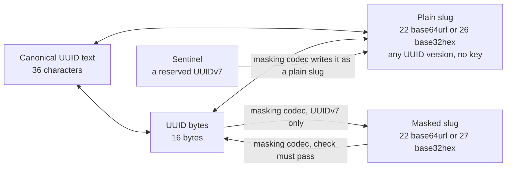

# @anizoptera/uuid-slug

[](https://www.npmjs.com/package/@anizoptera/uuid-slug)
[](https://github.com/Anizoptera/uuid-slug/actions/workflows/check.yml)
[](package.json)
[](package.json)
[](LICENSE)

Fastest UUIDv4/v7 generation and handling, short base64/base32 plain and masked slugs.  Zero runtime dependencies, tree-shakable, optimised for your runtime.  One efficient ID across database, URLs and files.

```text
UUID: 0198abcd-1234-7abc-9def-0123456789ab
Slug: AZirzRI0eryd7wEjRWeJqw
```

Plain slugs shorten any UUID without losing bits. Masked slugs hide UUIDv7 fields with your key;
they are not encryption or access control. Plain base64url UUIDv7 slugs are almost time-ordered.
Choose base32hex for exact timestamp order and case-insensitive filenames.

Use the same JavaScript or TypeScript API on Node, Bun, Deno, browsers and Workers.

[Install](#install) · [Quick start](#quick-start) · [Contents](#contents) · [API](#api) · [Performance](#measured-performance)

## Install

Run `bun add @anizoptera/uuid-slug`, or replace `bun` with `npm` or `pnpm`.

## Quick start

```ts
import { generateUuidV7WithPlainSlug } from "@anizoptera/uuid-slug";

const { uuid, slug } = generateUuidV7WithPlainSlug();
```

Use `generateUuidV4()` for a random UUID or `generateUuidV7()` for one with a timestamp.
Use `generatePlainUuidV7Slug()` when you need only the slug. Anyone can decode a plain slug;
choose [masking](#masked-slugs) to hide UUIDv7 fields.
Default generation returns the identifier directly and throws `rng_unavailable` only when
secure randomness is unavailable. [Conversions return errors as values](#handling-errors).

## Contents

- [Install](#install)
- [Quick start](#quick-start)
- [Convert existing IDs](#keep-your-existing-uuids) · [Bytes](#work-with-uuid-bytes) · [Representations](#representations)
- [Recorded time](#generate-at-a-recorded-time) · [Extract time](#use-the-uuid-as-the-timestamp-source) · [Ordering](#ordering-and-key-distribution)
- [Masking](#masked-slugs) · [Sentinels](#sentinels) · [Security limits](#what-masking-is-not)
- [Errors](#handling-errors) · [Types](docs/api.md#types)
- [API](#api) · [TypeScript API map](#typescript-api-map)
- [Codec options](docs/api.md#masking-codec-options) · [Migration](docs/api.md#reading-original-slugs-during-migration)
- [Measured performance](#measured-performance)
- [Guarantees](#guarantees)
- [Runtime](#runtime)
- [Upgrades and support](#upgrades-and-support)
- [License](#license)

## Keep your existing UUIDs

Encode your stored UUID; decode incoming slugs before querying that same key. Plain encoding
accepts every UUID version, including IDs from databases and other libraries. It preserves all
bits, so shortening adds no collisions and needs no mapping table. Plain slugs use standard
encodings, so you can recover the UUID without this library. Masked UUIDv7 slugs also recover the
original UUID, but need the matching masking codec.

```ts
import { isUuidSlugError, plainSlugToUuidString, uuidStringToPlainSlug } from "@anizoptera/uuid-slug";

const slug = uuidStringToPlainSlug("0198abcd-1234-7abc-9def-0123456789ab");
const uuid = plainSlugToUuidString(slug);
if (isUuidSlugError(uuid)) console.error(uuid.message);
else console.log(uuid); // Use this UUID to look up the existing record.
```

Generation supports UUIDv4 and UUIDv7. Parsing, inspection and plain-slug conversion accept
other versions too. UUIDv4 has 122 random bits. UUIDv7 stores time in 48 bits and uses its other
74 payload bits for randomness, counters or fractions. Conversion and masking preserve those
bits from any RFC 9562 UUIDv7; they do not depend on which library generated it.

## Assign IDs before saving or syncing

Create IDs before saving records, including in an offline client. Related records can refer to
those UUIDs before a database round trip, then keep the same IDs when synchronized. No central
ID allocator or worker number is required. Validate client-supplied IDs and check ownership on
the server; generating a valid UUID does not grant permission to create or replace a record.

## Generate at a recorded time

Pass `at` to use a record's time instead of the current time when creating its UUIDv7. It works
with text, byte, plain-slug, paired and immutable-value generators. Accepted values are a
Unix-millisecond `number` or `bigint`, a `Date`, zoned ISO timestamp text, a
Temporal-style `epochMilliseconds` or `epochNanoseconds` object, or a `{ seconds, nanoseconds }`
timestamp. Text must include a time zone. The UUID stores the containing Unix millisecond;
configured generators can also store a fraction in their payload. The default layout stores no
fraction. See [custom clocks and ordering](docs/api.md#custom-clocks-and-ordering) for precision,
counter overflow and rollback.

```ts
import { BASE32HEX, generatePlainUuidV7Slug } from "@anizoptera/uuid-slug";

function idForImportedRecord(recordedAt: Date) {
  return generatePlainUuidV7Slug({ at: recordedAt, alphabet: BASE32HEX });
}
```

Use one created generator across output forms when calls must share a sequence. Each call
generates and formats once, including calls with `at`. Module-level calls remain independent.

Each call uses fresh randomness, even at the same timestamp. For retries, keep the first ID or
use your application's deduplication key. Existing records should keep their UUIDs.
For masked IDs, choose a [timestamp range](#masked-slugs) that includes the recorded time.

Ordered generation can advance encoded time beyond the supplied time.

## Use the UUID as the timestamp source

UUIDv7 already stores a millisecond timestamp. If that is the time your application needs,
you can omit a separate timestamp field. Read it without a database lookup or conversion to UUID text:

```ts
import { extractUuidV7UnixMs, isUuidSlugError } from "@anizoptera/uuid-slug";

function dateFromId(uuidOrPlainSlug: string) {
  const unixMs = extractUuidV7UnixMs(uuidOrPlainSlug);
  return isUuidSlugError(unixMs) ? unixMs : new Date(unixMs);
}
```

`extractUuidV7UnixMs(bytes, offset)` reads a UUID inside a larger buffer.
`maskingCodec.extractMaskedUuidV7UnixMs(slug)` reads the same timestamp from a masked slug using the
masking codec's keys. Masking preserves it. UUIDv4 has no timestamp and is rejected.

The UUID does not identify its generator or payload layout. Use
`extractUuidV7Payload(value, layout)` only when you know how the generator assigned its bits:

```ts
import { extractUuidV7Payload } from "@anizoptera/uuid-slug";

function payloadFromKnownLayout(uuid: string) {
  return extractUuidV7Payload(uuid, { subMillisecondFractionBits: 12, counterBits: 14 });
}
```

The result keeps each value with its bit width and returns every undeclared low bit in `remaining`.
A fraction value `n` stored in `b` bits represents the encoded time bucket
`[unixMs + n / 2**b, unixMs + (n + 1) / 2**b)` milliseconds. It does not recover a more exact time.
Use `maskingCodec.extractMaskedUuidV7Payload(slug, layout)` for masked slugs and sentinels.

Choose what the timestamp means when assigning the ID: generation time, or a supplied time for
imports. It has millisecond precision and does not prove when an external event happened.
Keep a separate field for other dates, finer precision, editable times, or date queries your UUID
index cannot serve. Changing the timestamp inside a UUID changes the ID.

## Representations

These spellings encode the same UUIDv7. The sentinel row describes a reserved ID.
Sizes are characters, except for the byte representation.

| Representation | Size | Example | Meaning and use |
| --- | ---: | --- | --- |
| Compact UUID text | 32 | `0198abcd12347abc9def0123456789ab` | Input; hexadecimal may use mixed case |
| Canonical UUID text | 36 | `0198abcd-1234-7abc-9def-0123456789ab` | Input and the only emitted UUID text; lowercase by default or uppercase on request |
| Brace-wrapped UUID text | 38 | `{0198abcd-1234-7abc-9def-0123456789ab}` | Input; braces require canonical text and hexadecimal may use mixed case |
| UUID URN | 45 | `urn:uuid:0198abcd-1234-7abc-9def-0123456789ab` | Input; prefix is case-insensitive and requires canonical text; hexadecimal may use mixed case |
| UUID bytes | 16 | `01 98 ab cd 12 34 7a bc 9d ef 01 23 45 67 89 ab` | Compact storage; output can use a new array or caller-owned storage; URLs need text encoding |
| Plain base64url slug | 22 | `AZirzRI0eryd7wEjRWeJqw` | Lossless for any UUID; case-sensitive; almost time-ordered for UUIDv7 |
| Plain base32hex slug | 26 | `06canj8i6htbp7ff04hkaps9lc` | Keyless and lossless; output is lowercase, input may use mixed case, and UUIDv7 values sort by timestamp |
| Masked base64url UUIDv7 slug | 22 | `ap225Qa_y6wN5LQCJgwH0z` | Short opaque form with a 16-bit check; case-sensitive, unordered, and decoding requires its codec |
| Masked base32hex UUIDv7 slug | 27 | `daerdp86nv5qo3f4mg12c307qco` | Opaque and unordered; output is lowercase, input may use mixed case, and decoding requires its codec |
| Sentinel UUIDv7 slug | 22/26 | Configured | A recognizable plain slug reserved by a codec; size follows its selected alphabet |

The masked examples use the public `UUID_V7_TEST_MASK`, which is unsuitable for private IDs.
Plain slugs preserve all UUID bits without a timestamp limit. Masked slugs need their matching
codec. Alphabet and masking are separate choices: use base32hex for case-insensitive storage,
and masking to hide recognizable UUIDv7 fields.

Plain and masked base64url slugs have the same length and can identify different UUIDs.
Use a source-specific converter when you know which form was issued. A masking codec's general
converter uses the first passing mask, then plain decoding if every mask rejects it.

Generate bytes once when you need several representations, then convert only those you use.
Use paired generation when you need UUID text plus one slug.



## Work with UUID bytes

Decode a masked public ID directly into your database or protocol buffer using your masking codec:

```ts
import type { UuidV7MaskingCodec } from "@anizoptera/uuid-slug";

function decodePublicId(maskingCodec: UuidV7MaskingCodec, publicId: string, record: Uint8Array, offset: number) {
  return maskingCodec.maskedSlugToUuidBytes(publicId, record, offset);
}
```

Write a UUID directly into a binary record, leaving its other fields untouched:

```ts
import { uuidStringToBytes } from "@anizoptera/uuid-slug";

function convertUuid() {
  const record = new Uint8Array(32);
  return uuidStringToBytes("01990d4d-e600-7000-8000-000000000000", record, 8);
}
```

`uuidStringToBytes` accepts mixed-case canonical or compact text, UUID URNs and brace-wrapped
canonical text. It allocates a plain `Uint8Array` or writes 16 bytes at the requested offset.
`bytesToUuidString` reads at an optional offset and returns lowercase hyphenated text.
Every UUID-text writer accepts `UUID_TEXT_UPPERCASE` or `"uppercase"`; use `UUID_TEXT_LOWERCASE`
to select the default explicitly. Text case does not change slug alphabets or accepted input.
`Buffer` works because it is a `Uint8Array`. A standalone `ArrayBuffer` must contain exactly 16
bytes. A `DataView` must declare an exact 16-byte range, which can select a UUID inside a larger
buffer without copying. Offsets apply only to `Uint8Array`; other typed arrays and array-like values
are rejected. Use `isUuidBytes`, `isUuidV4Bytes`, or `isUuidV7Bytes` when unknown binary input must
be narrowed before storage or version-specific work.

For a binary database key or protocol field, use `uuidBytesToPlainSlug(record, offset)` and
`plainSlugToUuidBytes(slug, record, offset)` to avoid UUID text and temporary slices. Use
`maskingCodec.maskedSlugToUuidBytes(slug, record, offset)` for known masked IDs. These writes return the original
array, not a view of the UUID. Read it back at the same offset. Copy bytes you need to keep before
reusing the buffer.

Without an offset, `uuidBytesToPlainSlug` requires exactly 16 bytes.

## Two kinds of slug

### Plain slugs

Use `uuidStringToPlainSlug` to encode a UUID and `plainSlugToUuidString` to recover it.
Plain slugs have no padding; decoders reject nonzero padding bits.
`isPlainUuidSlug` checks canonical spelling and returns a boolean.

Pass `BASE32HEX` to any plain-slug writer for lowercase output that preserves UUIDv7 timestamp
order under ASCII comparison, for example `generatePlainUuidV7Slug(BASE32HEX)`.
Use one representation when sorting; database collations and natural file sorting can differ.
See [ordering](#ordering-and-key-distribution).

`uuidToString` infers the alphabet from the length, 22 or 26, so both spellings remain readable
after you switch output. It accepts uppercase base32hex and returns lowercase UUID text by default.
Decode to a UUID before comparing identities or building a cache key:
different spellings can identify the same record. Preserve base64url case; lowercasing it changes
the value. Choose base32hex when storage cannot preserve case distinctions.

### Masked slugs

Create a masking codec with your private key. It writes base64url by default; set
`maskedSlugAlphabet: BASE32HEX` for lowercase base32hex. Both recover the same UUIDv7.

Create the codec once and reuse its generator:

```ts
import {
  createUuidV7MaskingCodec,
  isUuidSlugError,
} from "@anizoptera/uuid-slug";

function createPublicIdGenerator(seed: string) {
  const maskingCodec = createUuidV7MaskingCodec({ maskSeed: seed });
  if (isUuidSlugError(maskingCodec)) return maskingCodec;
  return maskingCodec.generateMaskedUuidV7Slug;
}
```

Call `createPublicIdGenerator(seed)` at startup and check its result. Keep the returned function
and call it for each new ID; key derivation runs once. Masking-codec methods need no `bind`.

**Generate the seed; do not think one up.** For example, run `openssl rand -base64 32` and
store the result outside your source repository. Seeds shorter than 16 bytes are rejected, but
length alone does not make a seed unpredictable: a known UUID/slug pair allows offline guesses.

Changing the seed or `keyDerivationIterations` changes the keys. Keep the old settings in
`previousMasks` while their slugs must remain readable; new slugs use the current keys.
Retain each live format's timestamp-range start and sentinel definitions too.
Deploy readers for both formats before changing writers; old bookmarks still need their decoder.
See [format migration](docs/api.md#changing-an-existing-id-format).
`keyDerivationIterations` defaults to `1`; increasing it adds construction and guessing cost,
but does not turn a human-chosen seed into a suitable secret.

- A decoded slug is a candidate, not proof of issuance. Roughly one random 22-character string in
  65,536 passes the check and decodes to a well-formed, possibly unissued UUID. When accessing a
  stored record, check that it exists and that the caller may access it. A wrong candidate can name
  an existing record: a lookup alone does not prove correct decoding. Every extra
  mask you try adds another opportunity for false acceptance; the combined rate is
  at most the sum of the individual rates. Keep the rotation list short.
- Masking keeps the UUIDv7 timestamp within a configured range of `2^42`
  milliseconds. `timestampRangeStartUnixMs` sets the inclusive first millisecond; the inclusive
  last is `timestampRangeStartUnixMs + MAX_MASKED_UUID_V7_TIMESTAMP_OFFSET_MS`. The default start is `0`, which
  preserves existing slugs. Masking returns `invalid_timestamp` outside the selected range.
  Truncating would make different UUIDs share a slug. Plain slugs have no such limit;
  registered sentinels are always plain slugs and therefore retain the full UUIDv7 timestamp range.

Choose a range that covers your IDs. See [codec options](docs/api.md#masking-codec-options) and
the [wire layout](docs/design.md#representations-and-bit-budget).

### Sentinels

Sentinels are application-selected UUIDv7 values that are never masked, so they stay
recognisable in logs and support tickets. Codecs default to no sentinels; configure only identities
your application has reserved:

| Name            | UUID                                   | Slug                     |
| --------------- | -------------------------------------- | ------------------------ |
| `nil`           | `00000000-0000-7000-8000-000000000000` | `AAAAAAAAcACAAAAAAAAAAA` |
| `anonymous`     | `00000000-0001-7000-8000-000000000000` | `AAAAAAABcACAAAAAAAAAAA` |
| `unknown`       | `00000000-0002-7000-8000-000000000000` | `AAAAAAACcACAAAAAAAAAAA` |

Read the validated names, UUIDs, and slugs from `maskingCodec.sentinels`:

```ts
import { createUuidV7MaskingCodec, isUuidSlugError } from "@anizoptera/uuid-slug";

function createSentinels(seed: string) {
  const maskingCodec = createUuidV7MaskingCodec({
    maskSeed: seed,
    sentinels: [{ name: "unknownUser", uuid: "00000000-0002-7000-8000-000000000000" }],
  });
  return isUuidSlugError(maskingCodec) ? maskingCodec : maskingCodec.sentinels;
}
```

Each sentinel name must be nonempty and unique within the masking codec. Each sentinel UUID must also be
unique. Its input accepts every UUID text spelling above; `maskingCodec.sentinels` exposes normalized lowercase text.

Sentinels keep their spelling across seed rotation when the alphabet and reserved UUIDs stay the
same. This lets reserved identities remain recognizable while ordinary IDs use the new mask.
The example named `nil` is an application sentinel, not the all-zero UUID; that UUID
is not UUIDv7 and cannot be a masking-codec sentinel.

Keep sentinel definitions stable while their slugs are in use. Decoding checks sentinels first, so they
are reserved even if a mask could produce the same text. Encoding rejects a non-sentinel UUID
whose masked output collides with a reserved slug, using `invalid_mask`; it never returns
a slug that would decode to the wrong sentinel.

## Ordering and key distribution

Base64url UUIDv7 slugs are almost time-ordered. Nearby timestamps keep similar prefixes, but
ASCII sorting can put a later timestamp first. For example, `AAAAAAAz` and `AAAAAAA0` encode
consecutive milliseconds, yet ASCII sorting puts the second first.

Base32hex preserves UUID byte order because its alphabet, `0-9a-v`, follows numeric order and
the most significant bits come first. Equal-length slugs sort by timestamp even when a character
spans two UUID fields. This is timestamp order, not event order: clocks can move backwards, and
UUIDv7 does not promise creation order within a millisecond.

`uuidV7StringBounds(ms)` returns two search keys because one millisecond identifies a set, not one UUID:
the timestamp fixes the first 48 bits while 74 payload bits can differ. The first key sets those
payload bits to zero and the second sets them to one. Pass an inclusive end millisecond to cover a
longer interval. Use these bounds only where comparison follows UUID wire-byte order; SQL Server's
`uniqueidentifier` order does not.

Use plain slugs to keep time grouping, and base32hex for chronological text sorting.
Masking scrambles the timestamp, so masked filenames need decoding or separate dates for
chronological sorting.

Masking does not guarantee even key distribution or faster database writes. Measure with your
storage's sorting and partition rules. If you partition by hash, hash the UUID rather than its
slug so a change of spelling does not move the record. Changing only public URLs does not change
an index on the original UUID.
Sentinels remain plain slugs and keep their original grouping.

With unchanged settings, built-in masking gives the same UUID the same slug. URLs and filenames
stay stable, but anyone can recognize repeated uses of that slug. Key rotation can give the
record a different slug; compare decoded UUIDs to check whether two slugs identify the same record.

## What masking is not

Masking hides UUIDv7 fields; it does not provide encryption or authentication. No cryptographic
strength is claimed, even against attacks using known UUID/slug pairs.
See [how it works](docs/design.md) and the [security limits](docs/security.md).

The short check can reject incorrect decoding; it does not authenticate the slug, even with a
custom transform. Look up the decoded UUID and check the caller's access to the record:

```ts
import { isUuidSlugError } from "@anizoptera/uuid-slug";
import type { UuidV7MaskingCodec, UuidV7String } from "@anizoptera/uuid-slug";

async function findAuthorizedRecord<Record>(
  maskingCodec: UuidV7MaskingCodec,
  slug: string,
  findByUuid: (uuid: UuidV7String) => Promise<Record | undefined>,
  canRead: (record: Record) => boolean,
) {
  const uuid = maskingCodec.maskedSlugToUuidString(slug);
  if (isUuidSlugError(uuid)) return uuid;
  const record = await findByUuid(uuid);
  return record !== undefined && canRead(record) ? record : undefined;
}
```

Supply exactly one of `maskSeed` or `mask`; supplying neither or both returns `invalid_mask`.
Use `maskSeed` for your secret, or `mask` for a separately derived mask, derivation options or
`UUID_V7_TEST_MASK`. The test mask is public: anyone can decode IDs made with it.

A browser can use a masked ID returned by your service without knowing the seed. Keep private
masking and decoding on a trusted service; shipping the seed in client code makes it public.
Plain-slug generation and conversion need no seed and can run entirely in the client.

## Handling errors

Conversions return `T | UuidSlugError`; async mask construction resolves to the same union.
Chain compatible conversions and check `isUuidSlugError` at the point that handles failure.
It recognizes package errors across realms and package copies; it does not authenticate input.

```ts
import { isUuidSlugError, plainSlugToUuidBytes, uuidStringToPlainSlug } from "@anizoptera/uuid-slug";

function saveUuid(uuidText: string, save: (bytes: Uint8Array) => void) {
  const bytes = plainSlugToUuidBytes(uuidStringToPlainSlug(uuidText));
  if (isUuidSlugError(bytes)) return bytes;
  save(bytes);
}
```

The inner conversion's failure passes through the outer conversion unchanged. Check an
intermediate result only when the caller also needs that intermediate successful value.

Handle errors by `code`, using exported constants such as `INVALID_BUFFER` and the
`UuidSlugErrorCode` type. Use `message` for diagnostics; its wording can change without changing
the code. Failed entropy draws, clock readings and custom transforms retain their exception as `cause`.

## API

Use the [TypeScript reference](docs/api.md) for [types](docs/api.md#types),
[call signatures](docs/api.md#api), [codec options](docs/api.md#masking-codec-options),
[migration](docs/api.md#reading-original-slugs-during-migration) and
[timestamp windows](docs/api.md#validating-timestamp-windows).
Each export also documents its accepted input, result and failures in editor hover help.

## TypeScript API map

| Job | Main TypeScript API |
| --- | --- |
| Generate UUIDv4 | `generateUuidV4`, `generateUuidV4Bytes`, `generatePlainUuidV4Slug`, `generateUuidV4WithRandomFill` |
| Generate UUIDv7 | `generateUuidV7`, `generateUuidV7Bytes`, `generatePlainUuidV7Slug` |
| Generate one UUIDv7 with its slug | `generateUuidV7WithPlainSlug`, `maskingCodec.generateUuidV7WithMaskedSlug` |
| Generate an immutable UUIDv7 value | `generateUuidV7Value`, or its generator and masking-codec methods |
| Control UUIDv7 time, sequence, rollback, or entropy | `createUuidV7Generator`, `createUuidV7GeneratorWithRandomFill` |
| Convert UUID text, bytes, and plain slugs | `uuidToString`, `uuidToBytes`, `uuidToPlainSlug`, plus source-specific converters |
| Parse once for repeated work | `parseUuid` returns an immutable `Uuid` value |
| Inspect version, variant, timestamp, or payload | `Uuid.inspect`, `extractUuidVersion`, `extractUuidV7UnixMs`, `extractUuidV7Payload` |
| Narrow untrusted input | `isUuidText`, `isUuidString`, `isUuidBytes`, `isPlainUuidSlug`, their v4/v7 guards, and `isUuidSlugError` |
| Build UUIDv7 database range keys | `uuidV7StringBounds`, `uuidV7ByteBounds` |
| Validate a UUIDv7 timestamp window | `validateUuidV7StringUnixMs` and the plain or masked slug equivalents |
| Create UUIDv7 masking | `deriveUuidV7Mask`, `deriveUuidV7MaskAsync`, `createCustomUuidV7Mask` |
| Mask, unmask, rotate keys, or reserve sentinels | `createUuidV7MaskingCodec` and its methods |
| Read explicitly enabled old formats | `maskingCodec.createUuidSlugMigrationDecoder` |

TypeScript distinguishes UUID versions, text case, plain and masked slugs, and caller-owned buffers.
Generator, masking-codec and migration methods can be used as callbacks without binding `this`.

## Measured performance

Choose the output your application needs directly: UUID text, slug, or bytes. Caller-buffer
methods reuse your storage; named imports let bundlers remove unused features. Reuse codecs
to pay key derivation once. These choices avoid conversions, allocations, and setup on each call.

The [performance study](bench/PERFORMANCE.md) compares complete calls against native APIs and
packages on Node, Bun, Deno and Chromium, including portable fallbacks. It also measures CPU use,
allocations, retained memory and responsiveness. Results come from repeated runs on one machine;
different workloads, hardware and runtimes can change the rankings. Retained memory after GC
does not establish total allocation or resource parity.

| Evidence | Scope | Current result |
| --- | --- | --- |
| UUIDv7 text | Node, Bun, Deno, Chromium | Leads the compared packages, including `fastv7`. |
| UUIDv4 text | Node, Bun, Deno, Chromium | Leads the compared packages on Chromium; trails the fastest compared package on Bun. |
| UUIDv4/v7 bytes | New arrays and caller buffers on Node, Bun, Deno, Chromium | Leads the compared packages on Node and Chromium. On Bun, caller-buffer writes trail `uuid`; owned UUIDv7 byte comparisons are unresolved. On Deno, both UUIDv7 byte forms are unresolved against `uuidv7` and `uniku`. |
| Plain-slug generation | UUIDv4/v7 base64url | Bun UUIDv4 throughput trails a native Web Crypto comparison; resource parity remains unresolved. |
| Conversion | UUID text, bytes, both plain-slug alphabets, timestamp extraction | Text timestamp extraction leads `uuidv7-js` on Node, Bun, Deno, and Chromium. The study has no comparable package for extraction from bytes or slugs. |
| Bundling | Bun, esbuild, Parcel, Rollup, Rolldown, Rspack, webpack | A named root import keeps only the code it needs. |

See [competitor results](bench/results/competitors.md) and the [runtime matrix](bench/results/matrix.md)
for the underlying measurements.

## Guarantees

See [security limits](docs/security.md) for entropy failures and masking.

- Generated IDs have RFC 9562 version and variant bits.
- Built-in generators use the runtime's cryptographically secure random source. They never fall
  back to weaker randomness. If secure randomness is unavailable, generation with no arguments or
  only a spelling preset throws `UuidSlugError` with code `rng_unavailable`, and every generation
  call with an explicit time, a generator, caller-owned output, or custom entropy returns it.
- UUID collisions are possible. Keep a uniqueness constraint where a duplicate could overwrite or
  misidentify data. On conflict while creating a record, keep the existing record and generate a
  new ID.
- Default calls retain the selected native generator's ordering and clock behavior.
  Use a created generator to control ordering and clock rollback. Native failures fall back to
  the package's generator; if both fail, the error retains both causes.
- A v7 carries a 48-bit millisecond timestamp in its leading bits, so UUID strings sort by their
  encoded timestamps across different milliseconds.
  Backfilled timestamps or a clock adjustment need not reflect generation order.
- Successful current-time calls on one generator strictly increase in UUID byte order under the
  default preserve policy, including calls with `at`. Module-level generation does not provide this
  guarantee. Reset-policy calls after their tolerance, independent generators, package copies, workers,
  and processes do not share sequence state; use a sequence column when order must cross boundaries.
- A 26-character plain UUIDv7 base32hex slug sorts by encoded timestamp across different
  milliseconds under ASCII comparison. Its digits are in value order and the timestamp comes
  first. Its lowercase spelling also suits case-insensitive storage.
- The default 22-character base64url form preserves all 16 bytes. UUIDv7 slugs are almost
  time-ordered, but ASCII sorting can put a later timestamp first. Sort by the UUID or a timestamp
  column when exact time order matters. Masked slugs have no chronological ordering in either alphabet.
- Without an output buffer, byte generators return a plain `Uint8Array`, never a platform-specific
  subclass. With an output buffer, they return that same array and write only the requested range.
- `uuidStringToBytes` and `plainSlugToUuidBytes` validate the complete identifier
  before writing. Invalid text or destination ranges return an error and leave caller storage
  unchanged.
- Named root imports let supported bundlers remove the cipher, key derivation, sentinel table,
  and unrelated generation code.
- A UUIDv7 masking codec requires private mask options or a package-produced mask.
  The published-key mask is available only as `UUID_V7_TEST_MASK`; omission never
  selects it.

## Runtime

The npm package is ESM-only. It needs no native addons or WebAssembly installation.

The [Rust crate](rust/uuid-slug) uses the same identifier formats. Cross-language masked reads
require matching seeds, iteration counts and timestamp ranges; see [cross-language contracts](docs/cross-language.md).

| Runtime | Package code |
| --- | --- |
| Node 20 and newer | Compiled JavaScript |
| Bun | TypeScript source |
| Deno | TypeScript source; no flag or import map needed |
| Cloudflare Workers, browsers and other compatible runtimes | Compiled JavaScript over Web Crypto |

Generation selects native functions or the package's generator for each runtime and output.
See [entropy sources](docs/security.md) for the secure-randomness requirements and fallback choices.

Bun's native UUIDv7 timestamp can advance ahead of the clock during bursts. Create a generator
to control ordering, clock policy or payload layout. Bun uses its native functions even when
you import compiled JavaScript directly. The `development` export condition loads TypeScript source.

Workers compatibility is checked locally with and without `nodejs_compat`;
deployment behavior is not yet verified. See [edge checks](bench/README.md#profiling).

Conversion and timestamp extraction need no random source, so read-only tools and static builds
can use them without one. Generation requires secure randomness. See
[runtime coverage](docs/cross-language.md#distribution-and-dependencies).

## Upgrades and support

Check the [changelog](CHANGELOG.md) before upgrading. Breaking changes require a major release,
or a minor release before 1.0. APIs must be deprecated in a published release before removal;
see the [release policy](docs/release.md).
Report bugs through [GitHub issues](https://github.com/Anizoptera/uuid-slug/issues).

## License

Apache-2.0. Copyright 2026 Anizoptera and Art Shendrik.
