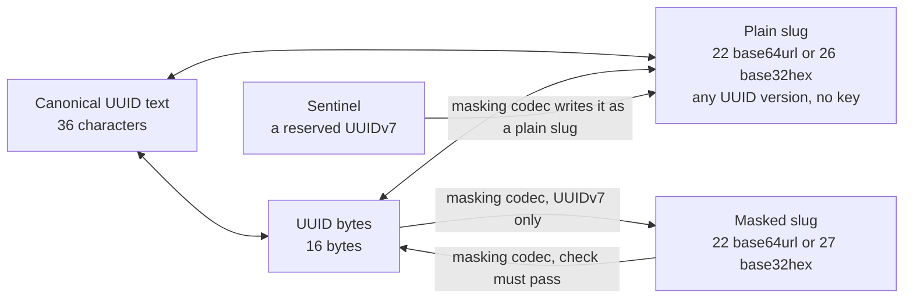

# @anizoptera/uuid-slug

[](https://www.npmjs.com/package/@anizoptera/uuid-slug)
[](https://github.com/Anizoptera/uuid-slug/actions/workflows/check.yml)
[](package.json)
[](package.json)
[](LICENSE)

Fastest UUIDv4/v7 generation and handling, short base64/base32 plain and masked slugs.  Zero runtime dependencies, tree-shakable, optimised for your runtime.  One efficient ID across database, URLs and files.

```text
UUID: 0198abcd-1234-7abc-9def-0123456789ab
Slug: AZirzRI0eryd7wEjRWeJqw
```

Plain slugs shorten any UUID losslessly. Masked slugs hide UUIDv7 fields with your key.
Plain base64url UUIDv7 slugs are almost time-ordered.
Use plain base32hex UUIDv7 slugs for ASCII timestamp sorting and case-insensitive filenames.

The JavaScript and TypeScript API works on Node, Bun, Deno, browsers and Workers.

[Install](#install) · [Quick start](#quick-start) · [Contents](#contents) · [API](#api) · [Performance](#measured-performance)

## Install

Run `bun add @anizoptera/uuid-slug`; replace `bun add` with `npm install` or `pnpm add`.
The package uses ES modules; see [runtime support](#runtime).

## Quick start

```ts
import { generateUuidV7WithPlainSlug } from "@anizoptera/uuid-slug";

const { uuid, slug } = generateUuidV7WithPlainSlug();
```

Use `generateUuidV4()` for random IDs, `generateUuidV7()` for timestamped IDs, or
`generatePlainUuidV7Slug()` for just the slug. Anyone can decode plain slugs;
[masking](#masked-slugs) hides UUIDv7 fields.
Default generation returns the ID and throws `rng_unavailable` only without secure randomness.
[Conversions return errors as values](#handling-errors).

## Contents

- [Install](#install)
- [Quick start](#quick-start)
- [Convert existing IDs](#keep-your-existing-uuids) · [Representations](#representations)
- [Plain slugs](#plain-slugs) · [Masking](#masked-slugs) · [Sentinels](#sentinels) · [Bytes](#work-with-uuid-bytes)
- [Recorded time](#generate-at-a-recorded-time) · [Extract time](#use-the-uuid-as-the-timestamp-source) · [Ordering](#ordering-and-key-distribution) · [Security limits](#masking-security)
- [Errors](#handling-errors) · [Types](docs/api.md#types)
- [API](#api) · [TypeScript API map](#typescript-api-map)
- [Codec options](docs/api.md#masking-codec-options) · [Migration](docs/api.md#reading-original-slugs-during-migration)
- [Measured performance](#measured-performance)
- [Guarantees](#guarantees)
- [Runtime](#runtime)
- [Upgrades and support](#upgrades-and-support)
- [License](#license)

## Keep your existing UUIDs

Encode stored UUIDs; decode incoming slugs before querying the same keys. Plain encoding accepts
every UUID version, including IDs from databases and other libraries. It preserves every bit:
no added collisions or mapping table. Standard encodings let you decode plain slugs without
this library; masked UUIDv7 slugs need the matching key and settings.

```ts
import { isUuidSlugError, plainSlugToUuidString, uuidStringToPlainSlug } from "@anizoptera/uuid-slug";

const slug = uuidStringToPlainSlug("0198abcd-1234-7abc-9def-0123456789ab");
const uuid = plainSlugToUuidString(slug);
if (isUuidSlugError(uuid)) console.error(uuid.message);
else console.log(uuid); // Use this UUID to look up the existing record.
```

Generation supports UUIDv4/v7; parsing, inspection and plain conversion accept other versions.
UUIDv4 has 122 random bits. UUIDv7 has 48 timestamp bits and 74 payload bits for randomness,
counters or fractions. Conversion and masking preserve those bits from any RFC 9562 UUIDv7,
regardless of its generator.

## Representations

A masking codec holds the keys and settings to encode and decode UUIDv7 slugs.

These spellings encode one UUIDv7; the sentinel row describes a reserved ID.
Sizes are characters, except for UUID bytes.

| Representation | Size | Example | Meaning and use |
| --- | ---: | --- | --- |
| Compact UUID text | 32 | `0198abcd12347abc9def0123456789ab` | Input; mixed-case hexadecimal |
| Canonical UUID text | 36 | `0198abcd-1234-7abc-9def-0123456789ab` | Only UUID text output; accepts mixed case; lowercase default, uppercase optional |
| Brace-wrapped UUID text | 38 | `{0198abcd-1234-7abc-9def-0123456789ab}` | Input; requires canonical text; accepts mixed case |
| UUID URN | 45 | `urn:uuid:0198abcd-1234-7abc-9def-0123456789ab` | Input; requires canonical text; accepts mixed case in prefix and UUID |
| UUID bytes | 16 | `01 98 ab cd 12 34 7a bc 9d ef 01 23 45 67 89 ab` | Compact storage; writes a new or caller-owned array; encode as text for URLs |
| Plain base64url slug | 22 | `AZirzRI0eryd7wEjRWeJqw` | Lossless for any UUID; case-sensitive; almost time-ordered for UUIDv7 |
| Plain base32hex slug | 26 | `06canj8i6htbp7ff04hkaps9lc` | Keyless, lossless; writes lowercase, accepts mixed case; UUIDv7 sorts by timestamp in ASCII order |
| Masked base64url UUIDv7 slug | 22 | `ap225Qa_y6wN5LQCJgwH0z` | Opaque, case-sensitive, unordered; 16-bit check; requires its codec to decode |
| Masked base32hex UUIDv7 slug | 27 | `daerdp86nv5qo3f4mg12c307qco` | Opaque, unordered; writes lowercase, accepts mixed case; requires its codec to decode |
| Sentinel UUIDv7 slug | 22/26 | Configured | Reserved plain slug; size follows the codec's alphabet |

Masked examples use `UUID_V7_TEST_MASK`, a public key unsuitable for private IDs.
Plain slugs preserve every UUID bit without timestamp limits; masked slugs require their codec.
Choose the alphabet and masking separately: base32hex suits case-insensitive storage;
masking hides UUIDv7 fields.

One base64url slug can identify different UUIDs when read as plain or masked. Use the
source-specific converter for known formats. General codec converters use the first passing
mask, falling back to plain decoding only if every mask rejects it.

Generate bytes once when you need several representations, then convert only those you use.
Use paired generation when you need UUID text plus one slug.



## Two kinds of slug

### Plain slugs

Use `uuidStringToPlainSlug` to encode a UUID and `plainSlugToUuidString` to recover it.
Decoders reject `=` padding and nonzero unused bits in the last character.
`isPlainUuidSlug` checks canonical spelling and returns a boolean.

Pass `BASE32HEX` to any plain-slug writer for lowercase output that preserves UUIDv7 timestamp
order under ASCII comparison, for example `generatePlainUuidV7Slug(BASE32HEX)`.
Use one representation when sorting; database collations and natural file sorting can differ.
See [ordering](#ordering-and-key-distribution).

`uuidToString` infers the alphabet from the length, 22 or 26, so old slugs survive alphabet changes.
It accepts uppercase base32hex and returns lowercase UUID text by default.
Decode before comparing IDs or building cache keys: different spellings can identify the same record.
Preserve base64url case; lowercasing changes the value. Use base32hex for case-insensitive storage.

### Masked slugs

Codecs default to base64url; set `maskedSlugAlphabet: BASE32HEX` for lowercase base32hex.
Both encode the same UUIDv7.

Supply either `maskSeed` or `mask`; neither or both returns `invalid_mask`.
Use `maskSeed` for a secret; `mask` accepts a derived mask, derivation options or
`UUID_V7_TEST_MASK`. Anyone can decode IDs made with the public test mask.

```ts
import {
  createUuidV7MaskingCodec,
  isUuidSlugError,
} from "@anizoptera/uuid-slug";

function createPublicIdGenerator(seed: string) {
  const maskingCodec = createUuidV7MaskingCodec({ maskSeed: seed });
  if (isUuidSlugError(maskingCodec)) return maskingCodec;
  return maskingCodec.generateMaskedUuidV7Slug;
}
```

Call `createPublicIdGenerator(seed)` once, check the result, then reuse the returned function.
This derives keys once. Codec methods need no `bind`.
Use [async mask derivation](docs/api.md#masking-codec-options) when setup must yield or be cancelled.

Generate a random seed, for example with `openssl rand -base64 32`, and keep it outside source control.
Seeds need at least 16 bytes; length alone does not prevent offline guessing from known UUID/slug pairs.

Changing the seed or `keyDerivationIterations` changes keys. Keep old mask settings and range starts
in `previousMasks` while old slugs must work. Retain each live format's sentinel definitions too.
New slugs use current keys. Deploy both readers before switching writers; bookmarks still need
their old decoder. See [migration](docs/api.md#changing-an-existing-id-format).
`keyDerivationIterations` defaults to `1`. More iterations increase setup and guessing costs;
they do not make a human-chosen seed suitable.

Masking accepts a `2^42`-millisecond range, from `timestampRangeStartUnixMs` through
`timestampRangeStartUnixMs + MAX_MASKED_UUID_V7_TIMESTAMP_OFFSET_MS`, inclusive.
The default start, `0`, preserves existing slugs. Out-of-range timestamps return `invalid_timestamp`;
truncating would make distinct UUIDs share a slug. Plain UUIDv7 slugs and sentinels retain all 48 timestamp bits.

See [codec options](docs/api.md#masking-codec-options) and the [wire layout](docs/design.md#representations-and-bit-budget).

### Sentinels

Sentinels are reserved UUIDv7 values kept plain for recognition in logs and support tickets.
Codecs have none by default; configure only IDs your application reserves:

| Name            | UUID                                   | Slug                     |
| --------------- | -------------------------------------- | ------------------------ |
| `nil`           | `00000000-0000-7000-8000-000000000000` | `AAAAAAAAcACAAAAAAAAAAA` |
| `anonymous`     | `00000000-0001-7000-8000-000000000000` | `AAAAAAABcACAAAAAAAAAAA` |
| `unknown`       | `00000000-0002-7000-8000-000000000000` | `AAAAAAACcACAAAAAAAAAAA` |

Read their validated names, UUIDs and slugs from `maskingCodec.sentinels`:

```ts
import { createUuidV7MaskingCodec, isUuidSlugError } from "@anizoptera/uuid-slug";

function createSentinels(seed: string) {
  const maskingCodec = createUuidV7MaskingCodec({
    maskSeed: seed,
    sentinels: [{ name: "unknownUser", uuid: "00000000-0002-7000-8000-000000000000" }],
  });
  return isUuidSlugError(maskingCodec) ? maskingCodec : maskingCodec.sentinels;
}
```

Sentinel names and UUIDs must be unique within the codec; names must be nonempty.
Input accepts every UUID text form above; `maskingCodec.sentinels` returns lowercase text.

Sentinel spelling survives seed rotation if the alphabet and reserved UUIDs stay unchanged.
The example `nil` is an application sentinel, not the all-zero UUID, which is not UUIDv7.

Keep sentinel definitions unchanged while their slugs remain in use. Decoding checks them first.
Encoding returns `invalid_mask` if a non-sentinel's masked output matches a reserved slug;
otherwise it would decode to the wrong UUID.

## Work with UUID bytes

Decode a masked ID into a database or protocol buffer:

```ts
import type { UuidV7MaskingCodec } from "@anizoptera/uuid-slug";

function decodePublicId(maskingCodec: UuidV7MaskingCodec, publicId: string, record: Uint8Array, offset: number) {
  return maskingCodec.maskedSlugToUuidBytes(publicId, record, offset);
}
```

Write a UUID into a binary record without changing other fields:

```ts
import { uuidStringToBytes } from "@anizoptera/uuid-slug";

function convertUuid() {
  const record = new Uint8Array(32);
  return uuidStringToBytes("01990d4d-e600-7000-8000-000000000000", record, 8);
}
```

`uuidStringToBytes` accepts mixed-case canonical or compact text, URNs and brace-wrapped canonical
text. It allocates a plain `Uint8Array` or writes 16 bytes at your offset.
`bytesToUuidString` reads at an optional offset and returns lowercase hyphenated text.
Every UUID-text writer accepts `UUID_TEXT_UPPERCASE` or `"uppercase"`; `UUID_TEXT_LOWERCASE`
selects the default explicitly. Text case changes neither slug alphabets nor accepted input.
`Buffer` works as a `Uint8Array`. `ArrayBuffer` inputs must have exactly 16 bytes; `DataView`
must select a 16-byte range and can read larger buffers without copying. Only `Uint8Array`
accepts offsets. Other typed arrays and array-like values are rejected. Narrow unknown input
with `isUuidBytes`, `isUuidV4Bytes` or `isUuidV7Bytes` before storage or version-specific work.

Use `uuidBytesToPlainSlug(record, offset)` and `plainSlugToUuidBytes(slug, record, offset)`
to avoid text and temporary slices. Use `maskingCodec.maskedSlugToUuidBytes(slug, record, offset)`
for known masked IDs. Writes return your array, not a UUID view. Read at the same offset;
copy bytes you need to retain before reusing the buffer.

Without an offset, `uuidBytesToPlainSlug` requires exactly 16 bytes.

## Assign IDs before saving or syncing

Create IDs before saving, even offline. Related records can reference them without a database round
trip and keep them after synchronization. No central allocator or worker number is needed.
On the server, validate client IDs and ownership; a valid UUID does not authorize record creation or replacement.

## Generate at a recorded time

Set `at` on UUIDv7 generation calls to encode a record's time instead of now.
It accepts Unix-millisecond `number` or `bigint`, `Date`, zoned ISO text, a
Temporal-style `epochMilliseconds` or `epochNanoseconds` object, or a `{ seconds, nanoseconds }`
timestamp. Text needs a time zone. UUIDs store the containing millisecond; configured generators
can store fractions too. The default layout stores none. See [clocks and ordering](docs/api.md#custom-clocks-and-ordering)
for precision, counter overflow and rollback.

```ts
import { BASE32HEX, generatePlainUuidV7Slug } from "@anizoptera/uuid-slug";

function idForImportedRecord(recordedAt: Date) {
  return generatePlainUuidV7Slug({ at: recordedAt, alphabet: BASE32HEX });
}
```

Use one created generator across output forms to share a sequence, including `at` calls.
Each call generates and formats once. Module-level calls remain independent.

Calls use fresh randomness even at identical timestamps. For retries, retain the first ID or
use a deduplication key; existing records keep their UUIDs. Masked IDs need a
[timestamp range](#masked-slugs) covering the recorded time.

Ordered generation can advance encoded time beyond the supplied time.

## Use the UUID as the timestamp source

Read UUIDv7's millisecond timestamp without a database lookup or UUID-text conversion.
If it is the time you need, omit a separate field:

```ts
import { extractUuidV7UnixMs, isUuidSlugError } from "@anizoptera/uuid-slug";

function dateFromId(uuidOrPlainSlug: string) {
  const unixMs = extractUuidV7UnixMs(uuidOrPlainSlug);
  return isUuidSlugError(unixMs) ? unixMs : new Date(unixMs);
}
```

`extractUuidV7UnixMs(bytes, offset)` reads from a larger buffer.
`maskingCodec.extractMaskedUuidV7UnixMs(slug)` recovers a masked timestamp with the codec's keys.
UUIDv4 has no timestamp and is rejected.

UUIDs do not identify their generator or payload layout.
Call `extractUuidV7Payload(value, layout)` only with a known layout:

```ts
import { extractUuidV7Payload } from "@anizoptera/uuid-slug";

function payloadFromKnownLayout(uuid: string) {
  return extractUuidV7Payload(uuid, { subMillisecondFractionBits: 12, counterBits: 14 });
}
```

The result includes each value's bit width and undeclared low bits in `remaining`.
A fraction value `n` stored in `b` bits represents the encoded time bucket
`[unixMs + n / 2**b, unixMs + (n + 1) / 2**b)` milliseconds. It does not recover a more exact time.
Use `maskingCodec.extractMaskedUuidV7Payload(slug, layout)` for masked slugs and sentinels.

Assign IDs from generation time or a supplied event time.
Keep separate fields for other dates, finer precision, editable times or queries the UUID index
cannot serve. Changing the timestamp changes the ID.

## Ordering and key distribution

Base64url UUIDv7 slugs are almost time-ordered: nearby timestamps have similar prefixes.
ASCII sorting can reverse them: `AAAAAAAz` and `AAAAAAA0` encode consecutive milliseconds,
but the second prefix sorts first.

Base32hex preserves UUID byte order: its alphabet, `0-9a-v`, follows numeric order, with the
most significant bits first. Equal-length slugs sort by timestamp even across field boundaries.
Clocks can move backwards, and UUIDv7 does not promise creation order within a millisecond.

`uuidV7StringBounds(ms)` returns the lowest and highest UUIDv7 for that millisecond:
both fix the first 48 timestamp bits, with all 74 payload bits zero in the first and one in the second.
Pass an inclusive end millisecond for a longer interval. Compare in UUID wire-byte order;
SQL Server's `uniqueidentifier` uses a different order.

Decode masked filenames or store dates separately to sort them chronologically.

Database write speed and key distribution depend on storage sorting and partition rules;
measure them before choosing masking for that purpose. For hash partitioning, hash the UUID so a spelling
change does not move the record. Changing public URLs leaves the UUID index unchanged.
Sentinels remain plain and keep their grouping.

With unchanged settings, built-in masking gives the same UUID the same slug: URLs and filenames
stay stable, and repeated uses are recognizable. Rotation can change the slug;
compare decoded UUIDs to identify the same record.

## Masking security

Masking hides UUIDv7 fields; the matching key restores them. Its cryptographic strength is not established,
including against attacks using known UUID/slug pairs. See the [design](docs/design.md)
and [security limits](docs/security.md).

Roughly one random 22-character base64url value in 65,536 passes a mask's 16-bit check.
It can decode to an ID you never generated, or to the wrong existing record, even with a
custom transform. More read keys add chances of incorrect decoding; the combined rate is
at most their sum. Keep the rotation list short. Look up the decoded ID and check caller access:

```ts
import { isUuidSlugError } from "@anizoptera/uuid-slug";
import type { UuidV7MaskingCodec, UuidV7String } from "@anizoptera/uuid-slug";

async function findAuthorizedRecord<Record>(
  maskingCodec: UuidV7MaskingCodec,
  slug: string,
  findByUuid: (uuid: UuidV7String) => Promise<Record | undefined>,
  canRead: (record: Record) => boolean,
) {
  const uuid = maskingCodec.maskedSlugToUuidString(slug);
  if (isUuidSlugError(uuid)) return uuid;
  const record = await findByUuid(uuid);
  return record !== undefined && canRead(record) ? record : undefined;
}
```

A browser can use your service's masked IDs without the seed. Keep private masking and decoding
on the service; client code exposes the seed. Plain generation and conversion need no seed.

## Handling errors

Conversions return `T | UuidSlugError`; async mask construction resolves to the same union.
Chain compatible conversions; check `isUuidSlugError` where you handle failure.
It recognizes package errors across realms and package copies.

```ts
import { isUuidSlugError, plainSlugToUuidBytes, uuidStringToPlainSlug } from "@anizoptera/uuid-slug";

function saveUuid(uuidText: string, save: (bytes: Uint8Array) => void) {
  const bytes = plainSlugToUuidBytes(uuidStringToPlainSlug(uuidText));
  if (isUuidSlugError(bytes)) return bytes;
  save(bytes);
}
```

Conversions pass errors through unchanged. Check intermediate results only when you also need their values.

Handle errors by `code`, with constants such as `INVALID_BUFFER` and the `UuidSlugErrorCode` type.
Use `message` for diagnostics; wording can change while codes stay stable.
Failed entropy draws, clock readings and custom transforms retain their exception as `cause`.

## API

Use the [TypeScript reference](docs/api.md) for [types](docs/api.md#types),
[call signatures](docs/api.md#api), [codec options](docs/api.md#masking-codec-options),
[migration](docs/api.md#reading-original-slugs-during-migration) and
[timestamp windows](docs/api.md#validating-timestamp-windows).
Each export also documents its accepted input, result and failures in editor hover help.

## TypeScript API map

| Job | Main TypeScript API |
| --- | --- |
| Generate UUIDv4 | `generateUuidV4`, `generateUuidV4Bytes`, `generatePlainUuidV4Slug`, `generateUuidV4WithRandomFill` |
| Generate UUIDv7 | `generateUuidV7`, `generateUuidV7Bytes`, `generatePlainUuidV7Slug` |
| Generate one UUIDv7 with its slug | `generateUuidV7WithPlainSlug`, `maskingCodec.generateUuidV7WithMaskedSlug` |
| Generate an immutable UUIDv7 value | `generateUuidV7Value`, or its generator and masking-codec methods |
| Control UUIDv7 time, sequence, rollback, or entropy | `createUuidV7Generator`, `createUuidV7GeneratorWithRandomFill` |
| Convert UUID text, bytes, and plain slugs | `uuidToString`, `uuidToBytes`, `uuidToPlainSlug`, plus source-specific converters |
| Parse once for repeated work | [`parseUuid`](docs/api.md#convert-and-inspect-ids) returns an immutable `Uuid` value |
| Inspect version, variant, timestamp, or payload | `Uuid.inspect`, `extractUuidVersion`, `extractUuidV7UnixMs`, `extractUuidV7Payload` |
| Narrow untrusted input | `isUuidText`, `isUuidString`, `isUuidBytes`, `isPlainUuidSlug`, their v4/v7 guards, and `isUuidSlugError` |
| Build UUIDv7 database range keys | `uuidV7StringBounds`, `uuidV7ByteBounds` |
| Validate a UUIDv7 timestamp window | `validateUuidV7StringUnixMs` and the plain or masked slug equivalents |
| Create UUIDv7 masking | `deriveUuidV7Mask`, `deriveUuidV7MaskAsync`, `createCustomUuidV7Mask` |
| Mask, unmask, rotate keys, or reserve sentinels | `createUuidV7MaskingCodec` and its methods |
| Read explicitly enabled old formats | `maskingCodec.createUuidSlugMigrationDecoder` |

TypeScript distinguishes UUID versions, text case, plain and masked slugs, and caller-owned buffers.
Generator, masking-codec and migration methods need no `this` binding.

## Measured performance

Generate the output you need: UUID text, slug or bytes. Reuse buffers to avoid allocations
and codecs to avoid repeated key derivation. Named imports keep unused features out of bundles.

The [study](bench/PERFORMANCE.md) compares complete calls and portable fallbacks with native APIs
and packages on Node, Bun, Deno and Chromium. It measures speed, CPU use, allocations, retained
memory and responsiveness. Repeated runs on one machine do not establish rankings for other
workloads, hardware or runtimes. Retained memory after GC does not measure total allocation.

| Evidence | Scope | Current result |
| --- | --- | --- |
| UUIDv7 text | Node, Bun, Deno, Chromium | Leads the compared packages, including `fastv7`. |
| UUIDv4 text | Node, Bun, Deno, Chromium | Leads the compared packages on Chromium; trails the fastest compared package on Bun. |
| UUIDv4/v7 bytes | New arrays and caller buffers on Node, Bun, Deno, Chromium | Leads the compared packages on Node and Chromium. On Bun, caller-buffer writes trail `uuid`; owned UUIDv7 byte comparisons are unresolved. On Deno, both UUIDv7 byte forms are unresolved against `uuidv7` and `uniku`. |
| Plain-slug generation | UUIDv4/v7 base64url | Bun UUIDv4 throughput trails a native Web Crypto comparison; resource parity remains unresolved. |
| Conversion | UUID text, bytes, both plain-slug alphabets, timestamp extraction | Text timestamp extraction leads `uuidv7-js` on Node, Bun, Deno, and Chromium. The study has no comparable package for extraction from bytes or slugs. |
| Bundling | Bun, esbuild, Parcel, Rollup, Rolldown, Rspack, webpack | A named root import keeps only the code it needs. |

See [competitor results](bench/results/competitors.md) and the [runtime matrix](bench/results/matrix.md)
for the underlying measurements.

## Guarantees

See [security limits](docs/security.md) for entropy failures and masking.

- Generated IDs have RFC 9562 version and variant bits.
- Built-in generators use cryptographically secure runtime randomness without weaker fallbacks.
  If it is unavailable, argument-free or preset-only generation throws `UuidSlugError` with code
  `rng_unavailable`. Calls with explicit time, a generator, caller output or custom entropy return it.
- UUIDs can collide. Use a uniqueness constraint where duplicates could overwrite or misidentify
  data. On conflict creating a record, keep the existing record and generate a new ID.
- Default calls retain the selected native generator's ordering and clock behavior.
  Use a created generator to control ordering and clock rollback. Native failures fall back to
  the package's generator; if both fail, the error retains both causes.
- UUIDv7 starts with a 48-bit millisecond timestamp, so UUID strings sort by encoded time across
  different milliseconds. Backfills and clock adjustments can differ from generation order.
- Successful current-time calls on one created generator strictly increase in UUID byte order
  under the default preserve policy; `at` calls share its sequence state. Module-level generation
  and reset-policy calls beyond their tolerance do not guarantee this order. Independent generators,
  package copies, workers and processes have separate state; use a sequence column for ordering across them.
- Plain UUIDv7 base32hex slugs have 26 lowercase characters and sort by encoded timestamp across
  different milliseconds under ASCII comparison: digits follow value order and the timestamp
  comes first. Lowercase output suits case-insensitive storage.
- The default 22-character base64url form preserves all 16 bytes. UUIDv7 slugs are almost
  time-ordered, but ASCII sorting can put a later timestamp first. Sort by the UUID or a timestamp
  column when exact time order matters. Masked slugs have no chronological ordering in either alphabet.
- Byte generators return a new plain `Uint8Array` or your supplied array, writing only the requested range.
- `uuidStringToBytes` and `plainSlugToUuidBytes` validate the whole identifier before writing.
  Invalid text or destination ranges return an error without changing caller storage.
- Named root imports let supported bundlers remove the cipher, key derivation, sentinel table,
  and unrelated generation code.
- A UUIDv7 masking codec requires explicit private mask options or a package-produced mask.
  Use `UUID_V7_TEST_MASK` explicitly for the public test key; omission does not select it.

## Runtime

The npm package needs no native addons or WebAssembly installation.

The [Rust crate](rust/uuid-slug) uses the same identifier formats. Cross-language masked reads
require matching seeds, iteration counts and timestamp ranges; see [cross-language contracts](docs/cross-language.md).

| Runtime | Package code |
| --- | --- |
| Node 20 and newer | Compiled JavaScript |
| Bun | TypeScript source |
| Deno | TypeScript source; no flag or import map needed |
| Cloudflare Workers, browsers and other compatible runtimes | Compiled JavaScript over Web Crypto |

Generation selects native functions or the package's generator for each runtime and output.
See [entropy sources](docs/security.md) for the secure-randomness requirements and fallback choices.

Bun's native UUIDv7 timestamp can advance ahead of the clock during bursts. Create a generator
to control ordering, clock policy or payload layout. Bun uses its native functions even when
you import compiled JavaScript directly. The `development` export condition loads TypeScript source.

Workers compatibility is checked locally with and without `nodejs_compat`;
deployment behavior is not yet verified. See [edge checks](bench/README.md#profiling).

Conversion and timestamp extraction need no randomness, so read-only tools and static builds
can use them. Generation needs secure randomness. See
[runtime coverage](docs/cross-language.md#distribution-and-dependencies).

## Upgrades and support

Check the [changelog](CHANGELOG.md) before upgrading. Breaking changes require a major release,
or a minor release before 1.0. APIs must be deprecated in a published release before removal;
see the [release policy](docs/release.md).
Report bugs through [GitHub issues](https://github.com/Anizoptera/uuid-slug/issues).

## License

Apache-2.0. Copyright 2026 Anizoptera and Art Shendrik.
