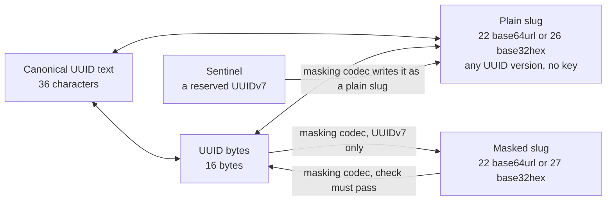

# TypeScript reference

Use the [README](../README.md) for installation and common workflows.
This reference covers types, call signatures, codec configuration and migration.

[Types](#types) · [Calls](#api) · [Codec options](#masking-codec-options) · [Migration](#reading-original-slugs-during-migration)

## Types

Branded types distinguish values this library has validated or produced. Plain strings and byte
arrays are not assignable to them; pass raw input directly to package operations or use a guard when
you need to retain the narrowed type.
JavaScript consumers do not need TypeScript. The shipped declarations compile with TypeScript 5.9
and newer.

Public identifier, configuration, and selector string inputs accept primitive JavaScript strings
and genuine `String` objects. This includes identifiers, output selectors, timestamp text, mask seeds and labels, sentinel names,
and migration formats. The package reads a wrapper's intrinsic value without invoking custom
coercion; TypeScript callers use primitive strings.

Use `BASE64URL`, `BASE32HEX`, `UUID_TEXT_LOWERCASE`, `UUID_TEXT_UPPERCASE`, `NIL_UUID`, `MAX_UUID`,
`MAX_MASKED_UUID_V7_TIMESTAMP_OFFSET_MS`, and the named error-code constants instead of copying their values.
`NIL_UUID` and `MAX_UUID` are canonical generic UUID text; they do not claim a UUID version.
Migration readers accept `SEEDED_MASK_FORMAT`, `FIXED_MASK_FORMAT`, or `PLAIN_SLUG_FORMAT`;
their TypeScript type permits only formats enabled when the reader was created.

| Type | What the value is |
| --- | --- |
| `UuidText`, `UuidV4Text`, `UuidV7Text` | Valid UUID text in any accepted spelling; the version is known where the name says so. |
| `UuidString`, `UuidV4String`, `UuidV7String` | Canonical UUID text; the version is known where the name says so. |
| `UppercaseUuidString`, `UppercaseUuidV4String`, `UppercaseUuidV7String` | Uppercase UUID text; the version is known where the name says so. |
| `UuidTextCase`, `UuidStringFor`, `UuidV4StringFor`, `UuidV7StringFor` | A text-case choice (lowercase or uppercase) and the UUID text type it selects. |
| `UuidVersion` | The complete four-bit version field: `0` through `15`. |
| `PlainUuidSlug`, `PlainUuidV4Slug`, `PlainUuidV7Slug` | A plain slug in either alphabet; the version is known where the name says so. |
| `MaskedUuidV7Slug` | A masked UUIDv7 slug; its check bits require masking-codec decoding. |
| `SentinelUuidV7Slug` | A reserved plain UUIDv7 slug, also usable wherever `PlainUuidV7Slug` is accepted. |
| `MaskedOrSentinelUuidV7Slug` | Masked or sentinel: what a masking call returns. |
| `UuidBytes`, `UuidV4Bytes`, `UuidV7Bytes` | `UuidBytes` proves the 16-byte shape; v4/v7 brands also prove version and variant bits. |
| `UuidByteInput`, `UuidInput` | The byte forms and complete keyless input domain accepted by generic conversion helpers. |
| `SlugAlphabet` | `"base64url"` or `"base32hex"`. |
| `GeneratedUuidV7`, `UuidStringResult`, `UuidBytesResult`, `PlainUuidSlugResult` | The paired generation result and version-preserving result types for typed wrapper functions. |
| `Uuid`, `UuidInspection`, `UuidV7Bounds`, `UuidV7Payload`, `UuidV7PayloadLayout` | An immutable parsed UUID and the typed inspection, search-bound, and caller-declared UUIDv7 payload results it exposes. |
| `UuidV7Instant` | A supported host time accepted by UUIDv7 generation, including exact epoch nanoseconds. |
| `UuidV7MaskingCodec`, `UuidV7MaskingCodecOptions`, `UuidV7PreviousMask`, `UuidV7Mask`, `UuidV7MaskOptions`, `AsyncUuidV7MaskOptions`, `CustomUuidV7MaskOptions`, `UuidV7Sentinel`, `UuidV7SentinelConfig` | The masking codec, what `createUuidV7MaskingCodec` takes, and the retained mask and sentinel shapes it accepts and exposes. |
| `UuidV7Generator`, `UuidV7GeneratorOptions`, `UuidV7ClockRollbackPolicy`, `UuidRandomFill`, `UuidV7TimestampWindow`, `UuidSlugMigrationDecoder`, `UuidSlugMigrationOptions`, `UuidSlugMigrationFormat`, `UuidSlugErrorCode` | A generator, its clock and rollback choices, an explicit custom-entropy callback, timestamp validation, migration controls, and error codes. |
| `GenerateUuidV7Options`, `GeneratePlainUuidV7SlugOptions`, `GenerateUuidV7BytesOptions`, `GenerateUuidV7BytesIntoOptions`, `GenerateUuidV7WithPlainSlugOptions`, `GenerateUuidV7WithMaskedSlugOptions` | Reusable option shapes for each UUIDv7 output job. |

A brand narrows what a call accepts at compile time. A value already typed as the wrong kind is
rejected before it runs, with or without an output buffer:

| Value typed as | Rejected by | Why |
| --- | --- | --- |
| Masked or possibly masked (`MaskedUuidV7Slug`, `MaskedOrSentinelUuidV7Slug`) | Root conversion and plain-slug readers | A masked value needs its masking codec; a sentinel alone remains a plain slug. |
| UUID text (`UuidString` and its versions) | Source-specific slug readers and migration readers | Those methods require encoded slug input. |
| Known v4 (`UuidV4String`, `PlainUuidV4Slug`, `UuidV4Bytes`) | UUIDv7 timestamp validation and masking | UUIDv4 has no UUIDv7 timestamp or masked form. |
| `unknown` | All conversion signatures | Narrow untyped data before calling; JavaScript values are still checked safely at runtime. |

Parsers accept ordinary strings and validate them at runtime. Choose the decoder from your ID
format: plain and masked base64url spellings overlap. A masking codec reads a 22-character slug as
masked when it passes the codec's check and as plain otherwise; keyless root readers always read
it as plain. UUID values with an unknown version also receive runtime version checks.
Lossless conversion preserves a known UUID version in its result type. Byte conversion returns an
owned branded array when it allocates and the caller's exact array subtype when it writes into
supplied storage.

Some masked slugs pass plain-slug guards because their trailing bits, version and variant match
by chance. Choose the decoder from the known format; guards cannot distinguish these slugs.
See [masking security](../README.md#masking-security) for incorrect-key decoding.

## API

Generation, conversion, and validation return the result below or `UuidSlugError`. Generation with
no arguments or only a text-case or alphabet argument returns its result directly; it throws `UuidSlugError` with
code `rng_unavailable` when generation cannot obtain secure randomness. When you supply
an output array, the exact array and its type are preserved; otherwise byte outputs are new plain
`Uint8Array` values. Invalid input leaves caller storage unchanged.

Generator, masking-codec, and migration methods do not depend on `this`; they can be passed as callbacks
without binding them first. Each export's full contract, accepted input, result, and errors, is in
its declaration comment; your editor shows it on hover.

### Generate IDs

Import these functions from the package root. UUIDv7 generation methods also exist on an
independent generator; UUIDv4 generation remains module-level.

| Call | Successful result |
| --- | --- |
| `generateUuidV4(textCase?)` / `generateUuidV7(textCaseOrOptions?)` | UUID text in the selected case, typed with its version. UUIDv7 options may set `at` and `generator`. |
| `generateUuidV4WithRandomFill(fill, textCase?)` | UUIDv4 text from an explicit synchronous entropy source. |
| `generatePlainUuidV4Slug(alphabet?)` / `generatePlainUuidV7Slug(alphabetOrOptions?)` | A plain slug in the chosen alphabet, typed with its UUID version. UUIDv7 options may set `at` or select a generator. |
| `generateUuidV7WithPlainSlug(alphabetOrTextCaseOrOptions?, textCase?)` | UUIDv7 text and its plain slug from one generated value; options may set `at` or select a generator. |
| `generateUuidV4Bytes()` / `generateUuidV7Bytes(options?)` | A new 16-byte array, typed with its UUID version. UUIDv7 options may set `at` and `generator`. |
| `generateUuidV4Bytes(out, offset?)` / `generateUuidV7Bytes(out, offset?)` | Your output array, with the UUID written at the offset. UUIDv7 also accepts `{ at, generator, output, outputOffset }`. |
| `generateUuidV7Value(options?)` | An immutable UUIDv7; options may set `at`, select a generator, or retain a masking codec. |
| `uuidV7StringBounds(ms, textCase?)` / `uuidV7StringBounds(startMs, endMs, textCase?)` | Inclusive canonical UUID bounds for one millisecond or an inclusive interval. |
| `uuidV7ByteBounds(startMs, endMs?)` | The same inclusive bounds as two owned byte arrays. |
| `createUuidV7Generator(options?)` | An independent UUIDv7 sequence using platform cryptographic entropy; invalid numeric ranges or clock policies return `UuidSlugError`. |
| `createUuidV7GeneratorWithRandomFill(fill, options?)` | An independent UUIDv7 generator using an explicit synchronous entropy source. |

#### Supplied time

`at` accepts Unix-millisecond `number` or `bigint`, `Date`, zoned ISO text, a
Temporal-style `epochMilliseconds` or `epochNanoseconds` object, or a `{ seconds, nanoseconds }`
timestamp. Text needs a time zone. UUIDs store the containing millisecond; configured generators
can store fractions too. The default layout stores none. See [clocks and ordering](#custom-clocks-and-ordering)
for precision, counter overflow and rollback.

#### Custom clocks and ordering

Use `createUuidV7Generator({ readUnixMs })` for an application clock or time-dependent tests.
Each generator has its own sequence state. A fixed clock does not make IDs repeatable:
randomness still comes from the runtime.

Set `subMillisecondFractionBits` from 1 through 12 to encode the clock fraction before the
generator's random-start counter. `payloadLayout` exposes the exact split for later extraction.
Without `readUnixMs`, this mode uses the runtime's high-resolution clock when available and falls
back to `Date.now()`. The selected width states the UUID layout, not the clock's real accuracy.
If another reading lands in the same fraction bucket, the generator increments the counter. If the
counter fills, it advances the logical fraction and then the millisecond timestamp. The default
`clockRollback` policy, `"preserve"`, applies the same rule when the clock moves backward, so extracted time can be later
than the supplied instant. The `"reset"` policy may move backward after its tolerance. Explicit `at`
calls on the generator join this sequence; module-level `at` calls use independent randomness.

With the default preserve policy, successful current-time calls on one generator strictly increase
in UUID byte order, including calls made within one millisecond. Module-level generation uses the
fastest validated secure path for each output form and does not promise ordering across calls.
Reset-policy calls beyond their tolerance can break that order. Other generators, package copies,
workers and processes have separate state. Set `clockRollback` to reset or
return `invalid_timestamp` when total skew exceeds an inclusive tolerance. Use
`createUuidV7GeneratorWithRandomFill` only when the application must own entropy; its callback must
fill every requested byte or return `UuidSlugError`.

### Convert and inspect IDs

Root functions need no key. They accept UUID text, UUID bytes, and both plain-slug alphabets. A
known UUID version remains in the result type.

#### UUID text input

| Representation | Size | Example | Meaning and use |
| --- | ---: | --- | --- |
| Compact UUID text | 32 | `0198abcd12347abc9def0123456789ab` | Input; mixed-case hexadecimal |
| Canonical UUID text | 36 | `0198abcd-1234-7abc-9def-0123456789ab` | Only UUID text output; accepts mixed case; lowercase default, uppercase optional |
| Brace-wrapped UUID text | 38 | `{0198abcd-1234-7abc-9def-0123456789ab}` | Input; requires canonical text; accepts mixed case |
| UUID URN | 45 | `urn:uuid:0198abcd-1234-7abc-9def-0123456789ab` | Input; requires canonical text; accepts mixed case in prefix and UUID |

#### Conversion calls



| Call | Successful result |
| --- | --- |
| `uuidToString(uuid, textCase?)` / `(bytes, byteOffset, textCase?)` | Canonical UUID text from UUID text, bytes, or a plain slug, or from one UUID inside a larger array. |
| `uuidToBytes(uuid, output?, outputOffset?)` / `(bytes, byteOffset, output?, outputOffset?)` | New UUID bytes or the exact supplied output array, read from a standalone array or from one UUID inside a larger array. |
| `uuidToPlainSlug(uuid, alphabet?)` / `(bytes, byteOffset, alphabet?)` | A plain slug from UUID text, bytes, or a plain slug, or from one UUID inside a larger array. |
| `parseUuid(uuid, maskingCodec?)` | An immutable UUID for repeated inspection and conversion; the optional codec also accepts masked input and stays available to the value. |
| `extractUuidVersion(uuid)` | The UUID version nibble from UUID text, exact bytes, or a plain slug. |
| `extractUuidV7UnixMs(value, offset?)` | Unix milliseconds from UUIDv7 text, a plain slug, or bytes. |
| `extractUuidV7Payload(value, layout, offset?)` | Timestamp and caller-declared payload fields, with all other payload bits unchanged. |
| `validateUuidV7StringUnixMs(uuid, window, textCase?)` / `validatePlainUuidV7SlugUnixMs(slug, window)` | UUIDv7 text in the selected case, or a canonical plain slug, after checking its timestamp. Base32hex results are lowercase. |

Use `parseUuid` when one UUID needs several operations. It validates and copies the input once.
Serialization returns canonical UUID text and intentionally drops the codec and payload layout.
Mixed-version parsed values support text, byte, plain-slug and inspection calls without narrowing.
When only some values retain a codec or payload layout, pass that configuration explicitly.
The retained codec and payload layout are independent. Unlike generator and codec methods, `Uuid`
methods need their UUID as `this`: to pass one as a callback, bind it
(`uuid.toMaskedSlug.bind(uuid)`); the bound method keeps the UUID's retained codec and layout.

```ts
import { isUuidSlugError, parseUuid } from "@anizoptera/uuid-slug";
import type { UuidV7MaskingCodec } from "@anizoptera/uuid-slug";

function inspectPublicId(input: string, maskingCodec: UuidV7MaskingCodec) {
  const uuid = parseUuid(input, maskingCodec);
  if (isUuidSlugError(uuid)) return uuid;
  return { facts: uuid.inspect(), stored: uuid.toBytes(), publicId: uuid.toMaskedSlug() };
}
```

#### Work with UUID bytes

Decode a masked ID into a database or protocol buffer:

```ts
import type { UuidV7MaskingCodec } from "@anizoptera/uuid-slug";

function decodePublicId(maskingCodec: UuidV7MaskingCodec, publicId: string, record: Uint8Array, offset: number) {
  return maskingCodec.maskedSlugToUuidBytes(publicId, record, offset);
}
```

Write a UUID into a binary record without changing other fields:

```ts
import { uuidStringToBytes } from "@anizoptera/uuid-slug";

function convertUuid() {
  const record = new Uint8Array(32);
  return uuidStringToBytes("01990d4d-e600-7000-8000-000000000000", record, 8);
}
```

`uuidStringToBytes` accepts mixed-case canonical or compact text, URNs and brace-wrapped canonical
text. It allocates a plain `Uint8Array` or writes 16 bytes at your offset.
`bytesToUuidString` reads at an optional offset and returns lowercase hyphenated text.
Every UUID-text writer accepts `UUID_TEXT_UPPERCASE` or `"uppercase"`; `UUID_TEXT_LOWERCASE`
selects the default explicitly. Text case changes neither slug alphabets nor accepted input.
`Buffer` works as a `Uint8Array`. `ArrayBuffer` inputs must have exactly 16 bytes; `DataView`
must select a 16-byte range and can read larger buffers without copying. Only `Uint8Array`
accepts offsets. Other typed arrays and array-like values are rejected. Narrow unknown input
with `isUuidBytes`, `isUuidV4Bytes` or `isUuidV7Bytes` before storage or version-specific work.

Use `uuidBytesToPlainSlug(record, offset)` and `plainSlugToUuidBytes(slug, record, offset)`
to avoid text and temporary slices. Use `maskingCodec.maskedSlugToUuidBytes(slug, record, offset)`
for known masked IDs. Writes return your array, not a UUID view. Read at the same offset;
copy bytes you need to retain before reusing the buffer.

Without an offset, `uuidBytesToPlainSlug` requires exactly 16 bytes.

#### UUIDv7 payload fields

UUIDs do not identify their generator or payload layout.
Call `extractUuidV7Payload(value, layout)` only with a known layout:

```ts
import { extractUuidV7Payload } from "@anizoptera/uuid-slug";

function payloadFromKnownLayout(uuid: string) {
  return extractUuidV7Payload(uuid, { subMillisecondFractionBits: 12, counterBits: 14 });
}
```

The result includes each value's bit width and undeclared low bits in `remaining`.
A fraction value `n` stored in `b` bits represents the encoded time bucket
`[unixMs + n / 2**b, unixMs + (n + 1) / 2**b)` milliseconds. It does not recover a more exact time.
Use `maskingCodec.extractMaskedUuidV7Payload(slug, layout)` for masked slugs and sentinels.

### Use a masking codec

A masking codec holds immutable masking keys, sentinels, rotation, and writer settings.
These methods use that configuration. New output uses its current mask;
readers also try its configured previous masks.

| Member | Successful result |
| --- | --- |
| `generateUuidV7Value(options?)` | An immutable UUIDv7 with this codec retained; options may set `at` or select a generator. |
| `generateMaskedUuidV7Slug(options?)` | A new `MaskedOrSentinelUuidV7Slug`; options may set `at` or select a generator. |
| `generateUuidV7WithMaskedSlug(textCaseOrOptions?)` | UUIDv7 text and its masked or sentinel slug from one generated value; options may set `at`, select a generator, or select UUID text case. |
| `parseUuid(uuid)` | The same parsed value as top-level `parseUuid(uuid, codec)`, with this codec retained. |
| `uuidToString(uuid, textCase?)` / `(bytes, byteOffset, textCase?)` | UUID text from any supported UUID form, or from one UUID inside a larger array. |
| `uuidToBytes(uuid, output?, outputOffset?)` / `(bytes, byteOffset, output?, outputOffset?)` | UUID bytes from any supported UUID form, or from one UUID inside a larger array. |
| `uuidToPlainSlug(uuid, alphabet?)` / `(bytes, byteOffset, alphabet?)` | A plain slug from any supported UUID form, or from one UUID inside a larger array. |
| `uuidToMaskedSlug(uuid)` | A masked or sentinel slug from any supported UUIDv7 form. |
| `plainToMaskedUuidSlug(plainUuidSlug)` | A `MaskedOrSentinelUuidV7Slug` from either plain UUIDv7 slug spelling. |
| `maskedToPlainUuidSlug(maskedUuidSlug, alphabet?)` | A plain UUIDv7 slug from a masked slug or registered sentinel. |
| `maskedSlugToUuidString(maskedUuidSlug, textCase?)` | UUIDv7 text when the caller knows the slug is masked. |
| `maskedSlugToUuidBytes(maskedUuidSlug, output?, outputOffset?)` | UUIDv7 bytes when the caller knows the slug is masked. |
| `extractMaskedUuidV7UnixMs(maskedUuidSlug)` | Unix milliseconds from a masked slug or sentinel. |
| `extractMaskedUuidV7Payload(maskedUuidSlug, layout)` | Timestamp and caller-declared payload fields from a masked slug or sentinel. |
| `validateMaskedUuidV7SlugUnixMs(maskedUuidSlug, window)` | A canonical slug, narrowed to `MaskedOrSentinelUuidV7Slug` after checking its timestamp. Base32hex results are lowercase. |
| `sentinels` | Readonly reserved names, UUIDs, and slugs. |
| `createUuidSlugMigrationDecoder(options?)` | A reader for the old formats you enable; new output stays unchanged. |

The universal methods read a 22-character base64url slug as masked when it passes the codec's
check and as plain otherwise. The source-specific methods apply the meaning the caller states
instead, because that string cannot identify its meaning itself.

A byte offset is the zero-based index where one 16-byte UUID starts inside a larger `Uint8Array`.
Omit it for a standalone 16-byte array. Output offsets select where a method writes; input offsets
select where it reads. Bytes outside that 16-byte range stay unchanged. Pass an input offset,
including `0`, for an array larger than 16 bytes. Only `Uint8Array` accepts a non-zero input offset: every other
accepted form holds exactly one UUID, with no surrounding bytes to skip.

Masking accepts UUIDv7 only. Its [wire layout](design.md#representations-and-bit-budget) leaves
room for a 16-bit check in the default 22-character slug. Plain slugs accept every UUID version.

Use an independent generator when the application owns the clock:

```ts
import { createUuidV7Generator } from "@anizoptera/uuid-slug";

function createEventGenerator(readUnixMs: () => number) {
  return createUuidV7Generator({ readUnixMs });
}
```

Both masking entry points return a raw sentinel slug when the UUID is registered as a sentinel.
Their result type is `MaskedOrSentinelUuidV7Slug`, the union of masked and sentinel slugs.

The byte decoder returns a new plain `Uint8Array` branded as `UuidV7Bytes` when storage is omitted.
When storage is supplied, it validates and decodes before writing, then returns that exact array;
an error leaves the array unchanged.

Each decoder accepts every value that a supported matching encoder can produce. Masked decoding
always accepts both alphabets, sentinels, and current or previous masks. Migration adds only
the old formats you enable. Forms no supported encoder produces are invalid.

### Constructors and guards

Also exported from the package root:

- Permissive type guards: `isUuidText`, `isUuidV4Text`, and `isUuidV7Text` accept mixed case,
  canonical or compact text, UUID URNs, and brace-wrapped canonical text.
- Normalized type guards: `isUuidString`, `isUuidV4String`, and `isUuidV7String` accept lowercase
  hyphenated text. Slug and byte guards are `isPlainUuidSlug`, `isPlainUuidV4Slug`,
  `isPlainUuidV7Slug`, `isUuidBytes`, `isUuidV4Bytes`, and `isUuidV7Bytes`.
- `extractUuidV7UnixMs` reads Unix milliseconds from UUIDv7 text, either plain-slug alphabet,
  or bytes. Use `maskingCodec.extractMaskedUuidV7UnixMs` for masked slugs and sentinels because their decoding
  keys belong to the masking codec. Both return an error for other UUID versions; a v4's first six bytes
  are random and must not be presented as a timestamp.
- `extractUuidVersion` reads the four-bit version field from UUID text, either plain-slug alphabet,
  or bytes. Use a version-specific guard to validate the version and RFC variant together.
- `deriveUuidV7Mask` builds a mask from a seed; `deriveUuidV7MaskAsync` adds cooperative
  cancellation; `createCustomUuidV7Mask` adapts separate forward and reverse callbacks.
  `UUID_V7_TEST_MASK` is the explicit, published-key choice for deterministic examples.
- `createUuidV7Generator(options?)` builds a generator with its own sequence state, your `readUnixMs`
  or `Date.now` when omitted, and platform cryptographic entropy. Preserve-order rollback is the
  default; reset and error policies require an inclusive total-skew tolerance. Invalid numeric
  ranges, clock policies, and untyped malformed options return `invalid_options`. Every method on
  the generator generates in its sequence: `generateUuidV7`, `generateUuidV7Bytes`,
  `generatePlainUuidV7Slug`, `generateUuidV7WithPlainSlug`, and `generateUuidV7Value`. Each takes
  the same spellings and `at` as its root function, without the `generator` option. The root
  functions reach the same sequence by taking `{ generator }`.
- `generateUuidV4WithRandomFill` and `createUuidV7GeneratorWithRandomFill` are the explicit
  custom-entropy paths. Their callback owns entropy quality and must fill every requested byte or
  return `UuidSlugError`; weak or partial successful fills cannot be detected.
- `UuidSlugError`, including code `rng_unavailable` when the runtime has no usable randomness;
  generation with no arguments or only a text-case or alphabet argument throws that error instead of returning it.
  `UuidSlugErrorCode` types the `code` property; `isUuidSlugError` recognizes package errors across
  JavaScript realms and duplicate package copies.
- `BASE64URL` and `BASE32HEX` select slug output without copying string literals.

When forwarding optional settings to `generateUuidV7Value` or `generatePlainUuidV7Slug`,
an undefined value uses default generation and may throw `rng_unavailable`.
Configured branches return failures as values; handle both effects when the settings can be absent.

### Sentinels

Sentinels are reserved UUIDv7 values kept plain for recognition in logs and support tickets.
Codecs have none by default; configure only IDs your application reserves:

| Name            | UUID                                   | Slug                     |
| --------------- | -------------------------------------- | ------------------------ |
| `nil`           | `00000000-0000-7000-8000-000000000000` | `AAAAAAAAcACAAAAAAAAAAA` |
| `anonymous`     | `00000000-0001-7000-8000-000000000000` | `AAAAAAABcACAAAAAAAAAAA` |
| `unknown`       | `00000000-0002-7000-8000-000000000000` | `AAAAAAACcACAAAAAAAAAAA` |

Read their validated names, UUIDs and slugs from `maskingCodec.sentinels`:

```ts
import { createUuidV7MaskingCodec, isUuidSlugError } from "@anizoptera/uuid-slug";

function createSentinels(seed: string) {
  const maskingCodec = createUuidV7MaskingCodec({
    maskSeed: seed,
    sentinels: [{ name: "unknownUser", uuid: "00000000-0002-7000-8000-000000000000" }],
  });
  return isUuidSlugError(maskingCodec) ? maskingCodec : maskingCodec.sentinels;
}
```

Sentinel names and UUIDs must be unique within the codec; names must be nonempty.
Input accepts every UUID text form above; `maskingCodec.sentinels` returns lowercase text.

Sentinel spelling survives seed rotation if the alphabet and reserved UUIDs stay unchanged.
The example `nil` is an application sentinel, not the all-zero UUID, which is not UUIDv7.

Keep sentinel definitions unchanged while their slugs remain in use. Decoding checks them first.
Encoding returns `invalid_mask` if a non-sentinel's masked output matches a reserved slug;
otherwise it would decode to the wrong UUID.

### Masking codec options

```ts
import { BASE32HEX, createUuidV7MaskingCodec } from "@anizoptera/uuid-slug";

function configureCodec(seed: string, previousSeed: string) {
  return createUuidV7MaskingCodec({
    mask: { seed, keyDerivationIterations: 1 },
    sentinels: [{ name: "nil", uuid: "00000000-0000-7000-8000-000000000000" }],
    previousMasks: [{ seed: previousSeed }],
    maskedSlugAlphabet: BASE32HEX,
  });
}
```

The masked payload is fixed at 132 bits, including a 16-bit check. `maskedSlugAlphabet` defaults to
`"base64url"`. Readers accept either masked spelling without an alphabet argument. With
`maskedSlugAlphabet: BASE32HEX`, sentinels are written as 26-character base32hex slugs; their
22-character base64url spelling still decodes.

To supply a different mixing implementation, call
`createCustomUuidV7Mask({ diagnosticLabel, mask, unmask })`. Each callback receives distinct 16-byte input
bytes and returns either a 16-byte result or `UuidSlugError`; `unmask` must invert `mask` for
every input. A callback may mutate and return its isolated input. The factory copies callback results
into package storage, captures the callbacks in an opaque frozen handle, and rejects invalid results
and failed round-trip probes. Unexpected throws become errors with the thrown value as their cause.
Finite probes cannot prove invertibility, so the caller remains responsible for the complete domain.

```ts
import {
  createCustomUuidV7Mask,
  createUuidV7MaskingCodec,
  isUuidSlugError,
} from "@anizoptera/uuid-slug";

function adaptMask(mix: (input: Uint8Array, output: Uint8Array, forward: boolean) => void) {
  const transform = (direction: "mask" | "unmask") => (input: Uint8Array) => {
    const output = new Uint8Array(16);
    mix(input, output, direction === "mask");
    return output;
  };
  const mask = createCustomUuidV7Mask({
    diagnosticLabel: "existing-scheme",
    mask: transform("mask"),
    unmask: transform("unmask"),
  });
  return isUuidSlugError(mask) ? mask : createUuidV7MaskingCodec({ mask });
}
```

Mask, masking-codec, generator, sentinel, migration, and timestamp options reject unknown keys instead of
silently applying a default. Invalid mask or masking-codec options return an error. Create custom handles
before passing them; an arbitrary object is not a mask.

Share one derived mask between codecs to avoid repeating key derivation, for example when URLs
use base64url and filenames use base32hex. Each masking codec chooses its alphabet and sentinels; keep
sentinel definitions the same if the codecs must read each other's output.

`diagnosticLabel` identifies a mask in error messages, not in slugs. It cannot select a decoding
key. Services must use the same seed bytes and iteration count to derive matching keys.
String seeds use UTF-8: base64 text and the bytes it encodes are different seeds.

For expensive derivation, await `deriveUuidV7MaskAsync` and pass the completed mask to the codec:

```ts
import {
  deriveUuidV7MaskAsync,
  createUuidV7MaskingCodec,
  isUuidSlugError,
} from "@anizoptera/uuid-slug";

async function createResponsiveCodec(
  seed: string,
  keyDerivationIterations: number,
  signal: AbortSignal,
) {
  const mask = await deriveUuidV7MaskAsync({ seed, keyDerivationIterations, signal });
  return isUuidSlugError(mask) ? mask : createUuidV7MaskingCodec({ mask });
}
```

The async form derives the same keys with the same seed settings and yields during long work.
Abort the supplied `AbortSignal` to stop derivation: it returns `UuidSlugError` with code
`aborted` and `signal.reason` as its cause. Invalid options return `invalid_mask`; unexpected
failures retain their cause. No partially derived mask is returned.

Options are captured when called. Byte seeds are copied before the first suspension, so later
caller mutation cannot change the key; synchronize concurrent writes to shared backing memory.
Copying a very large byte seed, plus allocation, GC, and host scheduling, can still block longer
than one work slice. Small derivations need no host yield. Construct once and reuse the mask;
passing seed options to each new codec would repeat derivation.

Use `previousMasks` to rotate a seed or timestamp range. Decoding tries the current mask, then
previous masks in the order you supply; the first passing check wins. Keep the list short.

```ts
import { createUuidV7MaskingCodec } from "@anizoptera/uuid-slug";

function createRotatedCodec(currentSeed: string, previousSeed: string) {
  return createUuidV7MaskingCodec({
    maskSeed: currentSeed,
    previousMasks: [{ mask: { seed: previousSeed }, timestampRangeStartUnixMs: 0 }],
  });
}
```

Writers use `currentSeed`; readers also accept `previousSeed`. Remove the old seed only after its
IDs no longer need to decode.

### Changing an existing ID format

Preserve the UUID; change only how it is encoded. Do not generate a replacement UUID when
converting an existing ID: references and stored records must still identify the same object.

Deploy readers that accept both formats before any writer issues the new format. Include
background jobs, cached clients and extensions in that rollout. After switching writers, keep
compatible readers available for rollback: an old-only reader cannot read newly issued IDs.

Updating the database does not update bookmarks, shared links, cookies or client storage.
Remove compatibility only when the old IDs in those places no longer need to work.
To keep old URLs after removing their decoder, retain an application-owned mapping from each
supported old slug to its UUID.

Keep keys, timestamp-range starts, and sentinel definitions with every format still in use.
Preserve UUIDs outside the configured masked range as UUID text or plain slugs. Never truncate a
timestamp or substitute a new identity to make masking pass.

### Reading original slugs during migration

Create a migration reader from your codec. Enable only the old formats your application issued:

```ts
import { isUuidSlugError } from "@anizoptera/uuid-slug";
import type { UuidV7MaskingCodec } from "@anizoptera/uuid-slug";

function createLegacyReader(maskingCodec: UuidV7MaskingCodec) {
  const migrationDecoder = maskingCodec.createUuidSlugMigrationDecoder({
    acceptFixedMask: true,
    acceptPlainSlug: true,
  });
  if (isUuidSlugError(migrationDecoder)) return migrationDecoder;
  return (incomingSlug: string) => migrationDecoder.uuidSlugToUuidString(incomingSlug);
}
```

`acceptFixedMask` accepts the fixed-key permutation/XOR format with a 4-bit check that predates
seeded masking, from before package 0.2.0. Releases from 0.2.0 on write different formats, and the
0.2.0 masked format itself is not readable.
`acceptPlainSlug` accepts plain UUID slugs of any version, including old base64url spellings whose
last four bits were ignored. Ordinary `uuidToString` remains strict about those trailing bits.
Create and check the reader once, then reuse it for incoming slugs. Both options must be booleans.
Unknown keys and inaccessible properties return `invalid_options`, including on typed objects.
Neither option changes generation, ordinary codec methods, keys or sentinels.

`uuidSlugToUuidString` returns one UUID or `UuidSlugError`: sentinels first, then current keys, then enabled
original and plain formats. A successful decode still needs a record lookup. The same slug can
decode to different UUIDs in different formats; the original check has only four bits.

When you know the input format, name it to avoid trying unrelated formats:

```ts
import { isUuidSlugError, FIXED_MASK_FORMAT } from "@anizoptera/uuid-slug";
import type { UuidSlugMigrationDecoder, UuidV7MaskingCodec } from "@anizoptera/uuid-slug";

function replaceOriginalSlug(
  maskingCodec: UuidV7MaskingCodec,
  migrationDecoder: UuidSlugMigrationDecoder<typeof FIXED_MASK_FORMAT>,
  oldSlug: string,
) {
  const uuid = migrationDecoder.uuidSlugToUuidString(oldSlug, FIXED_MASK_FORMAT);
  if (isUuidSlugError(uuid)) return uuid;
  const replacement = maskingCodec.uuidToMaskedSlug(uuid);
  if (isUuidSlugError(replacement)) return replacement;
  return { uuid, replacement }; // Keep uuid in the database; use replacement in new links.
}
```

Enable an old format before selecting it. Recognized sentinels always return their reserved UUID,
including old trailing-bit aliases when reading original or plain slugs.
With literal options, TypeScript offers only `SEEDED_MASK_FORMAT` and the formats enabled with `true`;
options whose values are dynamic remain selectable because they may be enabled at runtime.
Pass a UUID text case (`UUID_TEXT_UPPERCASE` or `UUID_TEXT_LOWERCASE`) after the slug when the format is unknown, or after the format when it
is known. Candidate arrays use the same selected case; lowercase remains the default.

For unknown formats, use `uuidSlugToUuidStringCandidates` to find the matching record without guessing:

```ts
import { isUuidSlugError } from "@anizoptera/uuid-slug";
import type { UuidSlugMigrationDecoder, UuidString } from "@anizoptera/uuid-slug";

async function findMigratedRecord(
  migrationDecoder: UuidSlugMigrationDecoder,
  incomingSlug: string,
  findRecordsByUuids: (uuids: readonly UuidString[]) => Promise<readonly unknown[]>,
) {
  const candidates = migrationDecoder.uuidSlugToUuidStringCandidates(incomingSlug);
  if (isUuidSlugError(candidates)) return candidates;
  const matches = candidates.length ? await findRecordsByUuids(candidates) : [];
  if (matches.length !== 1)
    return new Error(matches.length ? "ID matches multiple records" : "ID not found");
  return matches[0]; // Check access before returning the record to the caller.
}
```

`findRecordsByUuids` is your database query. Return distinct records by UUID. `uuidSlugToUuidStringCandidates`
returns distinct UUIDs in decoding order, or an empty array if none match. Malformed input and
failed mask callbacks return an error. Callback errors keep their cause; they never produce a
successful but incomplete list.
An old sentinel alias can also be a seeded masked ID. `uuidSlugToUuidStringCandidates` retains both UUIDs;
`uuidSlugToUuidString` keeps sentinel priority.

Keep this reader while old inputs must work. Replace it with
`maskingCodec.createUuidSlugMigrationDecoder({ acceptPlainSlug: true })` to stop trying the fixed mask, or
`maskingCodec.createUuidSlugMigrationDecoder({ acceptFixedMask: true })` to stop plain-slug decoding.
`maskingCodec.createUuidSlugMigrationDecoder()` tries only current keys and sentinels. Removing the migration reader entirely
leaves ordinary masking-codec decoding unchanged. Neither method can identify the issuing format from
the slug alone, so successful decoding is not a reliable count of legacy traffic.

### Validating timestamp windows

```ts
import { validateUuidV7StringUnixMs } from "@anizoptera/uuid-slug";

function validateRecentUuid(uuid: string) {
  return validateUuidV7StringUnixMs(uuid, { maxTimestampDeltaMs: 60_000 });
}
```

The timestamp must be inside the inclusive interval `referenceUnixMs - maxTimestampDeltaMs`
through `referenceUnixMs + maxTimestampDeltaMs`. The maximum delta is required, finite, and
nonnegative; zero and finite fractions are valid. `referenceUnixMs` defaults to one `Date.now()`
reading and must be finite when supplied. Invalid settings return an error instead of disabling
the check.

`validatePlainUuidV7SlugUnixMs` starts from a plain slug; `maskingCodec.validateMaskedUuidV7SlugUnixMs` starts from
a slug decoded with that masking codec. Success returns the same spelling with its UUIDv7 slug type.
The window accepts timestamps before and after the reference time. Use ordinary decoding for
permanent IDs. For expiring or single-use links, check stored expiry and consumption state too.
