# uuid-slug

Fast UUIDv4/v7 generation, short UUID slugs, and reversible UUIDv7 masking for Rust and WebAssembly. One UUID works as a database key, a short URL ID or a lowercase filename; every representation converts back to the same UUID.

- [Keep existing UUIDs](#representations). Plain base64url slugs are 39% shorter than UUID text, without changing database keys or adding a mapping table. Any UUID version works; plain decoding needs no key.
- [Hide UUIDv7 timestamps and fields](#convert-and-mask-existing-uuids). Keyed masking keeps public IDs short. [Key rotation and migration](#key-rotation) keep issued IDs readable when keys or formats change.
- [Avoid temporary byte buffers](#caller-owned-storage). Generate or decode directly into a packet or database buffer; failed calls leave that storage unchanged. Parse once into an owned `Uuid` and reuse it for conversion and inspection.
- [Fast generation, low allocations and small builds](#features). OS-seeded, per-thread ChaCha12 avoids an OS call per UUID. Caller-buffer APIs avoid output allocations; unused functions can be removed from the linked application.
- [Control UUIDv7 time and order](#generation-and-timestamps). Use recorded times, clock-rollback policies, sub-millisecond fields, timestamp extraction and database range keys. Ordinary generation needs no setup.
- [Use Rust values throughout](#interoperability). Convert directly to and from `uuid::Uuid` and `[u8; 16]`. Distinct plain/masked slug types prevent representation mix-ups; failures return `Result` with stable error codes.
- [Share IDs with TypeScript](#typescript-and-stored-ids). Rust and TypeScript read the same plain and masked formats. Native, browser WASM, WASI and `no_std` with `alloc` builds share the same encodings.

[Install](#install) · [Quick start](#generate-an-id) · [Representations](#representations) · [Features](#features) · [API reference](https://docs.rs/uuid-slug/latest/uuid_slug/)

## Install

Rust 1.97 or newer is required.

```sh
cargo add uuid-slug
```

Defaults include secure UUIDv4/v7 generation. For browser WebAssembly, enable `wasm-js`; for conversion-only or `no_std` builds, [disable default features](#features).

## Generate an ID

With default features, generate a UUIDv7 and derive a URL slug from that same ID. Use `generate_uuid_v4()` instead when you need a random UUID without a timestamp.

```rust
# fn main() -> Result<(), uuid_slug::Error> {
# #[cfg(all(feature = "std", feature = "os-rng"))]
# {
use uuid_slug::{generate_uuid_v7, UuidSlugAlphabet};

let id = generate_uuid_v7()?;
let url_id = id.to_plain_uuid_slug(UuidSlugAlphabet::Base64Url);
println!("UUID: {id}; URL slug: {url_id}");
# }
# Ok(())
# }
```

Both generators return an owned `Uuid`; generation failures propagate with `?`. Module-level UUIDv7 calls do not promise ordering. Use a [created generator](#generation-and-timestamps) when you need a shared sequence or clock policy.

IDs can be assigned offline, so related records can reference each other before saving or syncing. Generation uses fresh randomness: retain the first ID for retries. Collisions remain possible; use a uniqueness constraint where duplicates could overwrite or misidentify data.

## Representations

These examples represent the same UUID. Plain slugs encode its 16 bytes with standard base64url or base32hex, so other implementations can decode them too. Masked forms need the matching key and settings.

| Form | Size | Example | Use |
| --- | --- | --- | --- |
| UUID text | 36 characters | `0198abcd-1234-7abc-9def-0123456789ab` | Standard UUID columns and APIs |
| UUID bytes | 16 bytes | `01 98 ab cd 12 34 7a bc 9d ef 01 23 45 67 89 ab` | Binary storage and transport |
| Plain base64url | 22 characters | `AZirzRI0eryd7wEjRWeJqw` | Short URLs; case-sensitive; 39% shorter than UUID text |
| Plain base32hex | 26 characters | `06canj8i6htbp7ff04hkaps9lc` | Lowercase filenames; 28% shorter; UUIDv7 timestamp order under ASCII comparison |
| Masked base64url | 22 characters | `ap225Qa_y6wN5LQCJgwH0z` | UUIDv7 URLs with hidden fields; case-sensitive; 39% shorter |
| Masked base32hex | 27 characters | `daerdp86nv5qo3f4mg12c307qco` | Masked UUIDv7 filenames; lowercase; 25% shorter |
| Masked bytes | 16 bytes | `6a 9d b6 e5 06 bf cb ac 0d e4 b4 02 26 0c 07 d3` | Masked UUIDv7 transport without text encoding |

Masked examples use the public test mask. Production masking requires a private seed. Masked output has no chronological order; plain base64url is mostly time-ordered for UUIDv7, but exact text ordering needs base32hex. Preserve base64url case: lowercasing changes the ID. Base32hex writes lowercase and accepts mixed case.

Encode an existing UUID with `Uuid::to_plain_uuid_slug`; decode incoming slugs with `Uuid::from_plain_uuid_slug` before querying the same database key. Parsing once into `Uuid` avoids repeated text decoding when several operations need the ID.

[](https://raw.githubusercontent.com/Anizoptera/uuid-slug/main/docs/assets/uuid-representations.svg)

[Open the interactive diagram](https://raw.githubusercontent.com/Anizoptera/uuid-slug/main/docs/assets/uuid-representations.svg) and hover a field to trace it through the representations.

## Convert and mask existing UUIDs

```rust
use uuid_slug::{UuidSlugAlphabet, Uuid, UuidV7MaskingCodec, derive_uuid_v7_mask};

# fn main() -> Result<(), uuid_slug::Error> {
let uuid = Uuid::from_uuid_string("0190a1b2-c3d4-7e5f-8a9b-0c1d2e3f4051")?;
let filename = uuid.to_plain_uuid_slug(UuidSlugAlphabet::Base32Hex);
assert_eq!(Uuid::from_plain_uuid_slug(&filename)?, uuid);

let mask = derive_uuid_v7_mask(b"replace-with-your-own-secret-seed", 1)?;
let masking_codec = UuidV7MaskingCodec::new(mask);
let masked = masking_codec.uuid_to_masked_slug(uuid)?;
assert_eq!(masking_codec.masked_slug_to_uuid(&masked)?, uuid);
let binary = masking_codec.uuid_to_masked_bytes(uuid)?;
assert_eq!(masking_codec.masked_bytes_to_uuid(binary.as_ref())?, uuid);
assert_eq!(masking_codec.parse_uuid(&masked)?, uuid);
assert_eq!(masking_codec.parse_uuid(&filename)?, uuid);
# Ok(())
# }
```

Slug conversions return `PlainUuidSlug`, `MaskedUuidV7Slug`, or `MaskedOrSentinelUuidV7Slug`, so Rust keeps representations distinct. Borrow one anywhere an `&str` is accepted, format it with `Display`, or convert it into `String` without copying its text. `Uuid::parse_uuid` reads UUID text or a plain slug when the input can be either. `{:X}` formats uppercase UUID text and `Display` lowercase, both without allocating. `uuid_variant()` returns the RFC 9562 variant.

Parse stored plain-slug text with `text.parse::<PlainUuidSlug>()?`; it validates padding and normalizes base32hex to lowercase without encoding the UUID again. Codec and configuration values support `Debug` while keeping mask keys hidden.

### Read plain and masked input

Keyless parsers accept strings, typed plain slugs and their standard borrowed or owned containers through `KeylessUuidText`. They reject typed masked slugs: pass those to their masking codec. For a `MaskedOrSentinelUuidV7Slug`, select its `Sentinel` variant before keyless decoding. A sentinel is a named, reserved UUIDv7 that the codec leaves unmasked.

Custom string wrappers can pass `.as_str()`, but a string no longer tells the compiler whether it was masked. For generic input, use `Input: KeylessUuidText + ?Sized`. To pass the parser as a function pointer with ordinary string coercions, use `let parse: fn(&str) -> Result<Uuid, uuid_slug::Error> = Uuid::parse_uuid`.

Use `UuidV7MaskingCodec::new(mask)` for base64url output with no sentinels or previous keys. Use `UuidV7MaskingCodec::from_options(options)?` for those settings or a different timestamp range; set `masked_slug_alphabet: UuidSlugAlphabet::Base32Hex` for lowercase masked filenames. Both require an explicit mask; only configured construction can return a validation error. Construct the codec once and reuse it so per-ID calls need no key derivation.

Use `masking_codec.parse_uuid(text)?` when input may be UUID text, a plain slug or a masked slug. Registered sentinels take priority. For ambiguous 22-character text, the first passing mask decides the UUID; plain decoding applies only when every mask rejects it. Callback failures are returned, not retried as plain text. Use `Uuid::from_plain_uuid_slug` or `masked_slug_to_uuid` when you know the source. The returned `Uuid` owns its bytes without retaining the codec or keys.

Plain slugs preserve all 128 UUID bits without version, variant or timestamp limits. Masked text encodes 116 UUIDv7 bits plus a 16-bit check; decoding restores the fixed version and variant bits. Slug decoding infers the alphabet and rejects nonzero padding.

`uuid_to_masked_bytes` returns a 16-byte `MaskedOrSentinelUuidV7Bytes` without text encoding. Borrow its bytes with `as_bytes()` for transport and decode with `masked_bytes_to_uuid`. Registered sentinels retain raw UUID bytes. Binary has a 12-bit check; text has a 16-bit check. Neither check authorizes access.

Use `uuid_to_masked_bytes_into` and `masked_bytes_to_uuid_bytes_into` for caller-owned storage; failure leaves the entire buffer unchanged. Raw UUID conversion accepts every 16-byte value, including masked bytes, so byte content cannot uniquely identify the representation. Choose the reader from the known format.

### Masking limits

Masking supports UUIDv7 only. It replaces the recognizable UUIDv7 layout, including its timestamp, with a keyed reversible payload. Its cryptographic strength is not established. An incorrect key can pass the check and return the wrong UUID. Additional read keys can increase false matches. Look up decoded records and check caller access.

Use `uuid_v7_test_mask()` only for examples and wire fixtures because its seed is public. Keep your private seed and iteration count to read issued IDs.

Masking stores a timestamp offset from `timestamp_range_start_unix_ms` and restores the UUID's timestamp on decode. The inclusive end is the start plus `MAX_MASKED_UUID_V7_TIMESTAMP_OFFSET_MS`. Timestamps outside that range are rejected, never truncated. Plain slugs retain the full UUIDv7 timestamp range. Registered sentinels are never masked.

### Sentinels and custom masks

Reserve recognizable IDs for tests, debugging or tracing with `UuidV7MaskingCodecOptions::sentinels`: each entry pairs a name with a UUIDv7. Codecs precompute their plain slugs and leave them unmasked, even after key rotation. Keep the definitions while those IDs remain in use.

To use an existing reversible transform, construct a `UuidV7Mask` with `from_permutation_functions` and pass it to the codec. The two callbacks must undo each other over all 16-byte inputs; callback errors propagate. Retain the transform implementation as well as its keys to read issued IDs.

## Interoperability

Convert directly between this crate's `Uuid` and `[u8; 16]` with `.into()`. Enable `uuid-interop` for the same conversions with `uuid::Uuid`. These conversions preserve every bit without allocating or formatting text, including UUID versions and variants this crate does not generate.

Enable `uuid-interop` on this dependency (`cargo add uuid-slug --features uuid-interop`). The example also needs `uuid` as a direct dependency of your app; add this under `[dependencies]`:

```toml
uuid = { version = "1", default-features = false }
```

```rust
use uuid_slug::{Uuid, UuidSlugAlphabet};

# fn main() -> Result<(), uuid_slug::Error> {
# #[cfg(feature = "uuid-interop")] {
let external = uuid::Uuid::from_bytes([0x55; 16]);
let id: Uuid = external.into();
let slug = id.to_plain_uuid_slug(UuidSlugAlphabet::Base64Url);
let restored: uuid::Uuid = Uuid::from_plain_uuid_slug(&slug)?.into();
assert_eq!(restored, external);

let bytes: [u8; 16] = id.into();
assert_eq!(Uuid::try_from(bytes.as_slice())?, id);
# }
# Ok(())
# }
```

`Uuid::try_from(slice)` copies exactly 16 bytes and rejects every other length with `ErrorCode::InvalidBuffer`. For a UUID within a larger buffer, use `Uuid::from_uuid_bytes(buffer, offset)`; the offset is in bytes.

## Caller-owned storage

Decode directly into a packet or database buffer without allocating a byte array on the heap. The returned slice borrows exactly the 16-byte UUID range; the offset is in bytes. Invalid text or an invalid destination range leaves the entire buffer unchanged.

```rust
use uuid_slug::UuidSlugAlphabet;

# fn main() -> Result<(), uuid_slug::Error> {
let mut packet = [0xa5; 24];
let bytes = UuidSlugAlphabet::Base64Url.plain_slug_to_uuid_bytes_into(
    "AZChssPUfl-KmwwdLj9AUQ", &mut packet, 4,
)?;
# assert_eq!(bytes, &[0x01, 0x90, 0xa1, 0xb2, 0xc3, 0xd4, 0x7e, 0x5f, 0x8a, 0x9b, 0x0c, 0x1d, 0x2e, 0x3f, 0x40, 0x51]);
# assert_eq!(&packet[..4], &[0xa5; 4]);
# assert_eq!(&packet[20..], &[0xa5; 4]);
# Ok(())
# }
```

Already have a `Uuid`? Borrow its bytes with `as_uuid_bytes()`, or copy them into an existing buffer with `write_uuid_bytes(&mut buffer, offset)?`.

Generate directly into storage with `generate_uuid_v4_into(&mut buffer, offset)?` or `generate_uuid_v7_into(&mut buffer, offset)?`. For a shared sequence, use `generator.generate_uuid_v7_into`; supplied-time variants are `generate_uuid_v7_at_into` for `SystemTime` and `generate_uuid_v7_at_unix_ms_into` for fractional Unix milliseconds. These calls use the same default secure entropy as ordinary generation and leave the buffer and sequence unchanged on failure. Select a `_with_random_fill` method only when supplying your own entropy provider.

## Key rotation

Keep previous keys while stored identifiers still need them. The current key writes new slugs; previous keys only add read candidates. Install readers for the new key and spelling before switching writers. A rollback must retain those readers or it can strand newly issued identifiers. Here, `stored` is an existing slug written with the previous key.

Optional diagnostic labels identify masks in logs and errors without changing their keys or IDs.

```rust
use uuid_slug::{
    UuidSlugMigrationOptions, UuidV7MaskingCodec, UuidV7MaskingCodecOptions,
    UuidV7PreviousMask, derive_uuid_v7_mask,
};

# fn main() -> Result<(), uuid_slug::Error> {
let old_key = derive_uuid_v7_mask(b"previous-private-seed", 1)?.with_diagnostic_label("previous");
let new_key = derive_uuid_v7_mask(b"replacement-private-seed", 1)?.with_diagnostic_label("current");
# let uuid = uuid_slug::Uuid::from_uuid_string("0190a1b2-c3d4-7e5f-8a9b-0c1d2e3f4051")?;
# let stored = UuidV7MaskingCodec::new(old_key.clone()).uuid_to_masked_slug(uuid)?;
let masking_codec = UuidV7MaskingCodec::from_options(UuidV7MaskingCodecOptions {
    previous_masks: vec![UuidV7PreviousMask::new(old_key)],
    ..UuidV7MaskingCodecOptions::new(new_key)
})?;
let id = masking_codec.masked_slug_to_uuid(&stored)?;
# assert_eq!(id, uuid);
let migration_decoder = masking_codec.create_uuid_slug_migration_decoder(UuidSlugMigrationOptions {
    accept_original_masked_slug: true,
    accept_plain_uuid_slug: true,
});
let candidates = migration_decoder.uuid_slug_to_uuid_candidates(&stored, None)?;
# assert!(candidates.contains(&uuid));
# Ok(())
# }
```

Use `uuid_slug_to_uuid` when one candidate suffices; name a `UuidSlugMigrationFormat` when the stored format is known. Use `uuid_slug_to_uuid_candidates` for explicit lookup across possible formats or keys, and check the result against your store. Disable each legacy reader only after its stored values are migrated; neither option enables the unsupported 0.2.0 masked format.

## Generation and timestamps

Keep a generator when successive calls must share ordering state. Supplied times join that same sequence:

```rust
# fn main() -> Result<(), uuid_slug::Error> {
# #[cfg(all(feature = "std", feature = "os-rng"))]
# {
use std::time::{Duration, SystemTime};
use uuid_slug::UuidV7Generator;

let mut generator = UuidV7Generator::new();
let recorded_at = SystemTime::UNIX_EPOCH + Duration::from_millis(1_720_000_000_000);
let first = generator.generate_uuid_v7_at(recorded_at)?;
let second = generator.generate_uuid_v7_at(recorded_at)?;
assert!(first < second);
# assert_eq!(first.extract_uuid_v7_unix_ms()?, 1_720_000_000_000);
# }
# Ok(())
# }
```

On a `UuidV7Generator`, `generate_uuid_v7()` reads the system clock and `generate_uuid_v7_at(SystemTime)` takes a supplied time. Both use secure randomness and the same generator sequence. Use `generate_uuid_v7_at_unix_ms()` when another API supplies fractional Unix milliseconds.

### Clock rollback

With the default preserve-order policy, successful calls on one generator strictly increase in UUID byte order. If the clock stalls or moves backward, the generator advances the logical fraction, then the millisecond timestamp when needed. The fraction or timestamp can therefore be ahead of the clock.

Use `with_clock_rollback_policy` to reset or return `InvalidTimestamp` when the total clock rollback exceeds your tolerance. Reset calls beyond that tolerance can move backward. Module-level generation does not share the created generator's ordering guarantee.

### Sub-millisecond time

`with_sub_millisecond_fraction_bits(bits)` uses `0..=12` leading payload bits for the clock fraction; zero disables it. Supplied times fill that field. `payload_layout()` returns the fraction and counter widths.

Native and WASI generation read the clock through `SystemTime`. Browser WebAssembly with `wasm-js` uses millisecond `Date.now()`. If you have a finer reading, pass fractional Unix milliseconds to `generate_uuid_v7_at_unix_ms()`.

### Inspect payloads

The crate accepts every RFC 9562 UUIDv7 and preserves all 74 payload bits. Pass the generator's known fraction and counter widths to `Uuid::extract_uuid_v7_payload` through `UuidV7PayloadLayout`; the UUID format does not identify them. Unassigned low bits remain in `remaining`. For masked slugs, use `UuidV7MaskingCodec::extract_masked_uuid_v7_payload`.

### Timestamp searches

`uuid_v7_bounds(start, end)` returns the inclusive lowest and highest UUIDv7 search keys. Pass `None` for a single millisecond. Pass the result directly to `BTreeMap::range` or another `RangeBounds<Uuid>` consumer; comparisons must use UUID byte order.

Use `Uuid::extract_uuid_v7_unix_ms()` to read the encoded timestamp without a database lookup. Keep a separate field for editable dates or finer precision; a generator can advance logical time to preserve order. `UuidV7TimestampWindow::validate_uuid_v7` rejects timestamps outside a configured distance from a reference time; `UuidV7MaskingCodec::validate_masked_uuid_v7_slug_unix_ms` decodes and validates a masked slug with its keys.

## Errors

Failures return `Error`, retaining any underlying cause. Match `Error::code()` against `ErrorCode`; use `ErrorCode::as_str()` when a text protocol needs the shared TypeScript spelling. `Display` explains the failure. Do not parse its text: messages can change.

```rust
use uuid_slug::{ErrorCode, Uuid};

# fn main() -> Result<(), uuid_slug::Error> {
let user_input = "not-a-uuid";
match Uuid::from_uuid_string(user_input) {
    Ok(id) => println!("{id}"),
    Err(error) if error.code() == ErrorCode::InvalidUuid => {
        eprintln!("Enter UUID text, for example 0190a1b2-c3d4-7e5f-8a9b-0c1d2e3f4051: {error}");
    }
    Err(error) => return Err(error),
}
# Ok(())
# }
```

## Features

Defaults enable `std` and `fast-rng`, without `uuid`. `fast-rng` uses a per-thread ChaCha12 generator seeded through `getrandom` on native and WASM targets. It reseeds after 64 KB or a native process-ID change; seed failures return `rng_unavailable`. Browser entropy requires `wasm-js`.

For an OS draw on every call, disable defaults and enable `os-rng`; `fill_os_random_bytes` always draws directly from the OS. Add `std` for `SystemTime` methods and current-time generation. Browser generation uses `wasm-js`, which includes `std` and `os-rng`.

With default features disabled, the crate has no runtime dependencies and uses `no_std` plus `alloc`: conversions, masking, migration, derivation and explicit Unix-millisecond generation remain available. Your target must provide an allocator and pointer-width/8-bit atomics. `std` alone adds standard-library time without an entropy dependency. Add `uuid-interop` explicitly if a reduced build needs `uuid::Uuid` conversions.

Supply entropy through the `_with_random_fill` methods, or enable `os-rng` on a supported host. Custom callbacks must fill every requested byte or return an error. Production IDs require cryptographically secure entropy; successful partial fills cannot be detected.

`derive_uuid_v7_mask_async` limits hashing work per poll and needs no particular executor. The executor must let other host tasks run between polls. Pass `None` when dropping the future is sufficient to stop work. Pass `Some(token.clone())` to cancel through a `UuidV7MaskDerivationCancellation` shared with another task.

For conversions alone, or when your application supplies time and entropy, disable defaults:

```sh
cargo add uuid-slug --no-default-features
```

For browser WebAssembly generation, add `--features wasm-js` to that command. For WASI generation, use defaults or `--features std,os-rng`; the WASI host supplies clock and entropy access. Keep the JavaScript feature for browser integration.

Features select host capabilities and dependencies, independently of UUID version or slug alphabet. A v4-only or v7-only application does not need a per-version feature. Unused functions can be removed from the linked application, but enabling a feature still affects its dependency graph and compilation. Other dependencies can also enable features through Cargo feature unification.

## TypeScript and stored IDs

The [TypeScript package](https://www.npmjs.com/package/@anizoptera/uuid-slug) reads and writes the same plain slugs, masked slugs and masked bytes. Masked reads across languages need matching seed bytes, iteration counts and timestamp-range starts, plus the same sentinel definitions or custom transform when used. See the [cross-language guide](https://github.com/Anizoptera/uuid-slug/blob/main/docs/cross-language.md).

Supported identifier formats remain readable across upgrades. Keep private seeds, iteration counts, range settings and sentinel definitions while stored IDs need them; key rotation changes new output, not the keys needed to read old output. Plain slugs recover UUIDs with standard base64url/base32hex decoders, without this crate. The [wire format](https://github.com/Anizoptera/uuid-slug/blob/main/docs/design.md) is documented for independent implementations.

Check the [changelog](https://github.com/Anizoptera/uuid-slug/blob/main/CHANGELOG.md) and [release policy](https://github.com/Anizoptera/uuid-slug/blob/main/docs/release.md) before upgrading. Report bugs through [GitHub issues](https://github.com/Anizoptera/uuid-slug/issues).

## License

[Apache-2.0](https://github.com/Anizoptera/uuid-slug/blob/main/LICENSE).

The Rust UUID text parser and hyphenated formatter reuse code from the [uuid crate and its contributors](https://github.com/uuid-rs/uuid), under its MIT license. Only these text-conversion kernels are copied; generation, slug encoding and masking are separate. The opt-in `uuid-interop` feature uses `uuid` directly for parsing, formatting and `uuid::Uuid` conversions, and excludes the copied backend at compile time. Upstream source and license attribution are included with the copied code.
